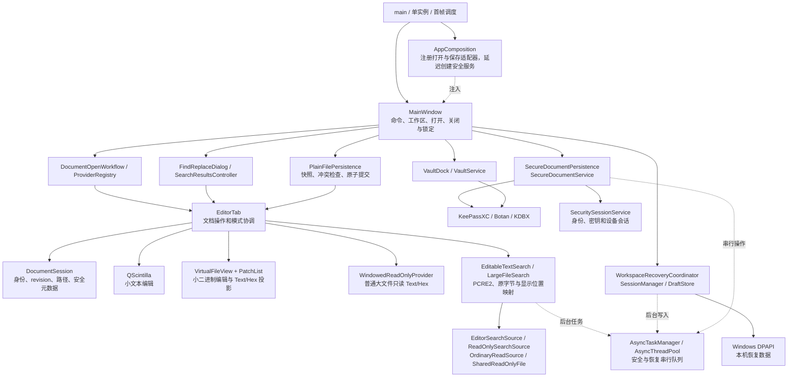

# Notepad Safe 当前架构

> 核对日期：2026-10-17。本文描述已经存在的结构和实现边界，不把接口、测试名称或历史通过记录视为当前功能验收。

本文中的模式限制属于实现现状；目标和必须跑通的旅程见 [产品目标](PRODUCT_GOALS.md)，各功能的当前行为见对应的现状文档。

界面外壳在 `src/shell/`：设计令牌与样式（`ThemeTokens`、`ThemeStyle`）、无边框窗口与标题栏（`WindowChrome`、`TitleBar`）、主菜单与 Alt 键（`MainMenu`、`AltMenuTracker`）、绘制的文档标签（`DocumentTabBar`）、状态栏分段（`StatusSegments`）、命令面板（`CommandPaletteModel`、`CommandPalette`）、提示条（`NoticeBar`）和绘制图标（`ShellGlyphs`）。外壳只依赖 Qt 和 `src/app` 的命令类型，不包含编辑器、窗口或保险库的头文件（`tools/check_architecture.ps1` 检查）；`MainWindow` 只负责接线。

## 1. 总体结构

Notepad Safe 是 Windows 本地 Qt Widgets 模块化单体。文本编辑使用 QScintilla；二进制编辑复用字节补丁与编辑覆盖层；大文件使用独立只读视图；安全文档和账号库通过 KDBX 后端持久化。主要协调逻辑仍在 `MainWindow` 和 `EditorTab`，并未收敛成一个与界面无关的完整 `DocumentService`。

图中是调用与使用关系，不是严格的编译依赖图。来源：[入口](../src/main.cpp)、[组合根](../src/app/AppComposition.cpp)、[主窗口](../src/window/MainWindow.h)、[编辑协调](../src/editor/EditorTab.h)。

## 2. 实际编译模块

以下是 [CMakeLists.txt](../CMakeLists.txt) 中已存在的产品静态库，不含测试和第三方库。

| 目标 | 实际职责和主要依赖 |
|---|---|
| `notepadsafe_domain` | 文档状态、能力、大小策略、快照/工具/推理/持久化注册合同；依赖 Qt Core |
| `notepadsafe_async_runtime` | 线程池、任务模型、取消、串行队列、专用线程封装 |
| `notepadsafe_file_runtime` | 普通读取准入、只读文本分析、编码、内容探测、行索引、PatchList；依赖 domain/async |
| `notepadsafe_search_runtime` | 普通文本查找、大文件查找、只读搜索源、编码正则编译；依赖 file/async/PCRE2 |
| `notepadsafe_recovery_runtime` | DraftStore；Windows 下链接 `crypt32` |
| `notepadsafe_editor_runtime` | EditorTab、QScintilla 适配、Text/Hex、只读视图、尾随、搜索结果模型和定位；依赖 domain/file/search/recovery/async |
| `notepadsafe_session_runtime` | SessionManager；依赖 domain/recovery |
| `notepadsafe_document_runtime` | DocumentProviderRegistry、PlainFilePersistence；依赖 domain/file |
| `notepadsafe_vault` | VaultService、安全工厂与合同；KDBX=ON 时加入身份、会话、安全文档与 KeePassXC 实现 |
| `notepadsafe_single_instance` | 同一数据目录的单实例所有权、外部打开转交；依赖 domain/async/Qt Network |
| `notepadsafe_app` | AppComposition、打开流程、MainWindow、搜索窗口、恢复协调、账号界面和安全持久化适配；组合上述运行时 |

正式 `notepad-safe` 入口链接产品组件；GUI 测试也链接这些运行时，减少重列产品源码造成的漂移。但共享组件只能证明使用同一实现，不能证明功能组合已经覆盖。

这里存在真实模块边界，也存在较宽的 `PUBLIC` 依赖和跨目录编译归属。例如 `src/editor` 的编码、行索引、PatchList 属于 `file_runtime`；搜索界面属于 `app`。不能直接把目录名当成独立架构层。

## 3. 装配、启动与扩展的真实程度

`AppComposition` 注册四类打开描述符和普通保存适配器。内建打开 Provider 最终调用 `IDocumentSurface::openSurface()`；它们是路由适配器，具体存储与显示仍由 `EditorTab` 选择，不能理解为四个完全独立的编辑器后端。

安全类型的路由在启动时注册，安全服务在首次需要时由 `createSecurityRuntime()` 创建。`KDBX=OFF` 工厂返回明确不可用实现，不会改用明文模拟安全文档。账号界面仍由 `VaultDock` 调用 `VaultService`；代码中没有原设计图所称的独立 `AccountService` 层。

启动先争取单实例所有权，再创建组合根和主窗口；首次真实 paint 后让出事件循环，再处理外部打开和会话恢复。第二进程仅转交有界路径列表，不成为另一会话写入者。

`DocumentToolRegistry`、`InferenceProviderRegistry`、快照、结果 revision 和编辑提案合同已经存在；当前产品源码没有注册实际文档工具或推理实现。能力枚举中的 `AnalyzeLocally`、`AnalyzeRemotelyWithConsent` 也不代表已有 AI 界面或模型调用。

来源：[组合根](../src/app/AppComposition.cpp)、[Provider 路由](../src/app/DocumentProviderRegistry.cpp)、[安全工厂](../src/vault/SecurityServiceFactory.cpp)、[首帧调度](../src/app/StartupCoordinator.cpp)、[工具注册表](../src/domain/DocumentToolRegistry.cpp)、[推理注册表](../src/domain/InferenceProviderRegistry.cpp)。

## 4. 文档状态与两类字节路径

### 4.1 状态所有权

`DocumentSession` 保存文档 ID、revision、来源、持久化类型、路径、磁盘基线、恢复路径以及安全遮蔽/转换状态；正文、撤销栈、编码、选区和活动视图不由它保存。

`EditorTab::documentState()` 从 session 拷贝元数据，再实时计算：

- `dirty`：来自 QScintilla 修改状态、覆盖层修改状态和编码等元数据修改状态的聚合。
- `capabilities`：来自当前只读策略、可修改命令判断，以及安全遮蔽和转换状态。锁定或转换中的文档不授予读、搜索、复制、编辑、保存能力。

因此 session 是元数据所有者，`EditorTab` 仍是运行时能力与内容状态的汇聚点。不能只读取 `DocumentSession::state().dirty` 就认为获得了当前完整状态。

来源：[DocumentSession](../src/domain/DocumentSession.h)、[状态与快照](../src/domain/DocumentState.h)、[EditorTab::documentState/isModified](../src/editor/EditorTab.cpp)。

### 4.2 当前分流

| 输入和状态 | 正文/字节路径 | 边界 |
|---|---|---|
| 小型普通文本 | QScintilla 完整文本 | 按源大小及预计 UTF-8 大小判断准入；具备普通编辑能力 |
| 小型二进制 | VirtualFileView + PatchList + QScintilla 覆盖层 | 保留原字节，Text/Hex 是呈现选择；二进制的 Text 投影不能视为完整普通文本编辑 |
| ≥32 MiB 的普通文件 | WindowedReadOnlyProvider | Text/Hex 窗口浏览、搜索、复制和导航；编辑、替换、普通保存/另存被禁止 |
| 安全文本 | 解密快照进入 QScintilla | 服务另有限制正文大小；锁定时清理并遮蔽 |
| 安全二进制 | 解密字节进入小二进制路径 | 受安全正文上限和锁定状态限制，不提供大安全文件晋升 |

`FileTierPolicy` 使用源字节数与可用的 UTF-8 估计值的较大值；可编辑准入是严格小于 32 MiB。`LargeReadOnly`、`HugeReadOnly` 和 2 GiB 常量仍保留在源码分类中，但两类能力相同，`openLargeFileL2()` 只根据只读策略选择同一 Provider。**2 GiB 不是当前功能门限，也没有后台完整加载后晋升编辑。**

只读不等于完全没有输出文件操作：普通 Text 仍有独立的“转换编码并另存为”，经 `transcodeFileEncoding()` 读取源文件、写入不同路径并支持取消；它不是普通 Save/SaveAs，不修改原文件，也不解除只读。

来源：[大小策略](../src/domain/FileTierPolicy.h)、[分类实现](../src/domain/FileTierPolicy.cpp)、[打开路由](../src/app/DocumentOpenWorkflow.cpp)、[实际路径选择](../src/editor/EditorTabLargeDocumentPersistence.cpp)、[编码转换命令](../src/window/MainWindowCommands.cpp)。

### 4.3 坐标和资源边界

小二进制路径同时涉及原始字节、应用 PatchList 后的虚拟字节、解码字符、Hex 字格、覆盖层局部位置；大文件还有窗口局部位置和全局 64 位位置。`HexProjection`、`TextEncoding`、`PatchList` 和只读 Provider 分别承担映射工作。跨编码、表示和编辑操作时，必须保持选区、光标、搜索结果和保存字节的对应关系。

大文件视图使用有界窗口，但不能据此宣称所有操作只映射小窗口：`ReadOnlySearchSource` 在搜索准备时对同一打开文件建立 `map(0, size)` 映射，供查找全部与前后导航两个引擎借用，空闲时释放。映射整个虚拟地址范围不同于把全文复制到内存；映射失败仍是明确的运行边界。

来源：[HexProjection](../src/editor/HexProjection.cpp)、[PatchList](../src/editor/PatchList.cpp)、[只读 Provider](../src/editor/WindowedReadOnlyProvider.cpp)、[搜索源映射](../src/search/ReadOnlySearchSource.cpp)。

## 5. 搜索、文件身份与异步生命周期

`SearchSession` 管理一次全目标查找的查询、generation、待完成数、跳过数与取消状态；当前范围只有当前文档和全部打开文档。它没有接管所有单文档状态：`EditorTab` 仍保留普通文本/字节路径的导航缓存、编码快照、revision 和 pending search。

普通可编辑文本使用 `EditableTextSearch` 和相关任务；字节/只读路径使用 `LargeFileSearch`。正则执行落在 PCRE2；非 UTF-8 原编码正则通过 `EncodedRegexCompiler` 转为受支持的字节模式，非法编码的文本投影还有专门字面量搜索与源位置映射。不能把所有编码、二进制 Text 和正常 UTF-8 的搜索语义视为完全相同。

`OrdinaryReadSource` 对同一文件句柄执行元数据、有限文件头和再次元数据检查，并携带不可变读取策略与预期文件 stamp。它防止普通读取入口把已变化为安全类型的文件继续当普通正文处理。`DiskFileStamp` 用于轻量观察，不能替代保存所用完整 `DiskFileVersion` 基线。

后台任务通过 `AsyncTaskManager::instance()` 和线程池调度；安全与会话写入分别使用 `AsyncSerialQueue`。这些仍是进程内共享单例，并非所有服务都通过构造参数注入。

关闭搜索源不能只看到界面上“已取消”就解除映射。实现区分 Pending/Running/Skipped 或 Finished、任务终态、worker 真正退出、读者资源释放和 UI 结果投递；`cancelAndWait()`、reservation 和条件变量共同承担清理屏障。结果还要经过 generation/revision/编码投影/磁盘版本等当前性判断。

来源：[SearchSession](../src/search/SearchSession.h)、[EditorTab 搜索协调](../src/editor/EditorTabSearch.cpp)、[正则与字节查找](../src/search/LargeFileSearch.cpp)、[普通读取准入](../src/file_runtime/OrdinaryReadSource.h)、[任务管理](../src/async/AsyncTaskManager.h)、[搜索 worker 屏障](../src/search/LargeFileSearchTasks.cpp)。

## 6. 保存、恢复和安全边界

### 6.1 普通文件保存

`PlainFilePersistence` 通过 `IDocumentContentPort` 获取有界快照，文本按目标编码生成字节，二进制直接保留字节。不能表示的字符返回失败。它使用禁用直接写回退的 `QSaveFile`，完整写候选后释放底层映射，提交前再次比较磁盘版本，再原子替换并更新文档基线。

需要保留两个区别：

- 版本检查与最终替换不是文件系统 compare-and-swap；最后检查之后仍可能发生外部写入竞争，代码注释明确承认这一点。
- 原子提交成功后重新打开底层文件或捕获版本也可能失败。此时文件已经保存，不能把所有返回 Error 都解释成磁盘未改变。

来源：[PlainFilePersistence::save](../src/app/PlainFilePersistence.cpp)、[内容 port](../src/editor/DocumentContentPort.h)、[底层释放与恢复](../src/editor/EditorTabPersistence.cpp)。

打开时的只读准入和打开后编辑增长不是同一检查。普通内容快照当前拒绝大于32MiB，而DraftStore拒绝大于等于32MiB；已有编辑文档增长到边界后的保存/恢复闭环需单独验证，不能由打开分流正确推导。

### 6.2 会话恢复

`WorkspaceRecoveryCoordinator` 保留未恢复、恢复中、恢复失败和已打开标签的对应关系，避免把暂未成功呈现的条目从下一次会话中丢弃。`SessionManager` 从会话 port 捕获数据，在串行队列写正文恢复稿和清单；`DraftStore` 使用 Windows DPAPI 密封普通文档的本机恢复数据，并保留旧格式迁移读取。

当前工作树新增的收尾行为：

1. 必要正文导出或恢复稿写入失败，不发布新清单、不清理旧稿，强制关闭不能因此报告成功。
2. 损坏、不可读或版本不支持的清单标记 Invalid，自动保存不把它当空会话覆盖。
3. 明确关闭时可选择保全：复制原清单与受管恢复稿，核对大小和 SHA-256，发布保全索引后再保存当前会话；默认取消。保全或新会话保存失败都阻止关闭。保全目录不会由普通恢复稿清理自动删除。

这仍不是跨文档、跨文件事务。已有加密恢复稿可能按原路径独立原子更新，随后另一正文或清单提交失败；旧清单还在，但其中指向的某些稿已是新内容。必须区分“仍保留可恢复正文”和“恢复到某一完整历史 revision 的一致快照”，当前只凭上述实现不能承诺后者。

清单读取还限制最多256项、文件不超过4MiB；写端正常输出需要满足同一可重读约束。当前未见相应发布前容量拒绝，须通过容量边界往返测试确认，尚不是动态复现结论。

来源：[恢复协调](../src/window/WorkspaceRecoveryCoordinator.cpp)、[捕获与提交](../src/session/SessionManager.cpp)、[主窗口保存时序](../src/window/MainWindowSession.cpp)、[DraftStore](../src/session/DraftStore.cpp)。

### 6.3 安全文档与账号

安全文档经 `SecureDocumentPersistence`/`SecureDocumentService` 保存为 KDBX；账号由 `VaultService` 和 KeePassXC 后端提供条目、历史、回收站、密码与 TOTP 等结构化操作。两者共享密码学供应商和安全会话相关基础设施，但不是同一种正文数据模型。

正式 KDBX 文件在 `<文件>.backups/<文件基名>.previous.kdbx` 固定保留一份保存前的完整密文。候选与当前文件验证通过后，原子替换备份并重新解锁验证，再清理同目录、同基名、严格匹配旧时间戳格式的普通备份文件，最后提交原文件。备份写入/验证或旧副本清理失败时不提交原文件；清理/提交失败时备份可能已推进为当前原件，可解除故障后重试。不会先删除旧备份再创建新备份，也不递归清理用户命名文件、目录或链接。

安全文档随机另存覆盖候选和托管草稿不生成持久备份；固定 `.ndraft` 恢复点继续复用一份。旧版遗留的孤立草稿/临时候选备份目录不在打开正式文件时全盘扫描删除；异常会话保全与账号条目历史是独立恢复责任，不按普通文件备份轮换。

显式另存覆盖已有 KDBX 时，上一版保留目标原有密文及原有凭据语义，以长度/SHA-256核对复制结果；不能用新文档凭据验证旧文档。普通明文目标不额外复制到加密备份目录。提交后最终验证失败的状态协调仍需单独回归：原子提交或回滚可能改变文件身份，不能将本轮提交前故障的重试证据外推到该路径。

主动锁定先将安全文档置于转换状态、清理敏感搜索/已跟踪剪贴板内容，再尝试保存当前修改；保存失败需为当前 revision 建立加密恢复点。如果保存和恢复都失败，主动锁定可取消。安全会话到期时则继续清除明文并提示丢弃未保存内容。系统锁屏同样优先保密；该路径有单独的恢复失败提示，不能归并成“任何失败均不丢修改”。

解锁后的文档正文实际存在于编辑器和有界任务快照中；锁定遮蔽和清理不构成对当前 Windows 用户/管理员恶意进程的隔离。DPAPI 本机恢复稿也不是可携带到另一用户/设备独立恢复的用户文件；可移植安全文档应通过 KDBX 凭据或恢复材料处理。

来源：[安全持久化](../src/app/SecureDocumentPersistence.cpp)、[安全文档服务](../src/vault/SecureDocumentService.cpp)、[账号服务](../src/vault/VaultService.cpp)、[锁定/到期/系统锁屏](../src/window/MainWindowDocuments.cpp)、[设备会话](../src/vault/SecuritySessionService.cpp)。

## 7. 分析结论与回归重点

当前结构已经将编码/字节、搜索、恢复存储和安全后端分离到可单独构建的组件；最复杂的部分仍是上层把多种正文表示和异步生命周期拼成同一个编辑器操作。

| 复杂度集中点 | 为什么难 | 回归必须检查的结果 |
|---|---|---|
| EditorTab 多路径协调 | 内容分类、呈现、编码、dirty、补丁、撤销和能力同时变化 | Text/Hex/编码切换前后选区与搜索位置对应；保存重开字节一致；只读无法被入口绕过 |
| 搜索和资源释放 | 任务终态、worker 退出、文件身份和 UI 生存期并不同时变化 | 排队即取消、运行中关闭、重复搜索、切换编码/文件变化后旧结果不继续导航 |
| 保存与恢复提交 | 正文、磁盘文件、恢复稿、清单是不同提交点 | 逐个失败点的磁盘结果、内存 dirty、旧稿保留、再次保存/关闭均可解释 |
| 安全生命周期 | 正常关闭、主动锁定、到期和系统锁屏的保留策略不同 | 当前 revision 恢复能力、搜索/剪贴板清理、失败后的明文状态及用户提示 |

这些是源码可见的耦合和风险面，不等于本轮已复现的 Bug。`MainWindow` 和 `EditorTab` 的大规模协调也不自动构成重写理由；应先用实际能力、边界和操作序列固定回归清单，再根据具体失败做局部修复。

本文件不再保存历次通过数量、旧迁移阶段、被否决的编辑晋升方案或未来 AI 产品路线。当前完成度应由对应源码版本、执行用例和证据判断；结构图不能代替客户端回归。
