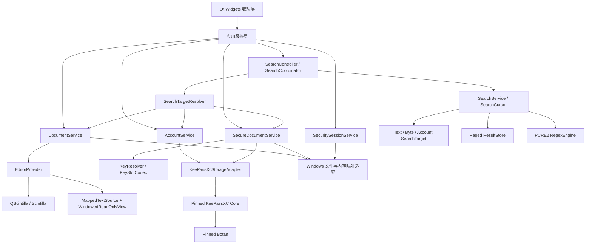
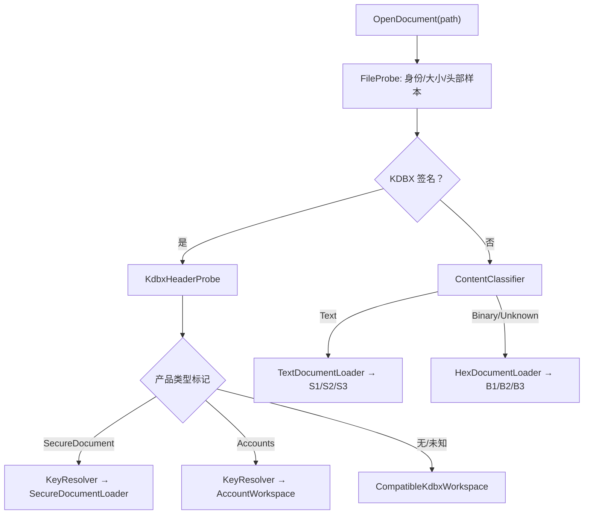
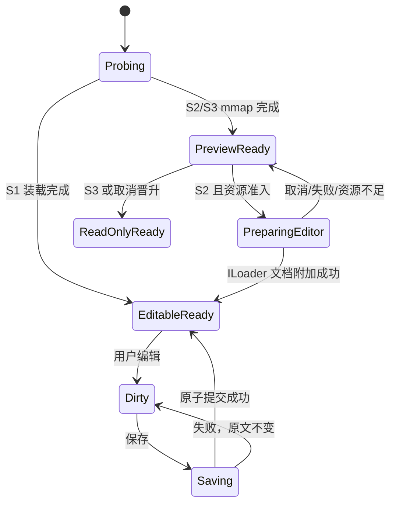
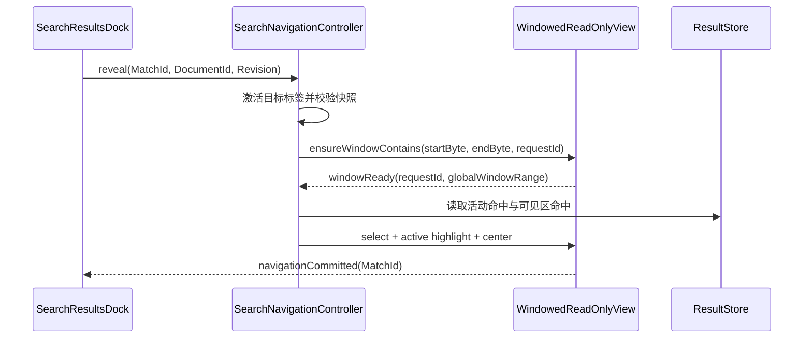
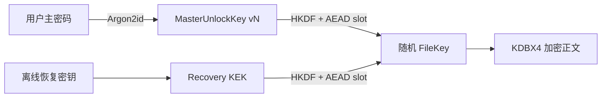

# Notepad Safe 架构设计

> 状态：已决策，作为后续开发的唯一架构基线
> 版本：3.1
> 更新日期：2026-08-17
> 产品许可证：GPLv3

本文替代旧版“L1/L2 + mmap + Patch 编辑”方案，以及“记事本 + 保险箱 Dock + `.nsk` 旁车文件”方案。旧代码仍可用于回归和迁移，但不再代表目标产品或架构。

用户可见目标、跨入口体验不变量、功能总账和真实 GUI 动态验收方法见 `docs/TARGET_EXPERIENCE.md`；外部产品和上游组件的采用/拒绝边界见 `docs/REFERENCE_BASELINE.md`；最终目标、迭代轮次和停止条件见 `docs/ITERATION_ROADMAP.md`。本文负责架构与安全边界，后续阶段只有同时满足全部基线才能标记完成。

## 1. 产品目标与边界

Notepad Safe 是 Windows 优先、离线优先的 Qt 桌面产品，提供三组核心体验：

1. 接近 Notepad++ 的多标签文本编辑、编码、搜索、替换和会话体验，并能打开任意格式文件。
2. 默认加密、使用时无感的安全文档；明文是用户可选的对等保存格式，而不是另一套工作区。
3. 现代化的本地账号密码管理；账号工作区与文档编辑器共享同一安全身份、密钥解析和保存基础设施。

产品哲学固定为：**文件离线时抗复制和抗口令暴力破解，可信 Windows 用户使用时像普通记事本一样无感。**“加密”是内部持久化策略，不是用户需要反复操作的功能。

所有本地文件必须能进入应用，统一入口为“打开文件”：

| 文件种类 | 探测依据 | 默认打开方式 | 可切换方式 |
|---|---|---|---|
| Notepad Safe 安全文档 | KDBX4 签名 + 产品 `PublicCustomData` | 按内部 Text/Binary payload 进入文本或十六进制编辑器 | 不允许把 KDBX 密文字节当明文误开；可另存为文本或原始二进制 |
| 兼容 KDBX 数据库 | KDBX3/4 签名、无本文档产品标记 | 账号/兼容数据工作区 | 可按导入流程转为安全文档或账号集合 |
| 普通文本 | BOM、编码探测和文本可信度 | 中央文本编辑器 | 可“以十六进制重新打开” |
| 未知二进制 | 非 KDBX，且文本可信度不足 | 十六进制编辑器 | 可“以文本重新打开”并选择编码 |

探测永远以文件头和内容为事实来源，扩展名只用于文件对话框筛选和 Windows Shell 关联。发现 KDBX 签名但损坏时必须报告损坏，禁止回退成乱码文本。

大文件能力分为三档：

| 档位 | 判定 | 产品能力 |
|---|---:|---|
| S1 标准编辑 | 小于 32 MiB | Scintilla 完整编辑，全部编辑功能 |
| S2 大文件编辑 | 32 MiB 至 2 GiB（含） | 按需随机读立即只读预览；后台准备完整 Scintilla 文档；资源允许后晋升为完整编辑 |
| S3 超大文件分析 | 大于 2 GiB | 窗口化随机读/短期分段 mmap 只读查看、导航、字面搜索和正则搜索；不编辑、不替换 |

边界统一使用二进制单位：32 MiB = 32 × 1024² 字节，2 GiB = 2 × 1024³ 字节。编码转换可能扩大文本时，以 max(文件字节数, 预计 UTF-8 编辑字节数) 进行编辑档位判定。

### 1.1 当前阶段不做

- 不从零开发文本编辑内核。
- 不再扩展 mmap + PatchList 为通用编辑器。
- 不修改 Scintilla 的存储内核以直接编辑 mmap。
- 不设计自有密码学算法或第二种用户可移植的正文加密格式；内部恢复缓存必须复用供应商密码原语、版本化且不可被误认为用户文件。
- 不在 MVP 中实现云同步、浏览器自动填充、移动端和 2 GiB+ 编辑。
- 不承诺任意硬件都能把接近 2 GiB 的文件完整装入编辑器；资源不足时保持可用的只读分析模式。
- 不以在线账户或厂商服务器作为恢复条件；产品在断网、厂商消失和 AppData 丢失时仍可凭文件、主密码或恢复密钥恢复。
- 不承诺防御已在当前 Windows 用户或管理员上下文中执行、可读取进程内存或调用 DPAPI 的恶意程序。

## 2. 架构决策

| 编号 | 决策 | 原因 |
|---|---|---|
| ADR-001 | Qt/C++ 是正式桌面主线 | 与现有 Qt/QScintilla UI 一致，减少跨语言秘密数据和 IPC 边界 |
| ADR-002 | Scintilla 是编辑内核供应商，QScintilla 是可替换 Qt 适配层 | 保留成熟编辑体验，同时避免被包装层版本锁死 |
| ADR-003 | KeePassXC Core + Botan 是 KDBX 生产实现 | 写入、历史、附件、KDF 和兼容性成熟；不自行实现密码学 |
| ADR-004 | Rust/Tauri 保险库保留为原型，不进入正式桌面构建 | 当前 keepass-rs 写入成熟度和现有 Qt 产品边界不匹配 |
| ADR-005 | S2 使用“窗口化按需预览 + ILoader 后台装载 + 单向晋升” | 兼得快速打开、外部原子替换兼容和成熟编辑，避免 Patch 编辑器复杂度 |
| ADR-006 | S3 永久只读 | 保留十几 GiB 日志分析价值，不承担编辑器内核重写成本 |
| ADR-007 | 正则统一为 PCRE2 | 三档语义一致；不混用 Scintilla 正则、QRegularExpression 和自制分块语义 |
| ADR-008 | 安全文档使用自包含的 KDBX4 文件，密钥槽写入 `PublicCustomData` | 继续复用 KeePassXC/KDBX，不再依赖易丢失的 `.nsk` 旁车文件 |
| ADR-009 | 新建和未命名草稿默认加密；普通保存保持原格式 | 用户不需要在日常编辑中理解或选择加解密 |
| ADR-010 | 打开入口统一，按文件头路由文本、安全文档、兼容 KDBX 和未知二进制 | 应用支持所有格式，扩展名不能决定安全边界 |
| ADR-011 | 未知二进制默认用现有十六进制编辑器打开 | 不拒绝文件，也不把二进制静默解码成损坏文本 |
| ADR-012 | 七天会话采用 Windows DPAPI CurrentUser 密封的版本化 KeyRing | 同一 Windows 用户/设备无感使用，复制出的文件仍需密码或恢复密钥 |
| ADR-013 | 主密码修改产生新密钥版本，不静默重写旧文件 | 能打开来自历史版本、其他设备和其他密码域的文件 |
| ADR-014 | “保存”绝不转换格式；只有“另存为”允许安全文档/文本转换 | 消除误解密、误加密和重复确认 |
| ADR-015 | 账号管理是一级全页工作区，不是保险箱 Dock | 账号体验现代化，并与文档编辑保持视觉和交互一致 |
| ADR-016 | 用户文件采用 KDBX；内部大文件恢复日志可使用版本化的加密缓存格式 | 用户可移植格式不自创密码学，内部恢复不受 32 MiB 安全文档上限束缚 |
| ADR-017 | 查找、查找全部和结果导航共享全局 SearchSession | 当前/全部打开/目录范围以及 Text/Hex/Secure/各大小档不再产生孤立实现和不一致语义 |
| ADR-018 | 任一文档工作区同一时刻只有一个用户可见、可操作的纵向滚动条 | 外层虚拟滚动条与 Scintilla 内部滚动条并存会形成两个位置真值，导致滚动无效、窗口回跳和无法遍历全文；禁止以双向同步补丁作为目标方案 |
| ADR-019 | “全部打开文件”同时支持查找和对可编辑目标的批量替换 | 这是 Notepad++ 类编辑器的正常一致性预期；S3/只读/不兼容查询类型按目标明确跳过，不能因混合范围而禁用全部替换 |

## 3. 总体分层



依赖只能从上向下。UI 不得直接访问 QFile mmap 指针、Scintilla 文档指针、KeePassXC Database/Entry、DPAPI blob 或密码字节。UI 只能根据统一 Document/Workspace 状态启用命令；不能依据“是不是保险箱”走另一套主窗口逻辑。搜索协调器也不能直接识别具体 Widget：它通过 SearchTargetResolver 从 DocumentService、SecureDocumentService 和 AccountService 获取带能力与安全策略的快照，因此新增文件 Provider 时必须同时声明搜索能力，而不是在查找对话框增加特判。

### 3.1 目标构建目标

| CMake target | 职责 |
|---|---|
| notepadsafe_domain | 无 UI 的文档、探测、保存策略、搜索和安全领域类型 |
| notepadsafe_editor | ScintillaGateway、文本编辑、十六进制编辑、窗口化只读视图 |
| notepadsafe_search | SearchScope/Target/Cursor、Text/Byte/Account 快照、PositionMapper、PCRE2、分页结果存储和导航契约 |
| notepadsafe_secure | SecureDocumentService、KeyResolver、KeySlotCodec、KeePassXC 适配器 |
| notepadsafe_accounts | AccountService、账号领域类型、安全剪贴板、TOTP |
| notepadsafe_session | SecuritySessionService、DraftStore、WorkspaceSession |
| notepadsafe_platform | mmap、原子替换、文件身份、DPAPI、Windows 会话事件和进程加固 |
| notepadsafe_app | Qt Widgets、命令、菜单、中央工作区和组合根 |

## 4. 供应链与版本治理

### 4.1 战略上游

| 上游 | 角色 | 2026-08 基线 | 策略 |
|---|---|---|---|
| Qt | UI、线程、平台抽象 | 当前构建 6.11.x | 固定补丁版本；Qt 与编译器 ABI 成套升级 |
| QScintilla | Qt 编辑器适配 | 2.14.1 | 过渡性锁定；只通过 ScintillaGateway 使用底层指针 API |
| Scintilla | 编辑器内核 | 当前随 QScintilla vendoring；未来独立锁定稳定版 | 作为真正战略上游；后续可替换为直接 Qt 端口 |
| KeePassXC | KDBX 读写和领域实现 | 2.7.12 为首个集成候选 | 固定 release tag/commit；只通过适配器访问 |
| Botan | KeePassXC 密码学依赖 | 由固定 KeePassXC 版本约束后锁定 | 不单独抢跑大版本；Botan 2 已 EOL，不新增 Botan 2 基线 |
| PCRE2 | 统一正则引擎 | 10.47，与 Qt 6.11.1 内置版本对齐 | 直接静态链接同版本的 8/16 位库，统一搜索语义 |
| zlib/minizip 等 | KDBX 传递依赖 | 随 KeePassXC 基线确定 | 在锁文件中展开记录，不视为“隐式依赖” |

“最新版本”不是构建输入。所有生产构建只读取仓库中的供应链锁文件。

### 4.2 供应链锁文件

仓库中的 `third_party/dependencies.lock.json` 是机器可读的唯一锁文件，每个组件至少记录：

```yaml
- name: keepassxc
  version: 2.7.12
  revision: refs/tags/2.7.12
  source: https://github.com/keepassxreboot/keepassxc
  archive_sha256: TBD
  signature: verified
  license: GPL-2.0-or-later
  patches: []
  build_options: [static, core-only]
```

同时保存上游源码归档或只读 subtree，支持离线、可重复构建。禁止构建时从 develop/master 或网络自动拉取源码。所有本地补丁放在 third_party/patches/<component>/<version>/，附原因、上游 issue 和删除条件。

当前 QScintilla 包的版本是明确的，但其内嵌 Scintilla 的文档版本与实际 API 集合不能作为可靠的独立版本标识；首次治理时必须补充源树 hash、接口清单和编译选项，不能只写“Scintilla 版本未知”。

### 4.3 更新流程


规则：

- Qt/QScintilla/Scintilla 与 KeePassXC/Botan 不在同一常规变更中升级。
- KeePassXC 升级必须通过双向 KDBX golden corpus：旧版本创建、新版本打开保存、KeePass/KeePassXC 再次打开。
- Scintilla 升级必须通过编辑命令、IME、编码、撤销、32 MiB 边界、ILoader 和性能基线。
- PCRE2 升级必须通过三档同语义正则语料和 ReDoS 资源限制测试。
- 例行依赖每季度评估；严重安全问题立即评估，不能等待季度窗口。
- 发布产物生成 SPDX/CycloneDX SBOM、源代码对应物、构建器版本和 SHA-256。
- 任一升级都保留上一套锁文件和可安装包，数据库格式升级默认保持向后可读，不静默进行不可逆迁移。

### 4.4 退出策略

- QScintilla：EditorProvider 和 ScintillaGateway 隔离后，可迁移到上游 Scintilla Qt 控件。
- KeePassXC：SecureDocumentService/AccountService 不暴露上游类型，可替换 KDBX adapter；KDBX 文件和离线恢复导出工具仍是用户的退出路径。
- PCRE2：SearchQuery/SearchResult 不暴露 pcre2_code 指针，允许替换实现，但产品正则语义必须保持。

## 5. 统一文档模型、探测与路由

### 5.1 领域对象

`Document` 是所有中央标签页的唯一业务对象。UI 不再使用 `isSecureDocument()`、`isL2Mode()` 等布尔组合决定流程，而是读取正交属性：

| 属性 | 值 | 含义 |
|---|---|---|
| `DocumentId` | UUID | 跨异步任务、草稿和会话恢复的稳定标识 |
| `Origin` | Untitled / LocalFile / AccountRecord | 文档从何处产生 |
| `PersistenceKind` | SecureKdbx / PlainFile / BinaryFile | 普通保存必须保持的持久化类型 |
| `PresentationKind` | Text / Hex / Account | 当前中央视图；文本和二进制可重新解释，不等于格式转换 |
| `SizeTier` | S1 / S2 / S3 | 文本或二进制的装载/编辑能力级别 |
| `SecurityBinding` | KeyVersion/ForeignKey/None | 仅供内部密钥解析，不用于制造不同的编辑 UI |
| `Revision` | 64 位递增值 | 搜索、保存、异步加载和恢复日志的一致性边界 |
| `DirtyState` | Clean / Dirty / Saving / Conflict | 保存与外部修改状态 |
| `SearchCapabilities` | Text/Byte/Structured、Regex、WholeWord、Snapshot、PositionSpace | 由 Provider 声明，不由查找 UI 猜测 |

关键不变量：

- `PresentationKind` 的“以文本/十六进制重新打开”只改变解释和视图，不改变原文件字节，不等于另存为转换。
- `PersistenceKind` 只在首次创建、打开探测和成功完成另存为转换时改变。
- Untitled 的 `PersistenceKind` 从创建起就是 `SecureKdbx`，不存在“尚未决定是否加密”的中间状态。
- 安全文档解密后只暴露逻辑 payload。Text payload 可按文本/十六进制重新解释，Binary payload 默认进入 Hex；两者都禁止把 KDBX 容器密文字节当作正文。分析原始容器只能走独立诊断命令，且不进入常用 UI。
- 每个可显示 Provider 必须同时提供 SearchTargetSnapshot 和 PositionMapper，或显式声明不可搜索并给出用户可见理由；“能打开但查找按钮无效”属于架构违规。OpenDispatcher 与目录搜索复用同一个 Provider registry，保证新增格式不会只接入打开而遗漏查找。

### 5.2 FileProbe 与 OpenDispatcher

统一打开流水线：



`FileProbe` 最多同步读取 64 KiB，目标是在主线程 16 ms 预算内完成；慢设备或网络路径转到 worker。它输出事实而不是直接创建 Widget：

- 文件 ID、规范路径、大小、mtime、可读写属性。
- 前 64 KiB、尾部小样本（仅需要时）、BOM、NUL/控制字符比例、UTF-8 合法性。
- KDBX 主签名、次签名、格式版本和可公开读取的产品标记。
- 推荐 `PresentationKind`、置信度和原因。

`ContentClassifier` 规则顺序固定：明确 BOM/有效 Unicode → 已知文本编码启发 → 文本可信度 → Binary。未知扩展名不能降低文本内容的置信度；常见文本扩展名也不能覆盖明显二进制内容。分类结果是推荐值，用户始终可以“以文本重新打开”或“以十六进制重新打开”。

当前迁移实现已经让文件菜单、最近文件、拖放和命令行复用同一个打开入口，并在创建标签前完成已打开文档判定：普通 Text/Hex/S2/S3 使用规范路径和 Windows volume serial + file index 文件身份，硬链接或路径大小写差异仍定位到原标签；安全文档使用公开头中的 DocumentId，副本或别名不会创建第二个竞争写入句柄。命中现有文档时保持编辑状态、选择和视图模式，只激活标签并给出短暂状态提示。显式“从磁盘重新加载”携带目标标签，跳过去重并重新执行完整格式/分级路由。最近文件在设置加载后立即按同一身份规则归一化/去重并重建菜单；缺失项点击后非模态移除并立刻持久化，不能让历史列表阻塞编辑旅程。

L2 打开接口必须保持三个正交决策：`L2ContentKind::Text/Binary` 记录 payload 的内容身份并约束保存/转换，`L2Presentation::Text/Hex` 决定当前解释、行索引和搜索语义，`allowFullTextPromotion` 只决定 S2 Text 是否后台提升为完整 Scintilla 编辑器。禁止再以单个布尔值同时表达内容类型、展示方式和提升策略；Binary payload 可以显式使用 Text 呈现但保存时仍保持原始 Binary 身份，`Text + false` 是合法的 mmap 文本视图，`Hex + false` 是原始字节视图。当前迁移代码已按此边界拆分，既避免 Hex 不建立行索引而 Text 搜索永久等待的模式死锁，也避免用户把二进制切到文本视图后重启又被自动探测强制切回 Hex。

### 5.3 未知二进制与十六进制模式

现有十六进制模式保留并提升为正式 `HexEditorProvider`，不再只是文本标签页上的显示开关。

| 文件大小 | 十六进制能力 |
|---:|---|
| B1 < 32 MiB | 完整十六进制编辑、选择、覆盖/插入、撤销、搜索、保存 |
| B2 32 MiB–2 GiB | mmap 快速预览；资源允许时后台准备可编辑字节文档；不足时保持只读 |
| B3 > 2 GiB | 分段 mmap 只读查看、跳转、字节/十六进制搜索、导出选择 |

十六进制编辑器要求：

- 位置、选择和文件大小一律使用 64 位字节偏移。
- 三栏可视化：offset、hex bytes、ASCII/UTF-8 提示；每行字节数可配置但默认 16。
- 编辑命令以原始字节为语义，不经过 `QString` 和编码转换。
- 输入法事件不能成为显示投影的写入旁路：Hex/ASCII 字节面禁用 native preedit；平台仍投递的 commit 先整段校验，再作为单个 byte patch 事务执行。混合非法候选不得应用合法前缀，Text 呈现必须重新启用 IME。
- “以文本重新打开”要求选择/确认显示编码，仅改变视图；发生文本编辑后，保存会按所选编码重建字节，因此状态栏必须显示编码。
- “以十六进制重新打开”优先保持光标对应的原始 byte offset；存在未保存文本编辑时必须先保存、放弃或取消，不能静默丢失重编码后的内容。
- 二进制搜索支持字节串、带空格的十六进制模式和 ASCII/UTF-8 文本；PCRE2 正则只用于文本解释，不对任意字节承诺 Unicode 语义。
- B2/B3 的窗口化、资源准入、保存冲突和取消机制复用 S2/S3 基础设施，不建立第二套 mmap/Patch 引擎。

#### 5.3.1 当前迁移实现（2026-08-15）

统一文档入口已经把普通打开、最近文件、拖放和会话中的原文件恢复收口到同一个有界内容探测；NUL 或高比例控制字节默认通过 mmap 进入 Hex，扩展名不参与安全判断。过渡期 Hex UI 使用 Scintilla 窗口显示：左侧 margin 是 64 位绝对 byte offset，正文按真实 viewport 选择 4-byte 对齐的 8–64 bytes-per-row，两位十六进制网格和 ASCII 栏共同填充有效宽度。原始字节保存在 `MappedByteSource/VirtualFileView`，显示文本只作为可编辑投影；保存前执行严格可逆解析，再把 byte diff 写入 patch，因此非法半字节或非十六进制字符会阻止保存，而不是发生编码替换。普通保存保持原字节类型；另存为成功后必须重新映射新路径，后续编辑不得继续依赖旧文件。Windows 原路径保存使用 `ReplaceFileW`/`MoveFileExW` 原子替换，不允许先删除原文件再复制。

这仍保留迁移期类型边界，但 0.3.1 的用户旅程已经闭合。ASCII 已从装饰性只读预览升级为与 Hex 共用同一 half-open source-byte selection 的第二输入面；两栏的 caret、鼠标/Shift 选择、非焦点镜像高亮和滚动保持同步。Hex nibble、ASCII、选择删除、剪切和粘贴直接调用原始 byte patch，不允许空格、换行或非十六进制字符破坏显示投影；Insert 在每标签切换 OVR/INS，状态栏显示 64 位绝对 byte offset、B1/B2/B3 与 OVR/INS/只读。安全 Binary 刷新、锁定和关闭时同时覆盖 ASCII 投影及 byte baseline。Hex bytes 查询已进入统一查找对话框，接受连续十六进制、空格/逗号/连字符分隔和 `0x` 前缀，直接在原始 byte source 上执行跨块 KMP，不等待文本行索引；结果 Dock 使用 16-byte ASCII 上下文并保留 64 位 byte offset，双击按原始字节范围跳转并在 Hex/ASCII 同时显示选择。普通 Binary/Hex 未保存 patch 已进入加密崩溃恢复链路，见 10.5 和 13。字节通配符、可选 Data Inspector 和内部 `HexEditorProvider` 重命名是发布后增强，不得以它们未提供为由改走“把二进制解码成 QString 后直接保存”的危险旁路。B2/B3 在本版明确只读。

### 5.4 保存路由

`SaveRouter` 根据 `PersistenceKind` 决定唯一保存器：

| PersistenceKind | 普通保存 | 另存为可选目标 |
|---|---|---|
| SecureKdbx | `SecureDocumentWriter`，保持当前 keyVersion 和 payload 类型 | 安全文档、文本文件；Binary payload 还可导出原始二进制 |
| PlainFile | `TextDocumentWriter`，保持编码/EOL | 文本文件、安全文档 |
| BinaryFile | `BinaryDocumentWriter`，保持原始字节 | 原始二进制、安全文档；能够无损解码时也可选文本文件 |

文件菜单的“另存为”使用一个对话框和明确的“保存类型”下拉框，不连续弹出加密确认：

- `Notepad Safe 安全文档 (*.nsafe)`：把当前文本或原始字节无损写入自包含 KDBX4。
- `未加密文件 (*)`：Text 按当前编码/EOL 写出，Binary/Hex 按原始字节写出；不再把“文本/所有文件/原始二进制”暴露为第三个安全选择。

选择明文时在对话框内静态显示“将创建未加密副本”，不再增加二次确认。转换成功后，新路径和新 `PersistenceKind` 绑定当前标签；原文件不删除。

当前过渡实现的“另存为”已经改为单个非原生 Qt 文件对话框，以便始终显示格式的
安全后果：安全文档为绿色离线加密提示，未加密文件为黄色明文提示。保存类型恰好
只有这两个安全事实；`.nsafe` 是 KDBX 安全文档专用扩展名，切到未加密时文件名输入框
立即改为 `.txt/.bin`，切回安全文档时立即显示 `.nsafe`，提交层仍拒绝生成“明文内容 +
`.nsafe` 名称”的矛盾结果。转换成功后立即重算命令、编码/语法状态栏和
标签标题；原始文件不删除，普通“保存”继续保持转换后的类型。

截至 2026-08-17，真实 GUI smoke 已完成安全 Text → 未加密 Text → 安全 Text 往返：
键盘操作保存类型下拉框，验证始终只有两项、说明栏颜色/文案和输入框扩展名同步；故意在
未加密类型下输入 `.nsafe` 时最终安全归一为 `.txt`；正文逐字保持，回转后的 `.nsafe`
文件头为 KDBX4。证据为 `gui-save-as-plain-choice.png`、
`gui-save-as-secure-choice.png`，定向结果 3 passed / 0 failed / 2034 ms。

### 5.5 文档装载状态机



安全文档在 `Probing` 和上述装载状态之间增加 `ResolvingKey`；未知密钥进入 `PasswordRequired`，取消后关闭本次打开而不创建空标签。十六进制文档复用状态机，但使用 `HexEditableReady/HexPreviewReady` 的 EditorProvider 实现。

每个异步结果携带 DocumentId、Revision 和 CancellationToken。结果到达时 revision 不一致则丢弃，禁止旧搜索或旧装载覆盖新状态。

## 6. S1：小于 32 MiB 的标准编辑

- 使用后台 Scintilla ILoader 装载，完成后在 UI 线程通过 pointer-sized ScintillaGateway 附加文档。
- 不再执行 QFile::readAll → QString → QByteArray → SCI_APPENDTEXT 的多重复制和 UI 串行追加。
- 默认启用完整撤销、语法高亮、折叠、换行、多选和书签。
- 文件读取、编码识别和 UTF-8 流式转换在 worker 完成；Scintilla UI 对象只在主线程使用。
- ILoader 由单个 worker 顺序 AddData。一个文件不使用多个线程向同一个 loader 写入。

## 7. S2：32 MiB 至 2 GiB 的大文件编辑

### 7.1 打开流程

1. FileProbe 读取文件身份、大小、BOM、编码样本和可用内存。
2. WindowedByteSource 只探测文件元数据，不长期占用源文件；读取当前窗口时以共享只读句柄按绝对位置读取 2–8 MiB 并立即关闭。仅对不会与外部轮转/原子保存竞争的内部扫描允许短期 mmap。
3. WindowedReadOnlyView 将光标附近窗口装入只读 Scintilla，先显示内容，不等待全量行索引。Windows 上不得以长期 mmap 或 `QFileSystemWatcher` 的文件句柄阻止日志轮转、截断或其它编辑器的原子替换。
4. SparseLineIndex 在后台单线程顺序扫描；滚动条以字节位置工作，因此索引未完成也可自由滚动。
5. 通过资源准入后，后台 ILoader 构建完整 Scintilla 文档。
6. 完成后 UI 保存当前全局 byte offset/选择，附加新文档并恢复到对应位置；切换是单向的。

预览期间可以滚动、复制、跳转、字面搜索和正则搜索，但编辑、粘贴和替换保持禁用。用户可以取消“准备编辑”，继续只读分析。

#### 7.1.0 S1/S2/S3 共用同一编辑器表面

文件大小分级只允许改变数据装载方式和 capability，禁止改变产品界面。Text 的 S1 完整文档、
S2 预览/晋升/回退和 S3 只读必须进入同一个 `EditorSurface`；用户可见结构和交互契约保持一致：

- 同一字体、字号、颜色、正文边距、当前行、selection、search indicator 和 caret 风格；
- 同一左侧 gutter 槽位。完整索引时显示精确行号；索引未完成时在相同槽位显示“约/计算中”或
  全局 byte offset，不得让 gutter 消失、改变宽度或显示窗口局部伪行号；
- 同一纵向/横向滚动条位置、尺寸、主题和 wheel/Page/drag 手感，任何时刻可见纵向滚动条恰好
  一条；换行、缩放、标尺、空白符显示和右键菜单使用同一视图配置；
- 同一查找高亮、书签、复制、标签、状态栏和 Dock 跳转表现。只读 Tier 通过 capability 禁用
  Cut/Paste/Undo/Replace/Save 等命令，不能换成简陋的“大文件查看器”；
- S2 从 Preview/Preparing 到 Editable 或 ReadOnlyFallback 时，EditorSurface 本身不被替换、
  不闪白、不改变几何。只在后台重新绑定 Windowed/Full document model，并恢复同一全局 top、
  caret、selection、horizontal offset、wrap、zoom、bookmark 和 active search match；
- Tier/准备/只读原因仅在状态栏和任务中心表达。正文区域不得增加常驻大文件横幅、水印、第二套
  工具栏或不同的上下文菜单来暴露内部实现。

Hex 同理：B1/B2/B3/Secure Binary 必须共用一个 `HexView`（地址、Hex、ASCII、滚动、选择、
主题和搜索高亮）；区别仅是 ByteSource 与 writable capability。当前 B1 overlay 与 B2/B3
`WindowedReadOnlyProvider` Hex 的可见差异属于迁移期 **P0**，在统一 HexView 前不得宣称体验一致。

#### 7.1.1 单滚动条与位置真值

S2 预览不得把带自身滚动条的 QScintilla 叠放在 `QAbstractScrollArea`/另一条滚动条的 viewport 中。目标实现是独立 `WindowedReadOnlyProvider`：

- 预览期隐藏 Scintilla 内部纵向滚动条，只保留一条与编辑区视觉一体的全局滚动条；该滚动条映射 64 位 `SourceBytes` 位置，是鼠标拖动、滚轮、PageUp/PageDown、键盘导航和搜索跳转的唯一位置真值。
- Scintilla 只负责当前窗口的文本渲染、选择、indicator 和输入法，不拥有独立的“当前窗口滚动到末尾”语义。滚轮和键盘事件先转换为全局导航请求，再决定是否切换窗口。
- 切换窗口前保存全局 top/caret/anchor/selection；窗口 ready 后按同一全局锚点恢复局部首行和选区。禁止用 `setText()` 后的默认局部位置覆盖用户全局位置，禁止滚动到底自动跳回窗口开头。
- ILoader 晋升成功后把同一 `EditorSurface` 重新绑定到完整 `TextEditorProvider`。内部可以从全局
  滚动代理切换到 Scintilla 文档滚动，但对用户暴露的滚动条槽位、geometry/style/pageStep 和
  当前 thumb 位置不得改变；晋升前后全局位置、选择、水平位置和活动搜索命中保持不变。
- 任何主题、DPI、Text/Hex 呈现和窄窗口下，编辑区可见且可操作的纵向滚动条计数必须严格等于 1。

2026-08-17 审计确认当前 `VirtualFileView(QAbstractScrollArea) + viewport 内 QScintilla overlay` 违反该不变量：两套滚动范围互相独立，局部窗口重灌会重置 Scintilla 可视位置。该路径标记为**不可验收的迁移实现**，不得继续通过同步两个滚动条或增加 debounce 修补；只能提取可复用的按绝对位置读取逻辑后替换视图容器。

同日动态切片进一步确认：Windows 即使使用 `FILE_SHARE_DELETE`，长期活动的映射视图以及 Qt 的具体文件 watcher 仍会令 `QSaveFile::commit()` 原子替换失败。生产 `WindowedReadOnlyProvider` 因此采用“投影/搜索块读取期间短开句柄、空闲时零源文件句柄 + 500 ms 元数据轮询”的策略。追加、原子替换为更小文件、旧位置钳制、头尾重读已在展示中的 Qt GUI 中通过；不得为了恢复“全文件一直 mmap”这一实现偏好而破坏外部修改兼容性。

#### 7.1.2 窗口投影不是文本编辑模型

`WindowedReadOnlyProvider` 中的 Scintilla 文档只是原文件某个 byte range 的有界显示投影，局部 position 可以可靠换算成绝对 `SourceBytes`。这种换算只足以支持导航、选择、搜索高亮，以及 Hex 中**不改变字节长度**的覆盖写；它不能让普通文本插入/删除直接写回 mmap：一次变长编辑会移动其后全部字节，并使后续位置、撤销、搜索结果、编码边界和崩溃恢复同时失效。

因此生产路径明确禁止“在窗口内编辑后把相对地址直接写回文件”的通用文本方案，也不再恢复 PatchList/piece-table 实验。S2 Text 只有在完整 ILoader 文档附加成功后才获得编辑、替换和撤销能力；附加前与失败后始终是可浏览、可搜索、可复制的只读投影。B2 Hex 的等长覆盖可作为独立能力继续评估，但不得据此宣称支持变长文本编辑。

### 7.2 资源准入

2 GiB 是功能上限，不是无条件内存承诺。ResourceAdmission 估计：

- 解码后文本容量。
- Scintilla 文本、行结构和最小样式开销。
- 保存/搜索临时预算。
- 撤销预算和系统保留内存。

只有预计峰值不超过物理内存的 60%，且系统仍能保留至少 2 GiB 可提交空间时自动晋升。用户可在 2 GiB 内请求强制准备，但仍不能越过会导致系统失稳的硬性保留线。推荐 64 位系统、16 GiB 起步，接近 2 GiB 文件推荐 32 GiB RAM。

峰值估算不再把源文件大小等同于常驻物理内存：生产预览只保留 2–8 MiB 投影，晋升 worker 使用 4 MiB 有界解码块；预算计入 Scintilla 文档/间隙、行与样式、搜索/保存 scratch、撤销和 32 MiB 预览解码余量。`LargeDocumentRuntimeState` 对 UI 明确暴露 `PreviewReady / PreparingEditor / Editable / ReadOnlyAnalysis / ReadOnlyFallback`；编码扩张越界、内存拒绝、任务取消、读取/解码失败和 ILoader 失败都必须落到带持久原因的 `ReadOnlyFallback`，不能只显示一条会消失的状态栏消息。

资源拒绝、用户取消、读取/解码错误、ILoader 分配失败或附加失败时，文档的领域尺寸仍为 `SizeTier::S2`，运行时 Provider 状态收敛为 `ReadOnlyFallback`（UI 文案为“只读分析”）。它复用 S3 的单滚动窗口浏览和搜索能力，但不能伪装成 `SizeTier::S3`，也不能无限显示“正在准备编辑”。任务中心保留失败/取消原因和重试入口；资源恢复后可重新请求晋升，期间所有编辑与替换命令保持禁用。

正式 `EditorTab` 不得为了搜索或历史兼容在窗口 Provider 背后预先打开隐藏 `VirtualFileView`。2026-08-17 GUI 防线已证明 33 MiB 正式打开路径的隐藏映射大小为 0，外部 `QSaveFile` 可在标签打开时原子替换源文件。0.3.1 仅在用户显式发起搜索时按需建立 mmap/patch 搜索快照，以换取 GiB 文件的全量扫描吞吐；它不创建第二个可见编辑器、不参与滚动真值，内容 revision/外部变化会使结果失效。将该兼容快照改名或抽成独立 `SearchSource` 是发布后内部重构，不得扩散回打开路径或形成第二套搜索语义。

### 7.3 分级关闭昂贵功能

| 预计编辑字节 | 默认能力 |
|---:|---|
| 32–128 MiB | 完整编辑；语法高亮可用 |
| 128–256 MiB | 高亮只按可见区/增量进行；关闭全文重着色 |
| 256 MiB–2 GiB | 默认关闭语法高亮、折叠、自动换行、文档地图和全文件变化历史 |

用户可以手动开启部分功能，但 UI 必须显示内存影响。撤销内存使用独立预算，默认 min(512 MiB, 物理内存 10%)；达到预算后建立保存点并明确提示，不允许静默耗尽系统内存。

### 7.4 Scintilla 接入约束

- 使用 SCI_CREATELOADER / ILoader::AddData / ConvertToDocument / SCI_SETDOCPOINTER。
- loader worker 不访问 QWidget，不发送普通 QScintilla long 返回值承载指针。
- ScintillaGateway 使用 SCI_GETDIRECTFUNCTION + SCI_GETDIRECTPOINTER，所有位置和指针采用 intptr_t、uintptr_t、Sci_Position。
- 装载阶段使用 SC_DOCUMENTOPTION_STYLES_NONE；需要高亮时再创建样式数据。
- 装载完成前禁用 undo，附加后清空装载历史并建立 save point。
- 单个 ILoader 由一个有序 writer 调用 `AddData`；读取和可安全分块的解码可以进入有界流水线并行，但不得从多个线程无序写同一 loader。多线程是吞吐实现手段，不是以线程数代替用户可见完成状态。
- 后台晋升使用显式状态机 `SourceReady → PreviewReady → Reading/Decoding → BuildingDocument → Attaching → Editable`，失败进入带原因的 `PreviewReadOnly`，取消进入 `PreviewReadOnly`；不得无限停留在“准备中”。`Mapped` 只可作为内部实现状态，不能成为 UI 或生命周期契约。
- 任务中心必须显示当前阶段、已处理源字节/总字节、速度、活动 worker 和可取消状态。预览正文保持可交互；附加 Document 的 UI 线程工作必须受 50 ms 门槛约束或拆分为可解释的最终短暂停顿。

### 7.5 保存与外部冲突

- 从 Scintilla 按固定窗口流式读取，按原编码流式编码到同目录随机临时文件，不构造整文件副本。
- FlushFileBuffers 后使用 ReplaceFileW/等价原子替换；失败保留临时文件并保持原文件不变。
- 打开时记录文件 ID、大小、mtime 和首/中/尾有界采样 hash；保存前变化则进入冲突状态，不静默覆盖。
- 大规模替换如果预计撤销成本超预算，使用“离线流式替换 → 备份 → 原子提交 → 重新加载”，并明确说明不能用 Ctrl+Z、只能从备份恢复。

#### 7.5.1 当前迁移实现（2026-08-15）

普通 Text S1、已晋升的 S2 Scintilla 文档、mmap Text/Hex 共用领域层 `DiskFileVersion`：Windows 文件身份使用 volume serial + file index，再结合大小、毫秒 mtime 和最多 3 × 64 KiB 采样 SHA-256。主窗口在保存前统一给出“重新加载磁盘版本 / 另存为… / 取消”；原文件丢失或无法验证时不提供覆盖逃生口。即使调用者绕过主窗口，`saveFile/saveAsFile/saveL2As` 也会在写入前再次拒绝已变化的原路径。重新加载始终回到统一 Open 路由，因此外部改变后的 KDBX 头、二进制特征和文件分级会重新判定；旧搜索结果同时清空，避免双击跳转到过期位置。

安全文档的密文冲突由 `SecureDocumentService` 自身持有基线，不借用明文 `EditorTab` 状态。当前 Text/S2/Hex/KDBX 已共用领域层 `DiskFileVersion` 的同一探测实现；KDBX 普通保存和自动保存在写入前都再检查密文版本。冲突时自动保存静默暂停并保持 dirty；用户保存/关闭时进入与普通文件一致的“重新加载磁盘版本 / 另存为… / 取消”。重新加载必须先用原文档凭据解锁并校验相同 DocumentId，成功后才替换内存正文和基线；失败保留当前未保存内容，仍可另存为新安全文档。

账户 KDBX 的防覆盖约束下沉到 `VaultService`：`upsert/recycle/restore/remove/save` 在改变内存数据库前就检查磁盘基线，避免“先改内存、保存时才发现冲突”造成不可见的待提交状态。冲突页明确告知当前表单未保存，用户可取消并复制字段，或选择“放弃当前编辑并重新打开”。后者清理表单和安全剪贴板状态，锁定旧后端，再通过统一 Open 路由使用当前七天安全会话或外来密码重新解锁磁盘版本。

## 8. S3：大于 2 GiB 的超大文件只读分析

S3 复用 WindowedByteSource、WindowedReadOnlyView、SparseLineIndex 和 SearchService，但永不创建完整 Scintilla 文档。窗口显示和可观察外部变化默认采用按需随机读；搜索可以在不长期锁定路径的前提下选择分块 `ReadFile` 或短期分段 mmap。

支持：

- 立即打开、按字节比例滚动、行号逐步精确化。
- 跳转 byte offset、已知行号、文件头尾和搜索结果。
- 有界复制、导出选择、导出匹配行。
- 字面搜索、完整 PCRE2 正则、结果 Dock、取消和进度。
- 与 S1 相同入口和外观的自动换行、缩放、字体、主题、选择、书签、右键菜单和搜索高亮；
  实现可以只重排当前有界窗口，但不得改变全局位置或造成假 EOF。
- 日志 tail/follow 可作为后续增量功能。

不支持：

- 编辑、粘贴、替换、自动保存、撤销。
- 全文语法高亮、代码折叠、文档地图。当前窗口的轻量高亮可以后续按同一 EditorSurface 增强，
  未实现时语言 capability 明确禁用，但正文布局仍与 S1 Plain Text 一致。
- 单行无限制渲染；超长行按窗口显示，复制/导出仍流式读取完整范围。

### 8.1 窗口化显示

WindowedReadOnlyView 保留 Scintilla 的字体、选择、IME、行号和 indicator 绘制，但只装入光标附近的窗口：

- 默认 16 MiB，可按机器在 8–32 MiB 调整。
- 光标进入窗口前后 25% 区域时异步预取下一窗口。
- 窗口边界对齐完整字符和尽量完整的行。
- 全局位置始终是 64 位原文件 byte offset；局部 Scintilla offset 仅存在于视图内部。
- 与 S2 预览复用 7.1.1 的单滚动条不变量。S3 没有“晋升后切换滚动条”阶段，因此从打开到关闭始终只有同一条全局滚动条；搜索跳转、手工滚动和窗口预取必须更新同一位置状态。

旧 L2ScintillaBridge 的“显示窗口”部分可以迁移；diff 回写 PatchList、虚拟坐标编辑和 patch 保存链全部废止。

### 8.2 稀疏行索引

SparseLineIndex 每固定行数保存一个 64 位锚点，并为可见窗口建立短期行缓存。它不再为每一行永久保存偏移，因此十几 GiB、数亿行文件不会产生同量级索引内存。

- 后台按磁盘顺序单线程扫描，避免多线程争抢页缓存。
- 索引未完成时滚动使用 byte offset，行号显示“约”或“计算中”。
- S3 搜索结果先保存 `SourceBytes` 位置，行列号按需由最近锚点计算。
- 文件变化后旧索引按文件身份失效；稳定格式的索引缓存可在后续版本加入。

## 9. 统一搜索与正则

### 9.1 查询契约

搜索是应用级能力，不属于 `EditorTab`、Scintilla、Hex View 或结果 Dock。`SearchQuery` 包含 pattern、Literal/Regex/BytePattern、大小写、整词、方向、`SearchScope`、编码策略、文件筛选和结果上限；“查找下一个/上一个”和“查找全部”必须使用同一个已编译查询和同一组目标快照。

`SearchScope` 是显式产品概念：

| 范围 | 目标集合 | 查找下一个/上一个 | 查找全部 |
|---|---|---|---|
| 当前文件 | 当前 Document/Provider | 从光标开始并按循环设置回绕 | 当前文件的全部结果 |
| 全部打开文件 | 标签顺序中的所有可搜索 Document，包含后台/预览标签 | 从当前标签和光标开始，随后按标签顺序跨文件；回绕前明确提示 | 按文档分组渐进返回 |

本次发布只交付“当前文件”和“全部打开文件”两档。目录树搜索/替换需要额外解决枚举边界、权限、符号链接、未打开安全文件解锁、备份与跨文件原子提交，属于发布后独立立项；UI 不显示未实现的“文件夹”范围，也不得把它暗中等同于“全部打开文件”。下文保留的目录 target/验收条款是未来扩展约束，不是本次发布完成条件。

范围是用户显式选择，不由按钮名称或文件大小推断：

- 默认永远是“当前文件”。Ctrl+F 新开对话框、应用启动和新会话都不得继承上次的“全部打开文件”，避免一次普通 F3 意外启动昂贵后台任务。
- 对话框保持打开时保留用户本次显式选择；切换标签后，“当前文件”动态指向新活动标签，query 与选项保留但旧 session 结束。
- “全部打开文件”是紧邻“当前文件”的唯一全局范围项，并显示当前可搜索文件数，例如 `全部打开文件 (12)`。
- “查找全部”表示“枚举所选范围内的全部匹配”，不等于自动把范围切到全部文件；F3/Shift+F3 也严格服从同一范围。
- 开始搜索后，范围、查询类型和筛选显示在查找框与结果会话标题中，用户不需要从结果猜本次搜了哪里。

“全部文件”同时意味着覆盖应用能打开的所有内容类型，而不是只覆盖 `.txt`：

| 目标 | SearchTarget / 快照 | 查询语义 | 结果导航 |
|---|---|---|---|
| S1 Text | 当前 revision 的 UTF-8 编辑快照 | Literal/Regex/整词 | TextEditorProvider |
| S2 Text 预览或未修改 | 原文件 mmap | Literal/Regex/整词 | 当前视图或晋升后的编辑器 |
| S2 Text 已编辑 | 按 revision 复用或异步生成只读搜索快照 | Literal/Regex/整词 | TextEditorProvider |
| S3 Text | 原文件 mmap/分段 mmap | Literal/Regex/整词 | WindowedReadOnlyProvider |
| B1/B2/B3 Hex | 内存字节源或 mmap/分段 mmap | Hex bytes、ASCII、UTF-8 literal；Regex 使用显式 byte/text 模式 | HexEditorProvider/WindowedHexProvider |
| 安全 Text/Binary | 已解锁 payload 的短期内存快照 | 分别复用 Text/Byte 语义 | 对应 Text/Hex Provider；结果只在内存 |
| Accounts/兼容 KDBX | AccountService 内存索引 | 标题、用户名、URL、标签、备注；默认排除密码、TOTP seed 和历史秘密 | 激活账号工作区并定位记录/字段 |
| 目录中未打开的普通文件 | FileProbe 后的 MappedTextTarget 或 MappedByteTarget | 按探测出的 Text/Byte 语义 | OpenDispatcher 打开后由 PositionMapper 定位 |
| 目录中未打开的安全/KDBX 文件 | 当前会话可解析时建立短期安全 target | 与打开后的类型一致 | 统一密钥解析后打开；未知密码按 10.3 的单次询问流程 |

混合目标时查询类型必须明确且结果可解释：Text literal 按各 Text target 的规范化文本语义搜索，在 Byte target 中按所选 ASCII/UTF-8 字节编码搜索；Hex byte pattern 只作用于 Byte-capable target；Regex 对 Text target 使用 Unicode PCRE2，对 Binary target 只有用户明确选择“字节正则”才运行 PCRE2 byte mode。不能因某个 target 不支持选定语义就把整个范围静默降级；结果摘要必须列出“已搜索、已跳过、需要解锁、失败”的文件数和理由。

`SearchMatch` 不直接假设所有 offset 属于同一种空间，而是携带 `DocumentPosition { PositionSpace, start, end }`、TargetId、DocumentId/PathIdentity、Revision/snapshotId：

- `CanonicalUtf8`：可编辑 Text 文档内部的 Scintilla UTF-8 位置。
- `SourceBytes`：mmap、Hex、未打开文件和 S3 的原文件 64 位 byte offset。
- `AccountField`：账号 recordId/fieldId 的结构化位置，不伪装成 byte offset。

`PositionMapper` 负责在原编码、规范化 UTF-8 编辑快照和窗口局部位置间转换；UI 禁止用裸 `int` 或无类型 `qint64` 猜测位置空间。S2 生成编辑快照时，主线程以短小批次从 Scintilla 取数据，后台写入 delete-on-close、仅当前用户 ACL 的临时文件；文档继续变化则取消并丢弃快照。未修改文档直接搜索原 mmap，不复制。

目录搜索不是绕过统一打开/安全策略的第二套文件读取器：每个候选先经过轻量 `FileProbe`，KDBX 不得按密文字节产生假匹配，未知二进制进入 Byte target，权限/损坏/解锁失败作为逐文件状态记录。当前七天会话可解析的安全文件无提示搜索；陌生 keyVersion/外部 KDBX 先归入“需要解锁”，继续搜索其他文件，不连续弹密码框。用户点击组级“解锁并搜索”后进入可跳过/全部跳过的 KeyResolver 队列，每个密码域在本次 session 最多询问一次。默认跳过版本控制目录、应用临时 spool 和用户明确排除项；符号链接默认不跟随，防止循环和意外越界。

### 9.1.1 查找与查找全部共享会话

`FindNext/FindPrevious` 是对 `SearchSession` 的惰性游标消费，`FindAll` 是对同一 session 的完整流式枚举：

- 若同一 query/scope/snapshot manifest 已有 Find All 结果，F3/Shift+F3 直接在有序 ResultStore 中移动，不重复扫描。
- 若没有完整结果，`SearchCursor` 从当前 Position/Target 开始惰性寻找第一个命中；不会为了“查找下一个”先扫描 10 GiB 全文。
- 用户随后按“查找全部”时可以复用已编译 pattern、快照和已验证的部分结果，但结果发布顺序及去重仍由 SearchSession 保证。
- 修改 query、scope、编码策略或文件筛选会创建新 session；仅移动光标或切换 Dock 不会。
- 跨文件 F3 到达命中后，通过同一个 `SearchNavigationController` 激活/打开目标并精确选中。不存在 Scintilla `findFirst()`、L2 `findAll()` 和 Dock 自建搜索三条并行语义。
- Replace/Replace All 复用同一 SearchSession，但按 scope 解析独立的 `ReplacePlan`。当前文件直接作用于当前可编辑 target；“全部打开文件”对所有查询语义兼容且可编辑的目标执行批量替换。S3、资源准入失败的 S2、只读文件、未解锁安全文档和不兼容 Text/Byte target 必须在执行前列入可解释的跳过清单，不能禁用整个范围或静默遗漏。
- 全部打开文件替换先冻结 manifest/revision、编译一次查询并为每个 target 生成有序反向替换计划；全部 preflight 成功后才开始修改。每个文档形成一个 undo group，协调器在中途失败/取消时撤销本批已触及文档；成功后只标记各文档 dirty，不自动保存。S2 只有在 ILoader 晋升为正式可编辑 Provider 后参与，禁止回退到 PatchList 批量修改。
- 文件夹范围提供独立的“在文件中替换”命令：默认先展示文件/命中预览，逐文件备份与原子替换，失败报告可恢复路径。它不与全部打开文档的内存 undo 事务混为一谈；在该流程完成前，文件夹替换控件可以标记“尚未实现”，但不能把全部打开文件替换一并禁用。

### 9.1.2 全局调度、背压与增量更新

`SearchScheduler` 维护一个应用级有界 worker pool，不为每个打开文件建立线程池：

- 默认 worker 上限为 `max(1, min(逻辑核心数 - 1, 8))`，并受 AsyncTaskManager 的应用总预算约束；保存提交、密钥清理、交互式 Find Next 和取消优先于 Find All。
- 一个 `SearchSession` 是任务中心中的父任务，每个 target/分块是内部 work item；任务中心可展开文件级状态，但默认只显示一个“搜索 7/12 个文件”，避免几十条后台任务噪音。
- 多文件时默认每个 target 同时最多一个扫描 work item，轮转保证小文件可快速完成；只有当前范围仅含一个大文件且 I/O/CPU 预算允许时，安全字面搜索才可增加该文件的分块并行度。
- 目录枚举、FileProbe、快照、扫描、行号装饰和上下文读取共用背压队列。结果 worker 不直接逐条触碰 Qt model，而以有序 batch 写入 ResultStore；UI 合并刷新不超过每帧一次，并限制单次 model 更新工作量。
- 每个 batch 携带 SessionId、TargetId、TargetGeneration、snapshotId 和有序序号。取消、query/scope 改变或 target 更新后，旧 generation 的迟到 batch 直接丢弃。
- 取消 token 在文件块、正则 callout 和批次提交点检查；用户收到取消反馈后不得再出现旧结果增长。spool writer、上下文 reader 和窗口导航均参与同一生命周期清理。

增量更新分为三个明确层次：

1. **扫描增量**：Find All 从首个 batch 开始渐进显示文件组、命中数和高亮上下文，不等待其他文件或完整行索引；这是所有大小档的默认行为。
2. **内容增量**：每个 target 拥有独立 `TargetGeneration`。S1/S2 编辑后立即把旧组标为 stale 并禁用旧跳转；用户停止输入 300 ms 且预计代价在交互预算内时，只重建该 target 的 snapshot/结果，不重扫其他文件。大文件完整重扫超预算时显示“刷新此文件”，不在每次按键后自动扫 GiB 数据。
3. **追加增量**：S3 日志保持同一文件身份、旧长度不缩小且前缀校验一致时，从旧 EOF 减去 pattern overlap 继续扫描，只合并新增 MatchId；文件替换、截断、编码变化或前缀不一致必须使该组失效并全量重跑。

“全部打开文件”的 scope membership 也使用增量 generation：搜索运行期间新打开的可搜索标签加入队列；关闭标签取消其未完成任务并把已完成组标记“已关闭”（允许通过原路径重新打开）；标签重排只改变下一次 session 的遍历顺序，不重排正在阅读的结果。所有这些更新只影响对应 target，不取消其他文件已经完成的结果。

搜索扫描不得以完整 `LineIndex/SparseLineIndex` 为启动条件。S2/S3 首批结果只要求稳定 snapshot 和 64 位 byte range；行列与上下文是可延迟装饰，索引到达相应区间后原位更新。任何“等待行索引完成后再开始文本搜索”的实现都视为快速打开/搜索验收失败。

当前过渡实现已经建立同一条正确性边界：每个 `EditorTab` 的内容变更递增
`contentRevision`；L2 搜索启动前先把当前可见 Scintilla overlay 原子 flush 到
PatchList，再以 flush 后的 revision 启动任务。有编辑发生时取消该 target 的进行中
任务，迟到结果在发布前按 revision 丢弃。当前文件结果绑定原标签而不是“当前激活
标签”；全部打开文件结果逐 target 记录 revision，某个文件被编辑时只把该文件组标为
“结果已失效”并禁用旧跳转，其他文件组继续可读、可跳转。失效摘要提供上下文
“重新搜索”动作，复用查找框中现有 query、scope 和 options 创建新 revision 结果；
当前文件会先恢复到原 target，全部打开文件则重跑整个显式范围，不建立第二套查询状态。
下一阶段把这套约束从
`EditorTab/FindReplaceDialog` 上移到正式 `SearchSession/SearchTargetSnapshot`，但迁移
不得降低上述行为。

### 9.2 字面搜索

- 大小写敏感和 ASCII 不区分大小写可以多线程分块。
- overlap 精确等于 needleBytes - 1；结果只归属“起点位于本块核心区”的 worker，避免漏报和重复。
- Unicode 大小写折叠或复杂整词规则无法保证按原始字节独立分块时，自动转入 PCRE2 顺序路径。
- 线程数默认 min(逻辑核心数, 8, 实际块数)，I/O 慢时允许自适应降低。

### 9.3 正则搜索

产品正则方言固定为 PCRE2 10.47。Qt/QRegularExpression 可用于 UI 校验，但搜索执行统一走 RegexEngine 的 PCRE2 8/16 位接口。

任意正则不采用固定 overlap 并行分块。原因是 .*、多行模式、可变长度量词、lookaround 和反向引用的最大匹配跨度可能无界，固定 4 KiB/64 KiB overlap 都会产生静默漏报。

默认正确路径：

1. 对稳定、逻辑连续的快照编译一次 pattern。
2. 在 worker 中从起始 offset 顺序 global match，不复制整个 mmap。
3. 零长度匹配按一个 Unicode code point 前进，防止死循环。
4. 使用 match/depth/heap limit 和自动 callout 检查取消，约束灾难性回溯。
5. 达到资源限制时返回“正则资源超限”，不伪装为“没有匹配”；用户可提高单次任务限制后重试。

只有静态分析证明不跨行、无回溯引用、无 lookaround 且测试语料验证等价的安全子集，未来才允许并行；优化失败自动回退顺序路径。

### 9.4 结果存储和高亮

- 默认内存保存 offset/length，不复制匹配文本；上下文在可见时按需读取。
- 结果很多时使用当前用户 ACL、delete-on-close 的二进制 offset spool；不写行文本。
- 结果数量、内存和磁盘均有可见预算；超限时停止收集但继续维护“至少 N 条”状态，提示用户收窄查询。
- ResultStore 按 target 的安全策略分区：KDBX/安全文档/账号内容不落 spool，只允许内存结果上限；混合搜索的普通文件 offsets 可以落无查询、无上下文的 spool，但整个会话历史在锁定时清除。
- 高亮只应用于当前可见窗口和有限邻域，禁止在 GiB 文件上创建每个匹配的永久 indicator。

L2 过渡实现只把内存预算内且与当前活动窗口相交的 byte ranges 转换为 Scintilla
indicator；窗口切换或搜索结果跳转后重新应用可见高亮。Patch 后搜索范围必须使用
`PatchList::virtualSize(mmapSize)` 的精确值，禁止以固定额外 512 MiB/若干 GiB 作为
猜测上界，否则轻微编辑也会产生无意义的额外扫描。Patch 后的行上下文先通过
`virtToOrig` 找原始稀疏索引锚点，再由 `origToVirtForLineStart` 回到虚拟位置；新增换行
的完全动态行号仍由后续 PositionMapper/SparseLineIndex 增量层负责。

### 9.5 替换

- S1/S2 EditableReady 才允许替换；S2 预览和 S3 禁止替换。
- 替换计划绑定 revision；提交前 revision 变化则作废并重新搜索。
- 可承受的替换从高 offset 向低 offset 应用，锁定编辑输入并放入一个 Scintilla undo action；取消时回滚整个 action。
- “全部打开文件”先对完整 target manifest 做 capability/revision preflight，再以稳定标签顺序执行；成功摘要同时报告修改文档数、替换数、跳过数与原因。任一目标在 preflight 后变化时停止并回滚本批，不产生一半成功却无法解释的状态。
- 全局替换完成后所有目标只进入普通 dirty 状态，保存仍由各文档原有 SaveRouter 保持 Plain/Secure/Text/Binary 类型；不得为了批量替换自动解密导出或覆盖磁盘文件。
- 超过撤销/时间预算时只提供“预览差异 → 流式生成临时文件 → 备份 → 原子替换 → 重载”。
- 替换语法规范化为 $1、${name}；UI 可接受 \1 并在提交前转换，避免不同引擎语义漂移。

当前迁移实现（2026-08-17）已关闭一批会直接造成误操作的数据正确性缺陷：

- `FindReplaceDialog::updateQueryUi()` 作为查询/能力状态机统一管理 Literal、Regex、Hex bytes、
  current/all-open、空 query 和 busy；冲突选项先清空再禁用，Binary/锁定/只读替换能力独立判定。
- L1 Replace 不再依赖 QScintilla 隐含的 `findFirst()` 会话，而以统一 PCRE2 cache 的当前
  authoritative range 调用 `SCI_REPLACETARGET`；已选命中不会被 Replace 按钮跳过。
- L2 Find Next/Previous 区分“当前命中选区、任意选区、无选区”，reset 在移动 caret 后重设
  BOF/EOF sentinel，修复了 byte 0 命中被跳过和旧选区污染新 query 的问题。
- `Pcre2Regex::expandReplacementAt()` 是 S1 与兼容 L2 patch 路径唯一模板展开器；所有命中先在
  同一不可变 subject 上展开，模板错误在 mutation 前失败。Literal replacement 完全不展开。
- 兼容 L2 patch 的 Replace All 完成后必须经 `VirtualFileView::notifyExternalPatchMutation()`
  发布 dirty、revision、Undo/Redo、scroll range 与 repaint，不能只改 PatchList 而让标签仍显示 clean。
- 全部打开文件 eligibility 只看 Text/可写/解锁 capability，不再把所有 `isL2Mode()` 文档
  一律当只读；正式 S2 Preview/S3 仍由 `isReadOnlyByPolicy()` 排除。
- 正式 S2/S3/B2/B3 可见 Provider 与隐藏 mmap 搜索后端分离。搜索源可用性按文档能力判定，
  不再依赖 `QStackedWidget::currentWidget()`；首次查找按异步 mmap 的“已接受/映射就绪”两阶段
  运行，准备期保持 busy/可取消，映射失败产生明确不完整结果，不能伪装成 0 命中。
- Find Next/Previous 的当前位置读取可见 WindowedReadOnlyProvider 的全局选区；隐藏 mmap 只负责
  扫描与有界结果，不能让重复 F3 永远重新选中同一命中。无缓存的首次导航等待映射就绪时保持
  GUI 事件循环和 busy/cancel 状态，命中后重复导航直接复用缓存并正确执行 wrap 边界。
- 隐藏搜索 mmap 禁止启动第二套完整 LineIndex；S3 Text 命中先以 64 位 byte range 和有界上下文
  发布。PCRE2 取消/进度按 16 MiB offset window 检查，不再启用逐模式位置的 AUTO_CALLOUT；
  ASCII UTF-8 校验按 8-byte 批量执行。同步 facade 的完成信号绑定等待循环线程，完成先于
  `QEventLoop::exec()` 时直接返回，避免快速小文件永远等待第二个 finished 信号。

可执行细粒度边界位于 `tests/gui_smoke/SEARCH_REPLACE_CONTRACT_MATRIX.md`。`tc_fr_019`–
`tc_fr_032` 分别覆盖合法组合穷举/禁用点击、当前项替换、每个文本组合的 Find All 与双向导航、
Hex 格式与错误、S1/L2 捕获替换、替换值等价类/原子失败和跨进度批次单 Undo。完整专项为
30 个功能用例全部通过；其中 `tc_fr_027` 直接只读打开保留的 4,928,168,473-byte S3 样本，
经正式 FindReplaceDialog 发起 Hex Find All，等待 mmap 准备后产生 Dock 结果，真实双击精确选中
75% 位置的 32-byte range，并断言正文只有一条纵向滚动条；`tc_fr_028` 从全新 S3 标签发起
Find Next，并验证首次准备、重复 forward/backward、非循环边界及 wrap；`tc_fr_029` 用 60,050
个分行命中越过 50,000 条常驻上限，验证 spool 稀疏索引、虚拟尾行显示与真实双击跳转。本机两轮
完整运行中真实 S3 两条链路约为 10.9–14.3 s；`tc_fr_030` 在 2 GiB 后放置有效 UTF-8 marker，
证明 S3 Text 大小写不敏感 Regex、Dock、双击和只读替换边界，优化后为 59.2 s。Regex 必须先
完整验证 UTF-8 再扫描，当前是安全优先的两遍读取，不能宣称与 Hex/Literal 同速。
最终证据拆分为 `tc_fr_001`–`tc_fr_029` **31 passed / 0 failed**（含 init/cleanup）及
`tc_fr_030` **3 passed / 0 failed**，底层 `test_pcre2_regex` 0 failures。
`tc_fr_031` 另以真实 4.9 GB Binary S3 证明：界面默认仅勾选循环查找时，复制文本走原始字节
Literal KMP（不区分大小写仅折叠 ASCII），不会因为文件含任意二进制字节而报告正则/UTF-8
错误；`tc_fr_032` 用含非法 UTF-8 的小型 Binary 提供不依赖大文件样本的快速门禁。显式勾选
正则才启用 UTF-8 PCRE2 语义。两个新用例及受影响的 `tc_fr_017/019/021/022`
定向回归均通过，视觉证据为 `build/gui-s3-default-literal-copied-text.png`。
这证明当前已登记切片，不替代百万级压力、编码 PositionMapper 和正式 exe 全菜单/F3 门禁。

### 9.6 “查找全部”是日志分析工作流

“查找全部”不是查找对话框的附属输出，而是全局 SearchSession 的结果视图，也是 S3（2 GiB+）日志分析的核心工作流。行为参考 Notepad++ 的 Search Results：结果按文件保留查询上下文，用户可在结果与正文之间快速导航；本产品进一步保证混合 Provider、64 位位置、分页结果和窗口化正文的精确一致性。

#### 9.6.1 启动、渐进结果与任务状态

1. 用户在非模态查找对话框选择当前文件、全部打开文件或文件夹范围并按“查找全部”后，底部 `SearchResultsDock` 在 100 ms 内打开并显示查询摘要、范围、运行状态和取消按钮，不等待目标枚举、行索引或首批命中，也不抢走查找输入框焦点。
2. `SearchCoordinator` 先建立带 membership generation 的初始 TargetSet，再由 `SearchService` 在各自不可变的 target snapshot 上扫描；全部打开文件可按 9.1.2 增量加入/关闭 target。S3 的 `SparseLineIndex` 可以并行建立，但不是搜索启动前置条件。命中首先以带 PositionSpace 的 64 位 range 返回，行列号随后按需补齐。
3. 调度器在全局并发预算内按“活动文件 → 已打开文件 → 目录文件”排序，并保证大文件不会独占全部 worker。单文件内部结果有序，文件组按稳定 target 顺序发布；完成较晚的 target 显示自己的进度，不把已出现结果来回重排。
4. 标题摘要使用面向运维的表达，例如：`"ERROR" · 全部打开文件 · 128,442 个匹配 / 91,203 行 · 12/12 文件 · 3.4 s`。单个文档组同时显示文件大小和命中数；运行中显示已处理目标数、总字节比例、当前命中数和“取消”，不显示实现线程数。
5. 取消保留已产生的结果并明确标记“已取消，结果不完整”；资源上限显示“已截断，至少 N 个匹配”；正则资源超限显示错误和“调整限制后重试”，三者不得伪装成完成或零结果。
6. 用户关闭 Dock 不取消任务；状态栏任务 chip 继续显示。通过“视图 > 面板 > 搜索结果”重新打开后恢复同一会话和滚动位置。

#### 9.6.2 结果信息架构与一眼可读性

Dock 默认位于底部、初始高度约主窗口的 30%，可停靠、浮动、调整高度并持久化布局。内容层级固定为：

```text
搜索会话：查询、范围、选项、状态、耗时、文件数、匹配数
├─ 文档：文件名/相对路径、类型、快照/Revision、文件大小、状态
│  ├─ 位置（行号或 64 位 byte offset）  命中上下文
│  └─ …
└─ 状态汇总：需要解锁/已跳过/失败的文件及原因
```

- 当前文件、全部打开文件和文件夹从首版共用相同层级；单文件范围也保留一个文档组，使 GUI、复制、导出和导航没有特例。
- 文档组按 scope 的稳定顺序排列，可折叠；文件名相同必须显示足以区分的父路径。运行/无匹配/需要解锁/跳过/失败是组状态，不以空列表含糊表达。
- 同一行的多个匹配合并为一行结果，所有命中词都高亮，并显示 `3 个匹配`；这比为每个命中复制同一日志行更便于扫读。
- 位置列优先显示精确 `行:列`；索引尚未到达该处时显示 `@ 0x0000000123456789`，行号解析完成后原位更新，任何阶段都可跳转。
- 上下文不永久保存整行。普通行显示围绕首个命中的有界片段；超长行显示前后省略号和每个可见命中的局部片段。选中结果可按需展开前后 0/1/3 行，读取仍有字节预算。
- 一般命中使用主题化 search-match 色；当前选择的具体命中再加粗边框/下划线，不能只靠颜色区别。颜色在浅色、深色、选中行和高对比度模式下均满足可读性。
- 工具条只保留查询摘要、重新运行、运行时取消、清空结果、展开上下文和复制所选行；导出结果仅对非安全文档启用，并流式写出位置与上下文。
- 进程内保留最近 10 个非安全搜索会话，最新展开、历史折叠，可逐个清除；不跨重启持久化。安全文档搜索不进历史，锁定即全部清除。

#### 9.6.3 精确选择与正文高亮

结果行的点击语义必须确定，不允许“猜最近一个匹配”：

- 单击选择结果行；单击某个高亮词时同时选择该 `MatchId`，但不强制把焦点移出 Dock。
- 双击高亮词、选中后按 Enter，或使用 F4/Shift+F4，执行精确跳转；双击上下文的非命中区域默认选择该行的第一个匹配。
- 同一行多个匹配由 delegate 使用一次 `QTextLayout` 完成绘制和 hit-test，保留每个匹配的真实 glyph range/矩形；禁止以平均字符宽度、UTF-16 下标近似 UTF-8 byte offset，或 `±N` 字符容差选择命中。
- 上下文解码产生 source-byte-to-UTF-16/grapheme 映射。无效编码按文档既定替换策略显示，但 `SearchHit.position` 始终是带 PositionSpace 的跳转真值；中文、emoji、组合字符和比例字体不得改变命中身份。
- Ctrl+C 复制所选结果的可见文本；上下键移动行，左右键或 Tab 在同一行的多个命中间切换；屏幕阅读器名称包含文档、行/offset、命中序号、总数和上下文。

正文端区分两层视觉状态：

1. `VisibleMatchHighlighter` 仅查询当前窗口及小范围预取区的命中并绘制普通高亮，不把百万个 Scintilla indicator 常驻内存。
2. `ActiveSearchMatch` 是唯一的活动命中。跳转完成后把其精确字节范围转换为当前窗口局部 UTF-8 position，设置选区/光标、使用更强的 active indicator，并垂直居中；长行还要水平滚动到完整可见。

S3/B3 双击跳转是异步事务：



只有与最新 `requestId`、DocumentId 和 Revision 一致的 `windowReady` 才能提交选区；快速连续双击时旧请求可完成但不得覆盖新选择。跳转完成后焦点进入正文，Dock 保留活动行和滚动位置。窗口读取失败时焦点留在结果、显示行内错误并允许重试。

增量更新期间的双击不能持有易失效的 `QModelIndex`：事件发生时 delegate/controller 立即从 ResultStore 复制不可变 `SearchHit { MatchId, TargetId, TargetGeneration, snapshotId, DocumentPosition }` 到 `NavigationRequest`。激活文件前和窗口 ready 后各校验一次 target generation、文件身份和 revision；任一不一致就终止请求、保持 Dock 选择并显示“结果已更新，请重试”，绝不把旧 offset 套到新正文。结果组刷新后 model 通过 MatchId 恢复选择；该 MatchId 已消失则选择同组最近的显示行，但不得自动执行跳转。

#### 9.6.4 快照、追加日志与失效规则

- 每次查找创建 query/scope 不可变的 `SearchSession`；TargetSet 有独立 membership generation，每个 target 再绑定 DocumentId/PathIdentity、文件身份、Revision、TargetGeneration 和 snapshotId。单个结果永远指向对应不可变快照，而不是“当前差不多的位置”。
- “全部打开文件”按 9.1.2 增量加入/关闭 target，但既有文档组顺序在本 session 内稳定；目录枚举可以渐进加入初始 target，枚举完成后的新增/删除文件提示“目录已变化，可重新运行”，除明确的日志追加路径外不静默改变一次性目录搜索边界。
- S1/S2 文档编辑或重新编码后，仅对应文档组显示“结果已过期”；其他 target 结果继续有效。过期结果仍可阅读/复制，但跳转禁用并提供“重新搜索此文件”或“重新运行整个范围”，不得把旧 offset 跳到新正文。
- 原文件被替换、截断或前缀变化时立即失效。仅追加且文件身份与已扫描前缀 hash 不变时，已有 offset 仍有效；后续 tail/follow 模式可从旧 EOF 增量搜索并更新会话。
- 切换标签不清除结果；双击历史结果先激活其文档。目标文档已关闭时，非安全文件可按路径和文件身份重新打开后校验；安全文档或身份不一致时要求重新运行。

### 9.7 全局搜索的可扩展实现契约

核心对象如下，`SearchResultsDock` 只负责呈现，不拥有搜索任务、文件或跳转逻辑：

| 对象 | 职责 |
|---|---|
| `SearchSession` | 不可变查询/SearchScope、TargetSet membership generation、全局状态/计数/耗时和资源预算 |
| `SearchTargetSnapshot` | TargetId/TargetGeneration、ProviderKind、DocumentId/PathIdentity、Revision、snapshotId、PositionSpace 和安全策略 |
| `SearchHit` | 不可变 MatchId、TargetId、DocumentPosition；不保存复制的整行文本 |
| `SearchCursor` | Find Next/Previous 的跨 target 惰性游标；可复用已存在 ResultStore |
| `IResultStore` | 有序批量追加、分页读取、按 byte range 查询可见命中、按行分组和清理 |
| `InMemoryResultStore` | 小结果集；固定内存预算内保存紧凑记录 |
| `PagedResultStore` | 大结果集的当前用户 ACL、delete-on-close offset spool 和稀疏页目录；永不全量回读 |
| `SearchResultsController` | 生命周期、有序 batch/背压、per-target 增量替换、会话历史、取消/重跑、失效与 Dock 状态 |
| `SearchResultsModel` | 对分页 store 的虚拟 Qt model；上下文和行号仅为可丢弃的可见页缓存 |
| `SearchResultDelegate` | `QTextLayout` 精确绘制、主题高亮、命中矩形和无障碍信息 |
| `SearchNavigationController` | 打开/激活目标、校验身份/Revision、PositionMapper、窗口加载、竞态淘汰、选择与焦点提交 |
| `VisibleMatchHighlighter` | 按当前全局窗口范围查询 ResultStore，只维护有界 indicator |

分页模型不能在 `rowCount()`、滚动或切换会话时调用 `loadOverrunIntoGrouped()` 一类全量物化路径。匹配记录、页目录和 UI cache 的常驻内存目标为固定预算，默认不超过 64 MiB；结果数量增加只增长 spool，不线性增长 QWidget、QString 或整行 `QByteArray` 数量。

## 10. 安全文档、密钥与七天无感会话

### 10.1 自包含安全文档

正式存储格式为 KDBX 4.x，首个兼容目标是固定供应链中的 KeePassXC 2.7.12。加密正文、完整性、header authentication、压缩、历史和 protected fields 由 KDBX/KeePassXC/Botan 实现；产品不实现第二套正文加密算法。

默认扩展名为 `.nsafe`，但扩展名不是识别依据。安全文档结构：

```text
KDBX4 Public Header
├─ 标准 KDBX 字段
└─ PublicCustomData["NotepadSafe.KeyEnvelope.v1"]
   ├─ envelopeVersion
   ├─ documentId
   ├─ documentType: SecureDocument / Accounts
   ├─ payloadKind: Text / Binary（账号集合无此字段）
   ├─ cipherSuite / KDF policy id
   └─ keySlots[]
      ├─ PasswordSlot(identityId, keyVersion, Argon2id params, wrappedFileKey)
      ├─ RecoverySlot(recoveryKeyId, wrappedFileKey)
      └─ FutureDeviceSlot(...)

KDBX Encrypted Payload
├─ 随机 256 位 FileKey 作为 KDBX 实际 composite credential
├─ Text: 标准 Entry Notes（供应商可读镜像）+ `notepadsafe.text-utf8.bin`（精确 UTF-8 编辑载荷）
└─ Binary: 标准 KDBX binary attachment + 原文件名/MIME 元数据
```

`PublicCustomData` 是公开头部，不能包含标题、正文、文件名、账号名、密码提示或密码哈希。每个 wrapped slot 必须使用经评审的 AEAD，并把 `documentId + slot type + identityId + keyVersion + envelopeVersion` 作为关联数据，防止槽被替换到另一文件。头部损坏只能导致拒绝解锁，不能产生可控明文。

固定 KeePassXC 2.7.12 的 `Kdbx4Reader/Kdbx4Writer` 已具备 `PublicCustomData` 读写与 round-trip 能力，但正式落地前仍要增加独立 golden test：未知键保留、槽增删、错误 tag、头部截断、KeePassXC 打开保存后再由本产品解锁。

废止 `.nsk` 旁车文件。新文件不得创建旁车密钥信封；旧 `.nsk` 只在迁移读取器中存在。

### 10.2 密钥层级与抗暴力破解



- 主密码从不直接作为 KDBX 数据库密码，也不写入磁盘或日志。
- `MasterUnlockKey` 由 Argon2id 派生。安装时在目标机器校准到约 750 ms，默认内存目标 256 MiB；低内存机器可降级但不得低于经安全评审的发布下限。参数随槽写入文件，使 AppData 全毁后仍可重建。
- 每个文件都有独立随机 `FileKey`；复制一个文件不会泄露其他文件的密钥材料。
- 恢复密钥是身份级 256 位随机量，以带版本和校验和的可打印编码交给用户；每个新文件都增加 RecoverySlot。
- 文件自身包含用主密码派生密钥解包所需的全部非秘密参数。即使应用配置、DPAPI 会话和账户集合全部损坏，用户仍可用正确主密码打开文件。
- 恢复密钥必须保存在本设备以外。丢失所有可用主密码和恢复密钥后不可恢复，产品不得暗示厂商能够找回。
- 独立 KeePassXC 不认识产品 key slot 时，可通过产品提供的“导出标准 KDBX 凭据/恢复副本”流程退出；每个发布版本必须维持该离线恢复工具。不能把供应商互操作误表述为任意 KeePass 客户端直接理解产品扩展槽。

### 10.3 安全身份与主密码版本

本产品完全离线，不创建邮箱/用户名式云账户。“登录”是解锁一个本地安全身份：

| 对象 | 持久化内容 | 是否秘密 |
|---|---|---|
| `SecurityIdentityDescriptor` | identityId、当前 keyVersion、KDF policy、恢复密钥 ID | 否 |
| `MasterKeyVersion` | 随机 versionId、KDF 参数、创建时间、状态 | 参数不秘密；派生密钥是秘密 |
| `RecoveryIdentity` | recoveryKeyId、校验信息 | ID 不秘密；恢复密钥是秘密 |
| `SessionKeyRing` | 当前和本会话已解锁的历史 MasterUnlockKey、可选恢复 KEK | 是 |

本地身份配置可以保存 `EncryptedRecoverySeed`：恢复种子由当前 MasterUnlockKey 进行 AEAD 包装，成功登录后进入 SessionKeyRing，用于给新文档创建 RecoverySlot。它不是恢复单点：配置损坏时，已有文件仍能凭各自 PasswordSlot + 主密码打开；用户导入离线恢复套件后可恢复原 identity 和统一恢复槽。若既没有配置也没有恢复套件，应用允许建立新 identity，但不能声称旧恢复密钥可以恢复新建文件。

首次使用流程：

1. 用户设置并确认主密码；不要求注册邮箱或联网。
2. 创建 identityId、`MasterUnlockKey v1` 和身份恢复密钥。
3. 展示恢复套件，允许打印、复制或保存到外部位置。
4. 要求用户输入恢复密钥中的随机校验片段，确认不是只点了“下一步”。
5. 创建七天设备密封会话并进入空白加密草稿。

修改主密码时创建 `MasterUnlockKey vN+1`。新文档只写入新版本 PasswordSlot；旧文件不静默重写、不删除旧 slot。当前实现由 `SecuritySessionService::changeMasterPassword()` 先用当前密码做恒定时间校验，再生成同一 identityId 的下一版本 KDF 参数，原子提交身份描述符并重封七天 Capsule。当前版本的 MasterUnlockKey、身份级恢复种子和本会话已经记住的历史 key 均保留在 DPAPI 密封的 KeyRing 中，因此轮换后当前会话可继续无提示保存和打开旧文件；显式锁定后旧密码仍可凭文件自包含 PasswordSlot 打开旧文件，新密码登录得到的同一身份恢复种子也可解锁历史版本。恢复种子在本版本中是 identity 级而非 keyVersion 级；未来若增加“轮换恢复密钥”，必须引入独立 recovery generation，不能复用主密码版本号。

“更新文件保护”是与修改主密码分离的后续显式批处理：操作前必须列出范围、保留加密备份并允许失败恢复。日常保存继续保持文件原有 keyVersion，不能以修改主密码或普通保存为名批量改写用户文件。

打开历史或异地文件时，`KeyResolver` 按 slot 中的随机 `identityId/keyVersion` 精确匹配：

1. 当前 `SessionKeyRing` 有对应密钥：零提示解锁。
2. 没有：只显示一次“此文件由另一密码保护”，请求文件密码或恢复密钥。
3. 解锁成功：默认把派生密钥加入本次剩余七天会话，同版本其他文件随后零提示。
4. 普通保存保持该文件原有 keyVersion；不以保存为名偷偷迁移密码。
5. 失败统一返回凭据无效/文件损坏的安全错误分类，日志不得记录候选密码、KDF 输出或可用于枚举的细节。

当前统一打开链路已经用同一个 `FileCredentialDialog` 覆盖安全文档、产品账户 KDBX 和
兼容 KDBX：产品文件在当前会话不匹配时显式选择“文件密码/恢复密钥”，一次只呈现一个
遮罩输入框，可临时显示；空输入和凭据失败在原对话框内反馈，格式损坏或 I/O 错误单独
显示脱敏诊断。安全文档成功解锁后只把随机数据库凭据 DPAPI 密封在打开文档 handle 中，
账户文件成功解锁后直接进入同级 AccountsWorkspace；离开账户页即释放数据库秘密。
历史 SessionKeyRing 已落地：按 identityId、keyVersion、KDF salt/memory/iterations/
parallelism 完整匹配主密码派生密钥或恢复 secret，最多保留 32 条，超限淘汰最旧条目。
它随七天 DPAPI Capsule v3 原子重封；服务对象不保留历史明文，查询、增加或刷新时只在
局部 `SecureBuffer` 中解封，完成后清零。由此同 identity/keyVersion 的安全文档和账户
文件在本次七天会话内均可零提示打开，应用重启后仍有效；立即锁定删除整个 Capsule。
GUI 回归 `unifiedOpenForeignDocumentWithRecovery` 使用两个独立本地身份，经统一“打开”
先验证错误文件密码在原对话框内反馈，再以离线恢复密钥解锁第一份异地安全文档；同一
identityId/keyVersion 的第二份安全文档随后必须零提示打开。
`gui-file-credential-recovery.png` 是首次恢复对话框的视觉证据。账户文件沿用同一
`SessionKeyRing` 与 `FileCredentialDialog` 路由；GUI 回归
`unifiedOpenForeignAccountWithRecovery` 创建含真实登录条目的异地 Accounts KDBX，验证统一
“打开”恢复、详情展示、离开账户页释放数据库秘密、同窗口再次进入以及销毁/重建
MainWindow 后再次进入均不弹凭据框。`gui-foreign-account-recovery.png` 是恢复后账户详情的
视觉证据。

### 10.4 七天设备密封会话

所谓 session token 不能是拿到即可远程使用的 bearer token；实现对象是 `SealedSessionCapsule`：

```text
SealedSessionCapsule v3
├─ schemaVersion
├─ identityId
├─ issuedAtUtc
├─ expiresAtUtc = issuedAt + 7 days
├─ lastObservedUtc
├─ applicationBinding
└─ DPAPI(CurrentUser, serialized SessionKeyRing)
```

规则：

- 使用 Windows DPAPI `CurrentUser`，禁止 `CRYPTPROTECT_LOCAL_MACHINE`。
- 有效期是七天绝对时间，不因每次使用滑动续期；到期需要一次主密码重新解锁。
- 主密码不进入 Capsule，只保存派生后的版本密钥；序列化前后使用 `SecureBuffer` 并尽量清零临时副本。
- 应用退出、工作站锁定、休眠时清除进程内 KeyRing。Windows 用户重新认证后，若 Capsule 未过期，由 DPAPI 无提示重建。
- 用户执行“立即锁定/结束本设备会话”时删除 Capsule、清空内存、清理秘密剪贴板并关闭或遮罩已解密视图。
- 七天到期时先把脏内容提交到加密 DraftStore，然后显示一个全局解锁页；禁止每个标签分别弹框。
- 应用关闭是一段不可重入事务：进入 `closeEvent` 先暂停普通自动保存、安全文档 debounce
  自动保存和会话到期定时器，再保存文档、会话并等待 L2 worker 收敛。若用户取消关闭则恢复
  原先活跃的定时器；真正退出保持停止，避免 `shutdownL2BeforeClose()` 泵事件时重入文档 I/O。
- 系统时间明显回拨到 `lastObservedUtc` 之前时结束会话；离线产品不宣称能抵抗管理员级时钟篡改。
- Windows Hello 是可选增强策略：应用启动、休眠恢复或显示账号密码时要求用户在场。默认无感模式不强制 Hello，否则不满足七天零应用提示。
- Capsule 只提供本机便利。复制 `.nsafe` 到另一设备时，必须输入主密码/历史密码/恢复密钥。
- v3 使用有界二进制序列化并加入最多 32 条历史主密码/恢复 KeyRing，避免先把密钥 Base64 放入不可可靠覆盖的 `QString/QJsonObject`；v1 JSON 与 v2 二进制 Capsule 仅保留读取迁移，成功恢复后立即原位重封为 v3。

DPAPI 的同用户/同设备约束也意味着：已在相同 Windows 用户上下文执行的恶意代码可能调用解封装。该风险属于明确威胁边界，不能用 UI 文案掩盖。

### 10.5 新建、自动保存和崩溃恢复

- `Ctrl+N` 直接建立 `Untitled + SecureKdbx + Text` 文档，并立即分配 DocumentId、FileKey 和当前 key slots。
- 未命名文档第一次编辑后写入 `DraftStore/<DocumentId>.nsafe-draft`，不弹路径或加密确认。
- 未命名安全文档按 `Ctrl+S` 只提交同一个加密草稿，仍不询问路径；只有“另存为”才创建用户选择路径的 `.nsafe` 或转换为明文。
- 草稿保存采用 debounce；切换标签、应用退出、会话过期和系统休眠前强制 flush，失败必须阻止静默退出并提供重试/导出恢复副本。
- 打开安全文档的恢复副本仍是加密 KDBX/加密增量，不生成明文正文。
- `< 32 MiB` 不只在保存时检查：安全文本每次内容变化后按 Scintilla UTF-8 字节长度检查，
  达到排他上限时撤销本次编辑并在状态栏提示转存普通文件；安全 Hex 把同一排他上限下沉到
  `VirtualFileView`，在 insert/replace 生成 patch 之前按虚拟字节数拒绝。这样自动保存不会
  接收到一个已经无法持久化的安全文档状态。打开与最终持久化仍保留服务层校验作为纵深防御。
- 打开普通文本后的崩溃恢复副本也必须加密；正常“保存”仍写回原明文文件。
- S1 可保存完整加密恢复快照。S2/B2 不允许每次复制 GiB 全文，应使用只服务于恢复的分块 AEAD 修改日志和周期性加密 checkpoint；它不是实时编辑 Patch 引擎，也不是用户文件格式。
- S3/B3 永久只读，不产生正文恢复数据。
- 恢复索引仅保存 DocumentId、原路径、持久化类型、revision、光标、恢复文件路径和时间；标题/正文摘要不得出现在 `session.json`。

当前落地状态：S1 普通文档已经使用版本化 `.ndraft`，由 Windows DPAPI
CurrentUser 密封并以原子替换提交，恢复时仅在内存解密。S2 文本晋升后优先保存
相对原文件的加密插入/删除日志；旧快照迁移、日志超限或基线不能安全复用时，使用
1 MiB 独立认证块组成的加密完整检查点，并在后台解密后直接送入 Scintilla ILoader，
不生成明文临时文件。块记录绑定随机流 ID、顺序、类型和编码，结尾认证总长度以拒绝
截断、重排及跨文件替换。旧 `.tmp` 仅在新的加密日志/检查点原子提交成功后删除；
S3/B3 只读文档仍不生成正文恢复数据。

普通 Binary/Hex 的当前迁移实现使用 `BinaryPatchJournal v1`：会话保存前先把 Scintilla Hex 投影严格解析并 flush 到 `PatchList`，再把原文件 `DiskFileVersion`、排序后的 64 位 byte patch 与新字节载荷流式写入 DPAPI CurrentUser 分块恢复文件。日志不含原文件全文，不生成明文临时文件；只在文件身份、大小、mtime 和有界采样 hash 仍一致时重放，原文件变化则拒绝重放而不猜测合并。异步 mmap 必须先完成正常初始化，恢复 patch 随后应用，避免 mmap ready 回调重置已恢复修改。恢复不带跨进程 undo 历史。

`WorkspaceSession v2` 显式保存 `presentation=text|hex` 以及光标、选区的 64 位 byte offset；JSON 中以十进制字符串存储 qint64，避免超过 JavaScript 53 位整数后精度丢失。恢复优先用 byte 选区/光标，v1 会话才回退到 32 位行列；普通 Binary 首次打开默认 Hex，但用户显式切换到 Text 后，会话恢复必须直接选择 `Binary content + Text presentation`，不能再经自动探测改回 Hex。真实 GUI 用例 `tc_binary_text_presentation_survives_session_restore` 已验证统一打开、切换、会话落盘、重启恢复、正文文本投影和清理全链路，证据图为 `build-codex-kdbx-default/gui-binary-text-session.png`。

安全文档 payload（文本 UTF-8 字节或原始二进制）硬上限固定为**严格小于 32 MiB**，即 `SecurePayloadMaxExclusive = 32 * 1024 * 1024`；恰好 32 MiB 已进入 S2/B2，不能另存为安全文档。达到或超过上限的产品安全文档拒绝进入普通可编辑状态，可提供受限导出/恢复工具；不得把大型日志或磁盘镜像自动塞进 KDBX。普通文本和未知二进制继续使用 S1/S2/S3、B1/B2/B3 分级。

当前迁移实现已经落地 Text/Binary 双载荷：Binary 使用 KeePassXC/KDBX 原生 binary attachment，保留附件名固定为 `notepadsafe.payload.bin`，不经 Base64 或 QString；Text 的 Notes 保持 KeePassXC 可直接阅读，同时把精确 UTF-8 编辑载荷写入加密附件 `notepadsafe.text-utf8.bin`。这是必要的编辑器边界：KDBX XML/Notes 往返会规范化 CRLF，而安全 Note 必须与普通文本一样保持行尾语义。打开优先读取精确 Text 附件，旧版只有 Notes 的 `.nsafe` 仍按 Text 兼容并在下次保存时无损迁移；Binary 仍以专用附件存在与否判型，空附件合法。Binary 解密后直接进入有界内存 backing 的 Hex Provider，不生成明文临时文件；编辑 patch 禁止写入 L2 明文 spill，锁定/关闭时清零 backing、活动窗口、patch/undo 和预读缓存。普通二进制与安全 Binary 可以通过同一个“另存为”在原始文件和 `.nsafe` 间逐字节转换，普通保存始终保持当前类型。

### 10.6 安全保存和文件冲突

安全文档保存事务：

1. 在目标同目录创建随机临时文件，ACL 仅当前用户。
2. 用当前文档 `FileKey` 和保持不变的 key slots 写完整 KDBX4。
3. flush 后重新读取头部、解包 FileKey、打开 KDBX 并校验文档 ID、正文和结构。
4. 保存原密文快照到 `<file>.backups/`；备份本身已经加密。
5. 使用 Windows 原子替换提交；失败时原文件不变，临时密文进入可恢复状态。
6. 成功后更新文件身份、mtime、revision/save point，并清理已被该保存覆盖的恢复记录。

保存前检查文件 ID、大小、mtime 和采样 hash。外部修改进入统一冲突页：重新加载、另存为、取消。没有 KDBX merge golden tests 前禁止自动合并。

### 10.7 运行时秘密内存安全基线

不把同用户恶意程序和管理员内存读取作为主要威胁，不等于允许密钥无边界驻留。工程目标是：**只让完成当前操作所必需的最小秘密，在最短时间、最少副本和最窄组件范围内以明文存在。**

#### 10.7.1 秘密分类与最长生命周期

| 秘密 | 明文允许存在的位置 | 最长生命周期 | 退出动作 |
|---|---|---|---|
| 用户输入主密码/历史密码 | 密码输入控件；随后立即移入 `SecureBuffer` | 从输入到 Argon2id 完成 | 清空控件、工作缓冲和 KDF 临时副本 |
| MasterUnlockKey | `SecurityOperationLease` 的锁页内存 | 一次打开/保存/新建操作 | lease 析构时可靠清零并解锁页面 |
| RecoverySeed/Recovery KEK | 新建 RecoverySlot 或恢复操作 lease | 单次操作 | 立即清零；不因七天会话长期常驻 |
| SessionKeyRing | DPAPI 解封后的 `SecurityOperationLease` | 单次密钥解析；空闲目标 < 60 秒 | 重新密封/释放并清零；磁盘只保留 DPAPI Capsule |
| FileKey/KDBX composite key | KeePassXC adapter 内部 | 单次 KDBX 读写 | Database/Writer 完成前销毁 composite key 和派生中间值 |
| 账号密码 | `SecretLease` + 当前可见控件 | 默认 30 秒或复制完成 | 隐藏控件、清零 lease、清理受控剪贴板 |
| TOTP seed | TOTP 计算函数栈/锁页 buffer | 一次验证码计算，目标 < 1 秒 | 计算后立即清零 |
| 安全文档明文 | 当前 Scintilla/Hex 文档和必要搜索快照 | 标签打开期间 | 关闭、锁屏或休眠时清撤销/搜索并尽力覆盖后释放 |
| Accounts KDBX 解密对象 | `AccountSession` 专用串行上下文 | 工作区可见；离开后 5 分钟空闲上限 | 销毁 Database 和详情缓存；需要时由有效会话无提示重开 |

七天会话表示“七天内 Windows 可以无提示重新授予解密能力”，不表示 MasterUnlockKey 必须在堆上驻留七天。`SecuritySessionService::acquireOperationLease()` 按需调用 DPAPI 解封；完成密钥解析后立即清理。已打开的安全文档保留其明文内容以便编辑，但不需要继续保留主密码或 FileKey；保存时重新获取短期 lease 并从文件头解包 FileKey。

当前迁移实现（2026-08-15）已经移除 `SecuritySessionService` 中长期存在的
`MasterUnlockKey/RecoverySeed` 成员。创建、登录和恢复只把密钥放入函数局部
`SecureBuffer`；稳定状态仅保留非秘密身份参数、时间戳和 DPAPI Capsule。安全文档
句柄也不再保存明文 KDBX composite credential，而只保存当前 Windows 用户可解封的
内存 DPAPI blob，每次打开、保存、重载和校验时短暂解封到调用栈上的
`SecureBuffer`。账户 KDBX 只在 AccountsWorkspace 可见期间保持打开；返回文档工作区
立即保存并锁定账户后端，但保留七天 Capsule，因此再次进入无需提示，也不会连带遮罩
已打开的安全文档。

账户表单当前迁移进一步收紧了可控的明文生命周期：密码和 TOTP seed 只在新建/编辑期间进入输入控件；保存成功、取消编辑、切换条目、离开工作区或锁定时，先让控件释放旧的隐式共享字符串，再尽力覆盖该缓冲并清空控件。只读详情不保留隐藏 seed，TOTP 日常显示只保存当前短验证码；密码显示仍受 30 秒、失焦和应用失活共同约束。未保存提示使用普通“未保存的更改”语言，不在日常账号操作中反复暴露底层加密概念。正式账户 GUI 流程覆盖创建、生成密码、保存、TOTP、编辑/取消、显示超时、受控剪贴板、锁定、回收站与历史恢复，`build/gui-account-round7-full.txt` 为 7/7；统一安全文档/账户会话邻接回归 `build/gui-secure-round7-full.txt` 为 7/7。

#### 10.7.2 SecureBuffer 和 API 约束

- 高价值、小体积秘密使用 move-only `SecureBuffer/SecureVector`；底层优先 `VirtualAlloc + VirtualLock`，释放前调用不会被编译器优化掉的安全清零，再 `VirtualUnlock/VirtualFree`。
- `VirtualLock` 只用于密钥、密码和 seed，不锁定整篇文档；失败时记录无敏感信息的本地诊断并继续使用可清零内存，不能为了锁页扩大工作集到影响系统稳定。
- 密钥 API 使用 `std::span<const std::byte>`、move-only handle 或回调 lease；禁止以 `QString`、普通 `QByteArray`、`std::string`、`QVariant`、QObject property、Qt queued signal 参数或异常 message 传递秘密。
- 所有秘密 lease 必须在成功、异常、取消和 early return 路径执行相同清理；异步闭包不得按值捕获秘密。
- 密码输入控件不可避免会持有 Qt 内部字符副本，因此提交后立即 `clear()`，禁用拖放和上下文复制；不把 `text()` 保存到中间 `QString`。仍保留 IME/Unicode 密码输入，不能以禁用国际化换取虚假的绝对清零承诺。
- `SecureBuffer` 不提供隐式字符串转换、拷贝构造、比较日志或调试格式化；常量时间比较用于验证器、key ID 和认证 tag。

Microsoft 文档说明 `VirtualLock` 可阻止已锁定页面写入 pagefile，但系统有意限制可锁页数量；因此只锁定短小密钥而不锁定正文。安全清零必须使用不会被优化器删除的 volatile/平台实现，而不是普通 `memset`。

#### 10.7.3 解密正文和编辑器清理

- 每个安全标签使用独立 Scintilla document，不与普通标签共享 document pointer、undo collection 或搜索缓存。
- 工作站锁定、休眠、用户“立即锁定”和七天会话结束时：先确保最新内容已有加密 DraftStore checkpoint，再清除 selection/clipboard lease、搜索结果、lexer 缓存和 undo history，最后尽力覆盖编辑缓冲并释放 document。
- Windows 解锁后，有效 DPAPI 会话可以无应用密码提示恢复安全标签；先恢复当前可见标签，其余按需异步恢复。
- 当前 Windows 实现已注册 `WM_WTSSESSION_CHANGE` 并处理休眠广播：锁屏/休眠前先提交
  安全文档与普通文档的加密恢复点，清除查找/替换输入、结果模型、受控剪贴板和
  Scintilla 撤销正文，再释放文档句柄与进程内会话密钥；系统解锁后仅在七天 Capsule
  仍有效时无提示恢复安全标签及此前打开的账户工作区。显式“立即锁定”仍删除 Capsule。
- Scintilla/Qt/系统分配器可能留下无法定位的旧副本，因此上述动作是 best-effort reduction，测试和文案不得声称能够对任意进程内存取证实现绝对清除。
- 安全标签禁止生成明文缩略图、预览缓存、拖放 payload、输入法候选日志、崩溃附件和最近内容摘要。
- 普通明文文件不在 Windows 锁定时销毁编辑缓冲；产品不能把用户主动选择的明文伪装成安全数据。

#### 10.7.4 账号显示、剪贴板和拖放

- 密码/TOTP 默认隐藏。显示使用 30 秒 `SecretLease`，窗口失焦、切换账号、切换工作区、锁屏或超时立即隐藏并清理。
- 复制秘密默认 30 秒清除，设置范围 10–120 秒；只在剪贴板当前内容指纹仍匹配本应用写入值时清除，避免删除用户后续复制的其他内容。
- Windows 上同时写入禁止进入剪贴板历史/云同步的注册格式；若系统不支持则仍执行定时清除并在安全设置中说明限制。
- 密码和 seed 禁止拖放、富文本、HTML、URI 和 selection clipboard，只写必要的 Unicode plain text 格式。
- 账号 URL 可正常复制/打开；用户名是否按秘密处理由用户设置，默认使用相同历史排除但较长 60 秒清理。

#### 10.7.5 日志、任务、错误和崩溃边界

- `qDebug/qWarning`、任务标题、进度描述、异常、断言、遥测和截图文件名禁止包含密码、key、正文、搜索词、账号 title/username、TOTP 或安全文档标题。
- 安全任务使用 opaque DocumentId 的短显示编号和通用文案，例如“正在保存安全文档”，而不是文件正文或账号名。普通文件路径也只在用户展开详情且明确属于普通文件时显示。
- `AsyncErrorInfo` 进入 UI 前经过 `SensitiveErrorSanitizer`；堆栈只保存模块+符号+offset，不保存局部变量、内存片段和命令参数。
- 发布构建不自动生成、上传或附加进程 dump。若用户主动生成诊断包，默认只含版本、供应链、任务状态和脱敏日志，并再次提示可能的隐私边界。
- 编译/链接启用与固定工具链兼容的 `/GS`、DEP/NX、ASLR、高熵地址和 CFG；每次 Qt/QScintilla/KeePassXC 升级都运行启动、插件/lexer 和 GUI 兼容测试后再调整额外进程缓解策略。

#### 10.7.6 内存安全验证

- `SecureBuffer` 单元测试覆盖不可复制、移动后源为空、异常/取消清零、长度变化、锁页失败回退和 double-free 防护。
- 测试 allocator 记录释放前内容，验证主密码、MasterUnlockKey、RecoverySeed 和 FileKey 的 owned buffer 在所有退出路径已被清零。
- 静态检查禁止安全模块出现 `QString password/key/secret`、秘密 Qt signal 和把 `SecureBuffer` 传给格式化/日志 API；例外必须代码评审登记。
- GUI 测试验证密码控件不可复制/拖放、提交后为空、显示超时、失焦隐藏、剪贴板定时清理和 Windows 锁定后的安全标签遮罩/无提示恢复。
- 测试只证明本产品拥有和能控制的缓冲区生命周期，不把“扫描一次进程未发现 canary”作为对第三方 allocator/内核攻击的安全证明。

### 10.8 威胁模型

保护目标：

- 文件、磁盘、备份、U 盘或云端副本被离线复制。
- AppData、注册表、会话文件或应用安装损坏。
- 口令离线暴力破解；通过 Argon2id 校准提高单次猜测成本。
- 明文误入 autosave、session、搜索 spool、日志、崩溃报告和临时文件。
- 保存中断、磁盘满和原子替换失败。
- 密码/TOTP 在剪贴板和 UI 中停留过久。

非目标：管理员/内核级进程、同用户恶意代码、被控制的输入法/屏幕录制、调试器读取进程内存、用户主动另存为明文后的保护。产品复用 KeePassXC 的秘密缓冲和 Windows 进程加固，禁用非必要 crash dump，但不承诺“内存绝对不可读”。

## 11. 账号工作区与现代账户管理

账号管理不再以 `VaultDock` 附着在每个编辑标签右侧。主窗口增加 `AccountsWorkspace` 一级页面，通过工具栏“账户”、应用菜单或命令面板进入；它与文档标签共享窗口，但拥有列表/详情布局。

### 11.1 数据和服务

账号集合是 `documentType=Accounts` 的自包含 KDBX4 文件，默认位于用户选择的位置或受管理文档目录，使用相同 `KeyResolver`、KeySlot、SessionKeyRing 和安全保存事务。

| 产品对象 | KDBX 映射 |
|---|---|
| 登录账号 | Entry：Title、UserName、Password、URL、Notes、Tags |
| TOTP | protected custom attribute/上游兼容字段 |
| 自定义字段 | 标准 custom attributes，敏感字段标记 protected |
| 分组 | 标准 Group；UI 默认弱化树结构，突出标签和搜索 |
| 历史版本 | KDBX Entry History |
| 回收站 | KDBX recycle bin |
| 附件 | KDBX binary；MVP 限制大小和类型 |

`AccountService` 在专用串行执行上下文中独占 KeePassXC `Database`，不跨线程共享上游可变对象。列表 API 只返回 `AccountSummary`；密码、TOTP seed 和敏感字段只能通过短生命周期 `SecretLease` 按需取得。

### 11.2 页面与交互

最终信息架构在“收藏、最近、标签”拥有真实索引后采用三栏：导航、账号列表、详情；
窄窗口折叠为列表→详情导航。当前发布实现不展示尚无数据语义的空导航栏，而采用
搜索 + 账号列表/详情两栏；账号、旧版安全笔记迁移项和回收站在列表内分组。待收藏、
最近和标签聚合模型落地时再增加可折叠导航，不用静态按钮伪装未完成能力。

- 导航只保留：全部、收藏、最近、标签、回收站。
- 顶部单一搜索框覆盖标题、用户名、URL、标签和备注，不搜索密码。
- 页面内单一 `+` 创建账号，不在主工具栏堆叠“新账号/新分组/新笔记”。
- 详情页主要动作：复制用户名、复制密码、复制验证码、打开网站、编辑。
- 密码生成器嵌入密码字段；保存时提供强度提示，但不阻止导入旧密码。
- 密码默认隐藏，显示超时自动恢复；复制后按设置清理剪贴板，且只清理由本应用写入且内容仍匹配的值。
- TOTP 只展示当前验证码和倒计时，不向列表模型或日志传 seed。
- 删除先进入回收站；永久删除必须在回收站上下文中明确执行。
- 账号详情可作为中央子页面，不以多个永久 Dock 占据文档编辑面积。

当前过渡实现已经把这条数据安全语义下沉到 `IVaultBackend` / `VaultService`：

- 普通账号列表不返回已回收条目，回收站使用独立的摘要枚举，避免文档和账号调用方误把已删除对象当成有效数据。
- “删除”调用 KeePassXC 上游 `Database::recycleEntry()`；即使导入的 KDBX 关闭了回收站，也会先启用回收站，绝不把普通删除降级为永久删除。
- KeePassXC 的 `previousParentGroup` 用于恢复；原分组失效时安全回退到根分组。
- 编辑区在回收站上下文中只读，只显示“恢复”和“永久删除”；后者在后端再次验证条目确实位于回收站，不能由 UI 误调用绕过。
- 每次移动、恢复和永久删除仍走现有 KDBX 候选文件写入、重新解锁验证和原子替换事务。后续 `AccountsWorkspace` 复用此服务契约，不重新实现删除逻辑。

当前 `AccountsWorkspace` 页面已完成以下融合，而不再呈现为附着在编辑器旁的保险箱插件：

- 首次进入且没有条目时隐藏无意义的搜索和双栏，整页只显示安全存储说明与一个“新建账号”动作；不同时出现“没有账号”和“请选择账号”两套空状态。
- 存在条目后显示单一搜索框、单一“+ 新建账号”入口和带明确边界的列表/详情横向分栏；搜索无结果时只替换列表状态，不销毁当前详情。
- 详情以账号标题为主标题；复制用户名、打开网址、复制密码和复制验证码紧邻对应字段。编辑/保存/取消、恢复和回收站动作与标题组成同一页首动作区，不被正文伸缩空间推到屏幕底部；任一状态同时最多显示两个主动作。
- 只读、编辑、新建和回收站状态复用同一详情容器，但严格切换字段可写性和动作集合；窄窗口至少保证返回文档、新建、字段动作及回收站动作完整可见。
- 聚焦 GUI 路径实际执行“七天会话无提示重进账户页 → 首次使用 → 新建并保存账号 → 只读详情 → 窄窗口”，并生成 `gui-account-first-use.png`、`gui-account-session-reopen.png` 与 `gui-account-session-reopen-narrow.png` 供视觉验收。跨身份真实 KDBX 路径另覆盖“恢复密钥解锁 → 同会话静默重开 → 重启静默重开 → 移到回收站 → 恢复”，宽/窄视觉证据为 `gui-foreign-account-recovery.png` 和 `gui-foreign-account-recovery-narrow.png`。

账号秘密已经按短生命周期租约拆分：`readEntryMetadata()` 只返回详情字段和
`hasPassword/hasTotp` 布尔值，生产 KeePassXC 适配层不会为该调用复制密码或 TOTP
seed；`readEntrySecrets()` 才把两者放入 move-only `VaultEntrySecrets/SecureBuffer`。
只读详情中的密码控件实际为空，只以占位圆点表达“已设置”；显示或复制时按需读取，
显示最多 30 秒并在隐藏、失焦或应用切到后台后清空，复制完成后立即清理调用侧缓冲。
只有显式进入编辑态时密码和 seed 才进入受控输入框，保存、取消、切换条目和离开工作区
均清空。当前验证码由 KeePassXC 适配层根据条目设置生成，UI 只取得短生命周期的验证码
和剩余秒数，每秒刷新，复制后沿用受控剪贴板的 30 秒清理规则。

账号页不再把已保存条目直接呈现为可编辑数据库表单。选中条目先进入只读详情态，显示复制用户名、复制密码、复制验证码、打开网站和编辑等高频动作；只有显式进入编辑态后字段和 TOTP seed 才可修改，并显示保存/取消。取消会从当前 KDBX 内存对象重新装载原值，新建账号则直接进入编辑态。回收站沿用独立只读态，不能进入编辑或调用网站/复制动作。该状态机作为后续独立 `AccountsWorkspace` 的交互契约，迁移页面容器时不得退回“选择即编辑”。

账户搜索由 KeePassXC 适配层在已解锁数据库内执行，覆盖标题、用户名、URL、标签和备注，明确排除密码与 TOTP seed；返回值只有匹配条目的 UUID 集合，备注正文不会被复制进树控件、摘要模型或搜索历史。标签使用标准 KDBX tags 保存，详情态仅在非空时展示，编辑态接受中英文逗号或分号分隔并去重。搜索范围同时包含当前账户列表和回收站，但回收站结果仍保持只读与禁用秘密动作。

账号历史直接复用 KeePassXC Entry History，不另建产品私有版本格式。保存已存在账号前保留完整旧条目；历史对话框只返回非秘密摘要（本地时间、标题、用户名和“是否含密码”布尔值），不把历史密码、TOTP seed 或备注复制到列表模型。恢复在同一 KDBX 内完成，恢复前的当前版本会再次进入历史，因此用户可以反向恢复而不会因一次误选丢失新值。`Entry::setTotp()` 自带 `beginUpdate/endUpdate`，适配层必须在 TOTP 改变时以它作为唯一历史事务，再应用同次表单的普通字段；TOTP 未改变时普通字段使用单一外层事务。禁止嵌套两者；新条目和 `recordHistory=false` 的安全文档自动保存会移除该内部事务产生的伪历史。真实后端门禁验证“更新密码→一个历史版本→恢复旧密码→当前新版本仍可恢复→原子落盘”，GUI 证据为 `gui-account-history.png`。

密码生成和强度评估不自研随机算法：固定供应链闭包纳入 KeePassXC `PasswordGenerator.cpp`，使用其 `crypto/Random`、排除易混淆字符并保证大小写、数字和特殊字符各至少一个；账号编辑态生成 24 位密码。强度提示复用已固定的 KeePassXC `PasswordHealth`/zxcvbn，只作非阻断提示，不拒绝旧密码。生成结果经 `SecureBuffer` 穿过适配层，写入受控密码框后立即清理中间缓冲；退出编辑态立即恢复遮罩，生成与评估控件不出现在只读详情或回收站。

### 11.3 安全中心

应用菜单中的“安全中心”是低频设置页，不是日常加密操作入口，只包含：

- 主密码：修改、当前版本和创建时间。
- 恢复：导出/打印/验证恢复套件，显示上次验证时间。
- 本设备：会话有效期、“已信任至”时间、立即结束会话。
- 历史文件密码：本次会话已解锁的版本数量；不显示密码，不永久升级为当前密码。
- 增强保护：可选 Windows Hello、休眠后验证、显示账号密码时验证。

当前落地状态：`工具 > 安全中心` 已实现为与文档、账户并列的
`SecurityCenterWorkspace`，展示本地 identity 摘要、keyVersion、会话建立时间和七天到期
时间，并提供立即锁定以及查看、复制、保存恢复密钥。恢复密钥只在显式弹窗期间由
`SecurityOperationLease` 解封；关闭弹窗即清空界面和调用侧字符串，复制使用内容指纹在
60 秒后条件清空剪贴板，保存通过 `QSaveFile` 原子写入并收紧为当前用户读写权限。安全
中心和账户工作区之间切换会先释放账户秘密，返回文档时恢复先前的搜索结果面板可见性。
`tools.securityCenter` 与 `tools.lockNow` 已有稳定 objectName，“立即锁定”不再占用
Ctrl+Shift+L。主密码修改已经落地：仅在有效会话中启用，要求当前密码、新密码和确认，
新密码至少 12 个字符；成功后 keyVersion 加一、不批量改写旧文件，并立即刷新身份摘要。
错误当前密码、相同密码和确认不一致均留在原对话框内反馈。恢复密钥重新验证也已经落地：
用户从独立保存位置粘贴完整 NSR1 密钥，服务端解析校验和后以恒定时间比较身份级恢复种子；
失败不改变状态，成功只在身份描述符中原子持久化非秘密的 `recoveryVerifiedAtUtc`，安全中心
显示本地时间。首次创建时在同一弹窗抄录末 8 位不计为独立备份验证。历史 keyVersion 管理
和 Windows Hello 增强保护尚未落地，不得在当前 UI 中显示无效开关。

本批 GUI 验收已覆盖：七天会话内无提示进入、安全中心宽/窄窗口、身份与到期信息、恢复
密钥弹窗、返回文档及无快捷键冲突；主密码轮换回归还覆盖 v1→v2、锁定后拒绝旧本地
登录密码、接受新密码并恢复旧版本加密文档。视觉基线为 `gui-security-center.png`、
`gui-security-center-narrow.png`、`gui-security-recovery.png`、
`gui-security-change-password.png`、`gui-security-verify-recovery.png` 和
`gui-security-recovery-verified.png`。

### 11.4 主窗口和命令精简

文件菜单：新建、打开、最近文件、保存、另存为、重新加载、关闭、退出。

编辑/搜索/视图菜单保留文本和十六进制能力。“保险箱”菜单整体删除，替换为应用菜单中的“账户”“安全中心”“立即锁定”。

主工具栏默认只保留：新建、打开、保存、查找、账户。删除“新建加密笔记”“新建明文”“打开加密数据”“加密文档导航”等并行入口。明文新建通过新建后的“另存为文本文件”完成。

普通编辑过程中不显示锁图标、加密色块或 Vault 状态。文件属性可以展示存储类型、keyVersion 和恢复保护状态；另存为对话框必须展示目标格式。

### 11.5 目标菜单信息架构

顶级菜单固定为八个：**文件、编辑、搜索、视图、语言、编码、工具、帮助**。删除“加密”和独立“书签”顶级菜单；前者融入统一文件流与安全中心，后者聚合到搜索导航。所有 QAction 由 `CommandRegistry` 创建并具有稳定 `commandId/objectName`，菜单、工具栏、快捷键和命令面板复用同一个 QAction，禁止重复 connect 到不同业务路径。

#### 文件

| Command ID | 菜单项 | 快捷键 | 来源/决策 |
|---|---|---|---|
| `file.new` | 新建 | Ctrl+N | 保留能力、改名；默认创建加密 Text 草稿 |
| `file.open` | 打开… | Ctrl+O | 保留；唯一打开入口，所有文件类型 |
| `file.recent` | 最近打开 | 无 | 保留动态子菜单和清除列表；所有条目仍走 OpenDispatcher |
| `file.reload` | 从磁盘重新加载 | 无 | 新增统一冲突/编码重载入口；脏文档先确认 |
| `file.save` | 保存 | Ctrl+S | 保留；SaveRouter 保持 PersistenceKind |
| `file.saveAs` | 另存为… | Ctrl+Shift+S | 保留；唯一格式转换入口 |
| `file.close` | 关闭标签 | Ctrl+W | 新增标准入口；取回当前错误分配给自动换行的快捷键 |
| `file.closeAll` | 关闭所有标签 | 无 | 新增批量关闭；统一运行 maybeSave/Draft 流程 |
| `file.exit` | 退出 | Ctrl+Q/Alt+F4 | 保留；先完成恢复点和安全清理 |

删除 `newPlainFile` 菜单与 Ctrl+Alt+N；“新建明文”不再是独立产品路径。打开文件对话框可以保留语言筛选，但“所有文件”必须在首位，筛选不参与格式判断。

当前迁移实现已补齐 `file.close` 和 `file.closeAll`：关闭当前标签唯一占用 Ctrl+W，自动换行不再占用文档生命周期快捷键。“关闭所有标签”先对全部文档执行 `maybeSaveTab` 预检，任一保存/放弃对话被取消时不删除任何标签；全部通过后才统一清理安全文档会话、恢复点、L2 异步任务和 mmap。撤销/重做菜单也已改走 `EditorTab` 统一分流，不再绕过 L2/Hex Provider 直调 Scintilla。

0.3.1 已落地工作区感知的统一命令状态：文档、账户和安全中心切换时会重算带稳定 Command ID 的 QAction，账户页 Ctrl+F 聚焦账户搜索，Ctrl+S 仅在当前账户有未保存编辑时启用并保存该账户，安全中心不会把保存、查找、关闭、语言或编码命令误投递到隐藏文档。主工具栏的新建、打开、保存、查找和账户复用菜单中同一 QAction，不再创建第二套连接。删除当前行固定为 Ctrl+Shift+L，立即锁定无默认快捷键。本版以实际 QAction/capability 为单一命令真值；不增加没有独立用户价值的空命令面板。将现有实现进一步抽成名为 `CommandRegistry` 的类属于内部重构，不是发布完成条件。

#### 编辑

| Command ID | 菜单结构 | 快捷键 | 目标 |
|---|---|---|---|
| `edit.undo/redo` | 撤销、重做 | Ctrl+Z/Ctrl+Y | 保留，统一调用 EditorProvider |
| `edit.cut/copy/paste/selectAll` | 剪切、复制、粘贴、全选 | 系统标准 | 保留；按 capabilities 启停 |
| `edit.line.duplicate` | 行操作 > 复制当前行 | Ctrl+D | 保留并聚合 |
| `edit.line.delete` | 行操作 > 删除当前行 | Ctrl+Shift+L | 保留；不再与“立即锁定”冲突 |
| `edit.line.moveUp/moveDown` | 行操作 > 上移/下移当前行 | Alt+Up/Alt+Down | 保留 |
| `edit.line.sortAsc/sortDesc` | 行操作 > 升序/降序排序 | 无 | 保留；仅可编辑文本启用 |

Hex 的 cut/copy/paste/select all 按字节语义实现；行操作在 Hex 和只读预览中禁用。对 B2/B3/S3，“全选”不得隐式选择 GiB 全文，改为“选择当前窗口”，完整范围通过“导出范围”完成。

#### 搜索

| Command ID | 菜单结构 | 快捷键 | 目标 |
|---|---|---|---|
| `search.find` | 查找… | Ctrl+F | 保留非模态对话框 |
| `search.replace` | 替换… | Ctrl+R | 保留当前已验证习惯，不改为 Ctrl+H |
| `search.next/previous` | 查找下一个/上一个 | F3/Shift+F3 | 保留 |
| `bookmark.toggle` | 书签 > 切换书签 | Ctrl+F2 | 从顶级菜单移动 |
| `bookmark.next/previous` | 书签 > 下一/上一书签 | F2/Shift+F2 | 保留 |
| `bookmark.clear` | 书签 > 清除当前文档书签 | 无 | 明确作用域，保留 |

“查找”“查找下一个/上一个”“查找全部”共享 9.1 的 scope selector：本次发布只提供“当前文件”和“全部打开文件”。查找全部继续位于查找对话框并把结果送入底部面板，不增加一套独立顶级命令。目录树搜索/替换涉及文件枚举、权限、链接循环、备份和事务提交，明确不属于本次发布边界；未来立项时也必须复用 SearchQuery/SearchResultsDock，而不能伪装成已经可用的第三个范围。

#### 视图

| Command ID | 菜单结构 | 快捷键 | 来源/决策 |
|---|---|---|---|
| `view.appearance.system/light/dark` | 外观 > 跟随系统/浅色/深色 | 无 | 把单一“深色模式”升级为互斥三态 |
| `view.wordWrap` | 自动换行 | 无 | 保留；移除冲突的 Ctrl+W |
| `view.edge.visible` | 长行标尺 > 显示标尺 | 无 | 保留 |
| `view.edge.column.*` | 长行标尺 > 72/80/100/120/150/200 | 无 | 聚合现有列数；本版不为低频自定义值增加重复设置入口 |
| `view.presentation.text/hex` | 呈现方式 > 文本/十六进制 | Ctrl+Shift+H 切换 | 替代“仅 L2 生效”的单一 Hex check action |
| `view.zoom.in/out/reset` | 缩放 > 放大/缩小/重置 | Ctrl++/Ctrl+-/Ctrl+0 | 聚合保留 |
| `view.panel.searchResults` | 面板 > 搜索结果 | 无 | 为现有 SearchResultsDock 增加正式显示入口 |
| `tools.tasks` | 面板 > 后台任务 | 无 | 与工具菜单、状态栏 chip 复用同一个 QAction，不产生第二个命令状态 |
| `view.toolbar/statusBar` | 主工具栏、状态栏 | 无 | 增加可见性开关并持久化 |

文本/Hex 是当前 payload 的呈现方式，不是加密状态。安全 Binary payload 默认 Hex；安全 Text payload 默认 Text。

当前迁移实现已把旧的单一“深色模式”改为“外观 > 跟随系统 / 浅色 / 深色”互斥三态；新配置默认跟随 Windows，旧 `darkMode` 设置一次性迁移为显式浅色或深色，随后只保存 `appearanceMode`。显式浅色使用独立浅色调色板，不受 Windows 当前深色主题影响；系统配色变化会在“跟随系统”状态实时重算。主题同时应用到应用调色板和每个现有或新建 QScintilla 编辑器，避免新标签仍沿用旧纸张颜色；Windows 原生样式下的菜单前景、禁用态、分隔线和选中态另有窄范围深色规则，避免黑字落在深色菜单背景。

视图菜单的现有动作已按本节重组为“呈现方式 / 长行标尺 / 缩放 / 面板”：Text/Hex 是互斥选择，`Ctrl+Shift+H` 保持双向切换；标尺显示与 72–200 列位于同一子菜单；三个缩放动作复用原快捷键。“面板”现为真实子菜单，搜索结果 Dock 和后台任务中心各有单一共享 QAction；后台任务在“面板”和“工具”中复用同一路由。账户和安全中心工作区会隐藏并禁用文档搜索结果入口，返回文档时才按进入前状态恢复。工具栏/状态栏偏好在恢复 `windowState` 后显式校准实际控件，不再只改变勾选；最后一个标签关闭后，位置、编码、语言、大小和修改状态全部隐藏，不残留上一文件元数据。真实 GUI 用例已覆盖旧设置迁移、三态切换、新标签编辑器颜色、菜单层级、可见性恢复、空工作区、Dock 显隐、任务窗口及 L2 Text/Hex 菜单与快捷键，定向结果均为 3 passed / 0 failed；视觉证据为 `build-codex-kdbx-default/gui-view-menu-structure.png`、`gui-view-appearance-menu.png`、`gui-view-panels-menu.png` 和 `gui-view-system-appearance.png`。

#### 语言

现有“语法”改名为“语言”，保留互斥选择：纯文本、C/C++、Python、JSON、HTML、XML、SQL、YAML、Markdown。打开时依据扩展名和内容建议；用户选择写入文档会话。Hex、账号工作区和 S3/B3 禁用。未来新增 lexer 必须同时增加供应链/性能/GUI golden，不直接在 MainWindow 写循环。

#### 编码

编码菜单拆成两个语义明确的子菜单，保留现有五种能力但把 UCS-2 文案更正为 UTF-16：

- `转换为`：GBK、UTF-8、UTF-8 BOM、UTF-16 LE、UTF-16 BE。改变文档编码并标脏，保存时重编码。
- `以编码重新打开`：同五种编码。重新解释原始字节，不改变文件；存在未保存编辑时必须保存、放弃或取消。

Hex 和 Accounts 禁用整个编码菜单；S2/S3 预览允许“以编码重新打开”，不允许“转换为”；完成 S2 编辑晋升后才允许转换。菜单勾选必须来自当前 DocumentPresentation，而不是全局 QAction 残留状态。

当前迁移实现已阻断旧路径的数据丢失风险：L1 文档存在未保存修改时，“以编码重新打开”必须选择“保存并重新打开 / 放弃修改并重新打开 / 取消”，取消保持正文、修改状态和菜单勾选不变；放弃才重新读取磁盘。安全 Text 不读取外层 KDBX 密文字节，Hex/Accounts/未命名草稿不暴露无效的编码重开动作。UTF-16 仅在真实 BOM 存在时跳过 BOM，GBK 固定使用 GB18030 解码器而不是依赖 Windows 当前代码页。L2 Text 在刷新可见投影前先把编辑 overlay 回写到 byte patch，改变解码方式不丢未保存字节；Hex→Text 后会立即重算编码菜单能力。真实 GUI 证据为 `build-codex-kdbx-default/gui-encoding-reopen-unsaved.png`。

#### 工具与帮助

| Command ID | 菜单项 | 目标 |
|---|---|---|
| `tools.accounts` | 账户 | 打开 AccountsWorkspace；取代 VaultDock“新建账号/账号树” |
| `tools.tasks` | 后台任务 | 打开非模态任务中心；与状态栏任务 chip 同一 QAction |
| `tools.securityCenter` | 安全中心 | 主密码、恢复、本设备、历史版本、增强保护 |
| `tools.lockNow` | 立即锁定 | 无默认快捷键，避免与删除行冲突；命令面板可搜索 |
| `help.about` | 关于 Notepad Safe | 保留版本、GPLv3、Qt/QScintilla/KeePassXC/Botan 版本和源码链接 |

旧“建立本地安全身份”只在首次使用和安全中心出现；旧“打开加密数据”删除并由 `file.open` 取代；旧“显示加密文档导航”删除；旧“锁定加密文档”改为全局“立即锁定”。

本次发布不增加空壳“首选项”窗口：外观、换行、标尺、面板和工具栏均在“视图”中直接设置并持久化；会话、恢复和主密码策略属于“安全中心”；大文件资源准入由运行时自动判断并在状态栏/任务中心解释。只有出现至少一组无法由这些现有入口自然承载、且用户确实需要手动覆盖的设置后，才引入独立首选项页。

### 11.6 现有 VaultDock 内部功能去向

| 当前控件/功能 | 目标位置 | 决策 |
|---|---|---|
| 打开加密数据、解锁或打开 | 文件 > 打开 | 删除重复入口，陌生密码时由 KeyResolver 弹一次密码页 |
| 建立安全身份 | 首次引导/安全中心 | 保留能力，去掉 Dock 按钮 |
| 锁定 | 工具 > 立即锁定 | 保留为全局会话动作 |
| 新建账号 | AccountsWorkspace 单一 `+` | 保留 |
| 新建加密笔记 | 文件 > 新建 | 从账号工作区删除 |
| 账号/加密笔记两棵树 | 账号列表 + 普通文档标签 | 拆分；账号页不再导航笔记 |
| 筛选输入框 | AccountsWorkspace 顶部搜索 | 保留并扩展标题、用户名、URL、标签、备注 |
| 标题、用户名、URL、密码、TOTP、备注 | 账号详情页 | 全部保留；密码/TOTP 使用 SecretLease |
| 显示密码 | 密码字段的临时显示按钮 | 保留，30 秒/失焦自动隐藏 |
| 复制密码 | 密码字段快捷动作 | 保留，排除历史/云同步并定时清理 |
| 保存（已加密） | 账号详情“保存”或自动提交 | 改名，不再反复强调已加密 |
| 删除条目 | 更多 > 移到回收站 | 改为可恢复删除 |
| 恢复密钥复制、保存、确认 | 首次引导/安全中心 > 恢复 | 保留完整闭环 |
| 传统 KDBX key file | 兼容 KDBX 打开页“高级选项” | 保留兼容能力，不进入日常安全文档流程 |

### 11.7 工具栏、标签页和上下文交互

主工具栏默认只显示五个高频动作：**新建、打开、保存、查找、账户**。删除“新建明文”“加密文档”“替换”独立按钮；替换由查找对话框模式和 Ctrl+R 到达。工具栏使用图标+tooltip，窄窗口可自动隐藏文字，不以多个纯文字按钮占宽度。

标签页保留标题、修改 `●` 和关闭按钮，不显示加密锁图标。右键菜单统一提供：保存、另存为、关闭、关闭其他、关闭全部、复制完整路径、在资源管理器中显示、以文本重新打开、以十六进制重新打开。无路径/安全草稿隐藏路径相关项；脏文档重新打开项执行保存/放弃/取消保护。

当前迁移实现已经补齐真实 `QTabBar` 右键菜单：右击非活动标签会先激活该文档；保存、另存为与主菜单复用同一路由，关闭其他/全部在删除任何标签前完成全量保存预检，取消时不留下半关闭工作区；路径复制和资源管理器定位只对用户命名文件出现，内部 `.nsafe-draft` 不暴露。文本/Hex 项仅在当前 Provider 已声明双呈现能力时启用，切换不改变 Binary/Text 内容身份。菜单使用非阻塞 `popup()`，避免在大文件后台任务运行时引入嵌套事件循环。真实鼠标 GUI 用例覆盖路径复制、Binary Hex→Text、关闭其他和 `Ctrl+W` 一致性，证据为 `build-codex-kdbx-default/gui-tab-context-text.png`。

最近文件列表允许显示实际文件名和路径，但不缓存安全文档正文摘要、窗口缩略图或账号信息。文件不存在时从列表删除并给出非阻塞提示。S1 文本在打开/重新解释时检测主导 CRLF/LF/CR，把它设置为 Scintilla 后续输入模式；状态栏以“编码 · 行尾”持续显示。编码转换属于元数据修改，必须独立于 Scintilla 文本 save-point 标脏，保存成功才清除；“以编码重新打开”是放弃/重读语义，成功后必须为 clean。`gui-round4-lifecycle-final.txt` 已用真实 Enter 键、保存动作、UTF-16LE BOM 和磁盘字节回读验证该闭环。

### 11.8 状态栏设计

状态栏保留，但从“多个实现字段 + 线程计数”改为面向用户的六个区域：

| 区域 | Text | Hex | S2/S3/B2/B3 | Accounts/无文档 | 交互 |
|---|---|---|---|---|---|
| 临时消息 | 保存/恢复/错误摘要 | 同左 | 同左 | 同左 | 3–5 秒；长任务不持续占用 |
| 位置 | 行、列；有选择时字符数 | 64 位 offset；选择字节数 | 全局 byte offset，行号可显示“约/计算中” | 账号数量或隐藏 | 点击可打开跳转 |
| 编码/呈现 | UTF-8/GBK/UTF-16 + EOL | HEX，16 bytes/row | Text 编码或 HEX | 隐藏 | 点击打开编码/呈现菜单 |
| 语言 | 当前 lexer | 隐藏 | 仅可编辑文本显示 | 隐藏 | 点击打开语言菜单 |
| 大小/能力 | B/KB/MB + S1 | B/KB/MB + B1 | S2/S3/B2/B3、只读或准备编辑 | 隐藏 | tooltip 解释资源策略 |
| 文档状态 | 已修改/保存中/冲突/只读 | 同左 | 同左 | 账号保存状态 | 不显示“已加密”常驻徽章 |
| 后台任务 chip | 无任务时隐藏或静默 | 同左 | `后台任务 N` | 同左 | 点击打开任务中心；tooltip 显示活跃/上限线程 |

删除默认常驻的“线程: 2/8”文字；线程数是诊断信息，移动到任务中心顶部和任务 chip tooltip。行索引、搜索、会话恢复等进度统一登记为 AsyncTask：上下文窗口可显示当前任务的局部进度，状态栏只显示任务总数，不重复滚动同一百分比。

状态栏可从“视图”隐藏，设置持久化。临时错误包含“查看详情”动作时打开脱敏错误详情，不用模态框打断可恢复的后台失败；保存失败、数据损坏和将丢失改动的操作仍使用阻塞式决策对话框。

### 11.9 查找、搜索结果和后台任务 UI

`FindReplaceDialog` 保持非模态并复用一个实例，由全局搜索会话驱动。顶部固定为 query、查询类型和范围；本次发布范围控件默认“当前文件”，显式支持“全部打开文件 (N)”，不能因用户上次做过全局搜索而跨会话保持昂贵范围。查询类型明确显示 Text literal、Regex 或 Hex bytes，不根据第一个标签静默改变其他文件语义。目录树范围保留为未来独立立项，不在当前 UI 中展示不可用入口。

- Text：查找/替换文本，正则、区分大小写、整词、循环；按钮为上一个、下一个、替换、全部替换、查找全部。上一个/下一个和查找全部都服从所选范围。
- Hex：查询类型为 Hex bytes/ASCII/UTF-8；Hex 模式支持字节通配符，正则仅在 Text 查询类型启用。替换只在 B1/B2 Editable 且替换长度规则可安全执行时启用。
- Preview/S3/B3：保留上下查找和查找全部，隐藏/禁用替换。
- Accounts：Ctrl+F 聚焦账号搜索；若选择“全部打开文件”，Accounts target 只搜索 9.1 定义的非秘密字段并使用结构化结果导航。
- Replace 模式保留用户显式 scope。当前文件直接替换；全部打开文件先显示 eligible/skipped 数量并执行 9.1.1 的 ReplacePlan。混合范围中存在 S3/只读目标只影响这些目标，不得禁用其他可编辑文档。未来目录替换必须进入独立结果预览、备份和原子提交流程。
- 搜索运行期间只禁用会改变当前查询的控件，保留关闭和取消；取消通过 AsyncTaskManager，不等待不可取消 worker。

`SearchResultsDock` 按 9.6–9.7 实现为独立日志分析面板：统一一个分页虚拟 model，删除 L1 QTreeWidget/L2 QTreeView 双实现；查找开始即打开，渐进显示结果；同一行高亮全部命中，双击精确命中后再异步装入正文窗口、选中并居中。面板提供取消、重跑、清空、上下文展开、复制和非安全结果导出；结果失效、历史会话、安全清理和键盘/无障碍行为均以 9.6 为唯一契约。

当前迁移已将“全部打开文件”改为可取消的增量调度：S1 每个事件循环回合最多派发一个文档，避免多个接近 32 MiB 的标签串行霸占 UI；L2 仍由 `AsyncTaskManager` 受控并发，结果按 target 渐进追加。查询参数在会话开始时快照，运行中保留“取消搜索”和“关闭”；取消后停止未派发 target、取消正在运行的 L2 任务、保留已完成结果并允许立即重跑。搜索期间关闭 target 不会使 pending 计数永久卡住；新打开的兼容标签会加入同一 generation 的队尾，切换到该标签不会误结束全局忙态，字节搜索则明确累计跳过新文本标签。会话结束同时清理查找框和主状态栏的进度残留。交互式“查找下一个/上一个”复用相同范围，默认当前文件；选择全部打开文件后按稳定标签顺序导航，关闭循环时在列表边界停止并给出反馈，只有显式勾选循环才跨边界回到另一端。Hex bytes 查询复用相同的当前/全部打开范围、后台任务和结果 Dock；混合范围只调度 Binary/Hex target，并在启动与完成摘要中明确报告跳过的 Text target，不把字节查询错误降级成文本搜索。文件夹范围、统一 `SearchController/SearchTargetResolver`，以及已完成 target 内容变化后的自动增量重跑仍是后续架构任务。

2026-08-17 实现证据：Text L2 已移除完整 LineIndex 启动门槛。搜索快照冻结时若索引未完成，worker 直接发布 64 位 byte range、围绕命中的有界上下文和 `line=-1`；Dock 显示 `0x…` 且双击仍按 byte range 精确导航。LineIndex 完成后，仅对内存结果前缀原位补齐行号，不重跑搜索、不改变 byte range；超出内存预算的 spool 行仍可保持 offset 显示。真实 GUI 用例 `tc_fr_016_large_search_starts_before_line_index_completes` 验证从 offset 到第 2 行的原位更新，`build/gui-search-round5-full.txt` 中与其余 15 条搜索旅程共同 18/18 通过。

`AsyncTaskPanelDialog` 保留非模态，改名“后台任务”，包含：排队、运行、最近完成、活跃线程/上限；任务行展示类型、状态、耗时、进度和阶段性取消；详情经过脱敏。增加“取消所有可取消任务”，保留“清空历史”和“关闭”。完成历史只在进程内保留最近 100 条，不写磁盘；安全任务不显示标题、搜索词、账号名或敏感路径。

任务类型至少覆盖：FileProbe、Kdf/KeyResolve、SecureOpen、SecureSave、DraftSave、Text/Hex Load、EditorPromotion、LineIndex、Text/Byte Search、Snapshot、LargeFileSave、Migration、AccountSave。`FileEncrypt/FileDecrypt` 预留枚举改为真实领域名称，避免把整个流程错误描述为单一“加密线程”。

### 11.10 设置与持久化

| 当前设置 | 目标 |
|---|---|
| `darkMode` | 迁移为 appearance=System/Light/Dark |
| `wordWrap` | 保留为新文档默认值；文档可临时覆盖 |
| `edgeVisible/edgeColumn` | 保留 72/80/100/120/150/200 预设；不增加低价值自定义对话框 |
| `windowSize/windowGeometry/windowState` | 保留并验证多显示器/DPI/屏幕移除回退 |
| `recentFiles` | 保留最多 10 条；只存路径，不存安全内容摘要 |
| `vaultDockVisible` | 删除迁移键；AccountsWorkspace 不以 Dock 可见性持久化 |
| 搜索参数 | 普通文件可选择只保留本进程历史；安全文档查询默认不持久化 |
| 工具栏/状态栏/搜索结果面板 | 新增可见性和布局持久化 |
| 安全设置 | 只保存非秘密策略、会话到期元数据和 DPAPI Capsule；不与 UI settings 混用 |

所有设置 schema 带版本。读取旧值后写入新键但保留一个版本周期的兼容读取；损坏设置回退安全默认，不影响用户文件解锁。

### 11.11 命令能力矩阵

`CommandStateController` 根据当前 `DocumentCapabilities` 唯一决定 enabled/checked/visible，业务 slot 不再依赖 early return 掩盖错误 UI。

| 功能族 | Text Editable | Text Preview/S3 | Hex Editable | Hex Preview/B3 | Secure Text/Hex | Accounts |
|---|---|---|---|---|---|---|
| 保存/另存为 | 是/是 | 否/是 | 是/是 | 否/是 | 是/是 | 由 AccountService 保存 |
| 撤销/重做/剪切/粘贴 | 是 | 否 | 是 | 否 | 按当前 Provider | 仅详情编辑控件 |
| 复制 | 是 | 是，有界 | 是 | 是，有界 | 是 | 字段级动作 |
| 行操作/排序 | 是 | 否 | 否 | 否 | 仅 Secure Text | 否 |
| 查找/查找全部 | 是；可作为当前/全部打开/目录 target | 是；同左 | 是；Text/Byte 查询显式 | 是；同左 | 是，结果仅内存分区 | 非秘密账号字段 target |
| 替换/全部替换 | 是；当前/全部打开/文件夹 ReplacePlan 的 eligible target | 否并在全局计划中明确跳过 | 条件启用；兼容 Byte ReplacePlan 可跨全部打开文件 | 否并明确跳过 | 按当前 Provider；已解锁且 editable 时可参与全部打开文件计划 | 否 |
| 语言/高亮 | 是 | 预览受限 | 否 | 否 | 仅 Secure Text | 否 |
| 转换编码 | 是 | 否 | 否 | 否 | Secure Text 是 | 否 |
| 以编码重新打开 | 是 | 是 | 切到 Text 时 | 切到 Text 时 | Text payload | 否 |
| 自动换行/长行标尺 | 是 | 受资源策略限制 | 否 | 否 | Secure Text | 否 |
| 书签 | 是 | 是，64 位位置 | 是 | 是，64 位位置 | 是 | 否 |
| Text/Hex 呈现切换 | 是 | 是 | 是 | 是 | Text/Binary payload 均可 | 否 |

每个命令的 GUI test 必须至少覆盖 enabled、disabled、checked、shortcut、触发目标和标签切换后的重新计算；不存在“菜单可点但函数什么都不做”的合格状态。

能力判断分两层：当前 Provider 决定查询输入和替换能力，`SearchTargetResolver` 决定所选 scope 中每个 target 的搜索适配器。不能因为当前标签是 Text 就把全部打开文件中的 Hex/S3/Secure 排除，也不能因为其中一个文件不可解锁就禁用整个全局搜索。

## 12. 异步任务与优先级

现有 AsyncTaskManager 保留为任务展示和取消入口，但业务通过窄接口提交任务，不直接传裸 mmap/Database 指针。

| 优先级 | 任务 |
|---|---|
| P0 | 原子保存提交/失败恢复、密钥清除、用户取消 |
| P1 | 文件头探测、KeyResolver、交互式 find next、账号秘密租约 |
| P2 | S1/S2/B1/B2 文档装载、KDBX 保存、用户发起 find all |
| P3 | SparseLineIndex、预取、语法增量高亮 |
| P4 | 依赖扫描、缓存清理等维护任务 |

主线程单次工作目标小于 16 ms，硬上限 50 ms；超过 500 ms 的任务必须有进度/不确定进度状态和取消。取消是协作式的，worker 每个 I/O 块或可控匹配步骤检查 token。

S2 编辑准备不能只登记一个笼统的“后台加载”百分比。任务模型至少公开 `Mapping/PreviewReady/Reading/Decoding/BuildingDocument/Attaching/Editable/PreviewReadOnly` 阶段；每次阶段变化、源字节进度、吞吐和取消能力必须同步到任务 chip 与任务中心。任务完成时还要由 Provider 状态证明 Scintilla Document 已附加且长度/当前位置正确，不能以 worker 返回或进度达到 100% 代替正文实际更新。

全局搜索按 9.1.2 只登记一个父 `SearchSession` 任务和可展开的 per-target 子状态，共享应用级 CPU/I/O/内存预算；禁止“每打开一个文件各自启动 min(核心数, 8) 个 worker”。活动文件的 Find Next 延迟优先，但原子保存、密钥清理和用户取消仍可抢占；目录枚举、FileProbe、文本/字节扫描和行号装饰使用同一背压队列。

## 13. 工作区会话、临时数据与隐私分区

`WorkspaceSession` 与 `SecuritySessionService` 必须分离：前者恢复窗口和标签，后者持有解密权限。删除 workspace session 不能损坏文件；删除安全 Capsule 只会要求重新输入密码。

| 数据 | 允许持久化 | 位置/规则 |
|---|---|---|
| 标签状态 | 是 | `session.json`：DocumentId、路径、PresentationKind、SizeTier、光标/选择和 revision |
| 未命名安全草稿 | 是 | DraftStore 中的 `.nsafe-draft`，正文始终加密 |
| 普通文本 S1 恢复副本 | 是 | 加密 DraftStore；原文件仍按 PlainFile 保存 |
| S2/B2 修改恢复 | 是 | Text 使用分块加密操作日志/checkpoint；Binary/Hex 使用绑定 `DiskFileVersion` 的 DPAPI 分块 `BinaryPatchJournal`；不写明文整文件 |
| 安全文件路径、keyVersion ID | 是 | 非秘密元数据；不保存标题/正文摘要 |
| 主密码 | 否 | 只在输入和派生期间存在，随后清零 |
| SessionKeyRing | 是，密封后 | DPAPI CurrentUser Capsule；七天绝对过期 |
| 解密正文、账号密码、TOTP seed | 否 | 仅短生命周期进程内存 |
| 普通大文件搜索 offset | 临时 | delete-on-close spool，不含上下文文本 |
| 安全文档搜索结果 | 否 | 仅内存并设结果上限；锁定时清除 |
| 二进制搜索结果 | 临时 | 只保存 byte offset/length，不复制匹配字节 |
| 剪贴板秘密 | 短期 | 带内容指纹和过期时间，只清除本应用仍拥有的内容 |

临时目录按运行实例使用随机 ID，ACL 仅当前用户。正常退出和下次启动清理过期缓存。不能依赖“安全删除”保护 SSD 上曾写入的明文，因此秘密数据必须从设计上不落明文盘。

工作区恢复顺序：先显示主窗口框架 → 加载非秘密 session 索引 → 恢复普通只读/文本标签 → 尝试无提示解封 Capsule → 恢复安全草稿和账号工作区。DPAPI 或密钥派生不得阻塞第一帧；安全标签在解锁前显示统一占位页，不泄露标题摘要。

## 14. 测试与验收

### 14.1 必须建立的测试资产

- editor-golden：编码、EOL、IME、多选、撤销、长行、边界大小和保存往返。
- probe-golden：KDBX3/4、产品 KDBX、BOM、UTF-8/16/32、无扩展文本、伪装扩展名、NUL/控制字符、截断文件，验证路由稳定且不按扩展名误判。
- hex-golden：0–255 全字节、插入/覆盖、撤销、64 位偏移、B1/B2/B3 边界、以文本/十六进制重开和原始字节保存往返。
- search-golden：同一语料在 S1、S2 mmap、S2 编辑快照、S3 上产生相同语义的 typed positions；包括 UTF-8/GBK/UTF-16、中文/emoji、同一行多次命中、超长行、跨 16 MiB 与 2 GiB 边界、文件末尾和零长度正则。
- search-scope-golden：当前文件、全部打开文件、递归目录在固定 manifest 上目标枚举、排序、去重和计数一致；混合 Text/Hex/Secure/Accounts、同名文件、符号链接、权限失败、include/exclude 和逐 target 失效均有覆盖。
- search-results-golden：分页追加/读取、按行分组、可见区间查询、spool 重开/清理、取消/截断/失败状态、Revision 失效和 byte-to-glyph 映射；百万结果不得被全量转换为 QString/QModel 行。
- search-scheduler-golden：固定虚拟时钟下验证 worker 总上限、per-target 公平性、活动 Find Next 优先级、batch 排序/背压、取消后零迟到发布以及 TargetGeneration 淘汰。
- search-incremental-golden：S1 连续编辑 debounce、S2 超预算 stale、S3 append overlap 合并、truncate/replace 全量失效、标签加入/关闭和刷新中 NavigationRequest 校验。
- windowed-scroll-golden：64 位全局滚动位置与滑块归一化映射、窗口边界前后 top/caret/selection 保持、0/25/50/75/100% 跳转、滚轮/PageDown 单调性和全区间覆盖；同一视图任何时刻只有一个可见纵向滚动条。
- s2-promotion-golden：`Mapped → PreviewReady → Reading/Decoding → BuildingDocument → Attaching → Editable/PreviewReadOnly` 的合法转换、阶段进度单调、取消/资源拒绝/ILoader 失败收敛、附加后 document length 与位置保持。
- replace-scope-golden：当前/全部打开/文件夹三个 scope 的 eligible/skipped/failed manifest；S1、已晋升 S2、安全 Text、只读/S3、Text/Byte 混合目标；反向替换计划、每文档单 undo group、跨文档失败回滚和普通保存保持类型。
- regex-adversarial：灾难性回溯、深层递归、巨大捕获、无界跨行和取消。
- kdbx-golden：KDBX3/4、AES/ChaCha20、Argon2d/id、历史、附件、自定义字段、Unicode、损坏/截断文件。
- key-envelope-golden：PublicCustomData 往返、错误 AEAD tag、槽替换、多个 keyVersion、主密码/恢复密钥恢复、AppData 全毁恢复和 `.nsk` 迁移。
- session-golden：DPAPI 成功/失败、七天边界、绝对过期、时间回拨、工作站锁定、休眠、立即结束会话和旧密码会话缓存。
- interoperability：KeePassXC 打开/保存后未知 PublicCustomData 不丢失；产品可导出标准 KDBX 恢复副本；外部 KDBX 可进入兼容工作区。
- account-golden：账号 CRUD、历史、回收站、搜索脱敏、SecretLease 到期、TOTP 和剪贴板清理。
- fault-injection：磁盘满、断电点、ReplaceFileW 失败、外部修改、错误密码、取消解锁、DPAPI blob 损坏、DraftStore 部分写入。
- fuzz：KDBX 解析入口、编码检测、正则替换解析和 session 元数据。
- gui-smoke：统一打开（含同路径、硬链接身份、Text/Hex 既有标签定位）、按钮/菜单精简、默认加密新建、保存保持类型、另存为转换、未知二进制默认 Hex、陌生密码单次提示、账号全页工作区。

### 14.2 性能验收基线

在固定硬件、固定语料和冷/热缓存分别记录，不写无法复现的单一宣传数字。

| 指标 | 目标 |
|---|---|
| S2/S3 首屏可见 | NVMe 常规机器小于 500 ms，不等待全量索引 |
| UI 最长事件 | 正常小于 16 ms，任何路径小于 50 ms |
| 取消反馈 | 小于 100 ms；单次受限正则不得无限阻塞 |
| 查找全部面板出现 | 点击后小于 100 ms，不等待首个匹配或行索引 |
| 首批搜索结果 | 热缓存基准语料目标小于 500 ms；持续批量发布且 UI 单次处理小于 16 ms |
| 结果跳转 | 已缓存窗口小于 200 ms；NVMe 未缓存窗口目标小于 500 ms；完成时关键词已选中并可见 |
| 海量结果内存 | ResultStore、model 和上下文 cache 默认合计不超过 64 MiB；结果增长转为分页 spool |
| 结果面板滚动 | 百万匹配语料无 QWidget-per-row、无全量物化，连续滚动不出现超过 50 ms 的 UI 卡顿 |
| 全部打开文件调度 | 总 worker 不超过应用预算；任一单文件不饿死其他文件；结果 batch UI 发布不超过每帧一次 |
| 增量结果一致性 | 旧 generation 取消后零迟到行；追加扫描跨 overlap 不漏报/重复；局部刷新不重扫未变化文件 |
| S2 编辑晋升 | 吞吐和峰值内存纳入版本基线；升级不得退化超过 10% |
| 10+ GiB 滚动 | 预取命中时保持交互流畅，无全文件复制 |
| KDBX 保存 | 任意注入失败点均保留一个可验证的旧库或新库 |
| 文件头探测 | 本地常规文件 P95 < 50 ms；不读取全文 |
| 有效会话安全文档打开 | 除 KDBX 解密成本外零用户提示；UI 不阻塞超过 50 ms |
| 密钥会话恢复 | DPAPI 解封在 worker 完成；主窗口第一帧不等待 |
| 未知二进制首屏 | B2/B3 与 S2/S3 使用同等快速预览目标 |

2 GiB 编辑验收使用 32 GiB RAM 的 64 位基准机；16 GiB 机器验证资源不足时正确退回只读，而不是交换风暴或进程崩溃。

### 14.3 产品级验收场景

1. 首次启动设置一次主密码后，新建、编辑、退出、重启、恢复未命名文档全程不再出现加密选择，磁盘扫描找不到正文片段。
2. 有效七天会话内连续打开当前密码的 20 个安全文档，密码提示次数为 0。
3. 打开一个旧密码文件只提示一次；同 keyVersion 的后续文件在剩余会话内提示次数为 0。
4. 删除整个应用数据目录，在另一干净安装中仅凭安全文件和正确主密码或恢复密钥成功打开。
5. 把 `.nsafe` 复制到另一 Windows 用户/设备，DPAPI Capsule 不随文件生效，必须重新认证。
6. 普通文本保存后仍逐字节保持原目标格式；安全文档保存后仍为 KDBX；只有另存为改变类型。
7. 无扩展二进制、伪装成 `.txt` 的二进制和未知格式均默认进入 Hex；用户可按指定编码以文本重新打开。
8. `.txt`、JSON、源码、日志、KDBX、图片、压缩包、可执行文件和随机字节都能进入明确的可用视图或兼容工作区，不出现“仅因格式未知而拒绝打开”。
9. 将小于 32 MiB 的随机二进制另存为安全文档，重新打开后默认进入 Hex；再导出原始二进制，逐字节 hash 完全一致。
10. 大于等于 32 MiB 的文本或二进制尝试另存为安全文档时，在写入前明确拒绝并保留当前文档，不产生半成品目标文件；`32 MiB - 1 byte` 成功、`32 MiB` 失败。
11. 在 2 GiB+ 日志中“查找全部”后面板立即出现并渐进展示上下文；双击文件中部、2 GiB 边界后和末尾的命中，正文分别装入正确窗口、完整显示并精确选中关键词。
12. 同一 UTF-8 日志行包含多个中文/emoji 命中时，双击第二个高亮词只跳到第二个 byte range；快速连续双击两个远距离结果，最终正文必须停在最后一次选择。
13. 同时打开 S1 UTF-8、S2 GBK、S3 日志、B3 二进制和安全文档后，“全部打开文件”的 F3 按标签顺序跨 Provider 精确导航；“查找全部”产生同一 SearchSession 下的文档分组，不遗漏、不重复、不泄露安全上下文。
14. 对包含文本、未知二进制、产品安全文档、兼容 KDBX、无权限文件和符号链接的目录执行查找：FileProbe 正确路由，筛选/排除生效，失败按文件呈现；双击结果通过统一 OpenDispatcher 打开并定位，不存在第二套简化打开路径。

### 14.4 功能总账与 GUI 调试门槛

为避免“代码存在但设计遗漏”或“单测通过但 UI 不可用”，维护机器可核对的功能总账。每个用户可见功能必须拥有：

```text
FeatureId
├─ 设计文档章节
├─ Command ID / QAction objectName / Widget objectName
├─ 目标菜单、工具栏、上下文菜单或页面位置
├─ 保留 / 聚合 / 移动 / 删除 / 新增 决策
├─ DocumentCapabilities predicate
├─ 快捷键及冲突检查
├─ 单元/组件测试 ID
├─ Qt GUI smoke ID
└─ 真实进程截图/交互场景 ID
```

本版不为形式上的 `CommandRegistry` 类重写已经稳定的 Qt 命令层；行为边界是每个核心 QAction 拥有唯一、稳定的 objectName/Command ID，菜单和工具栏复用同一实例，enabled/checked 来自当前文档能力而不是 slot 内 early-return。GUI 门禁导出并核对实际命令清单。源码新增 QAction、按钮、可切换状态栏 segment 或页面主动作而没有稳定 ID 时 CI 失败；删除功能必须先修改设计决策和迁移说明，不能只删代码。若后续插件/命令面板确实需要运行时注册，再从这套已验证 ID 提取 registry，而不是预先增加一层空架构。

GUI 验证分三层，三层都需要：

1. **结构 smoke**：Qt 测试直接检查 objectName、菜单层级、文字、快捷键、enabled/checked/visible、信号目标和切换标签后的状态重算。
2. **真实进程交互**：启动正式 exe，通过真实文件对话框替身/拖放/键盘/鼠标执行用户路径，验证焦点、模态关系、取消、进度、文件结果和重启恢复。
3. **视觉 QA**：保存稳定截图并人工/像素检查布局、裁切、重叠、对比度、DPI、深浅主题和忙态；关键页面不得只靠 offscreen unit test。

最低 GUI 场景矩阵：

| 区域 | 必测状态 |
|---|---|
| 菜单与快捷键 | 无标签、Text S1、S2 Preview、S3、Hex B1、B2/B3、安全 Text/Binary、Accounts；检查全部八个顶级菜单和零快捷键冲突 |
| 工具栏 | 1024/1280/1920 宽度，100%/150%/200% DPI，浅色/深色；五个动作可达且 tooltip 正确 |
| 状态栏 | Text/Hex/大文件/无文档/Accounts、脏/保存/冲突/只读、0/1/多任务；无裁切和百分比重复 |
| 标签页 | 新建、重命名、修改、关闭、关闭其他/全部、路径菜单、20+ 标签溢出 |
| 打开路由 | 安全文档、兼容 KDBX、各种编码文本、无扩展文本、伪装 `.txt` 二进制、图片/zip/exe、损坏 KDBX、无权限文件 |
| 保存 | 三种 PersistenceKind 普通保存、各类另存为转换、覆盖冲突、取消、磁盘满、原子替换失败 |
| 查找/替换 | Text/Hex、literal/regex/byte pattern、当前/全部打开/文件夹、跨 Provider F3、循环、整词、查找全部立即开 Dock、渐进结果、取消/截断/正则超限；全部打开文件对 eligible `<2 GiB` 文档批量替换并报告跳过项；文件夹替换使用独立预览/备份流程 |
| 搜索结果 | 单/多文档分组，空/运行/完成/取消/截断/失败/需要解锁/过期；小/百万结果、Unicode/emoji/超长行高亮、typed position、异步跨文件跳转、Dock 关闭重开、锁定清除 |
| 后台任务 | 排队/运行/成功/失败/取消/不可取消提交阶段、取消全部、清空历史、脱敏详情 |
| 安全流程 | 首次引导、恢复确认、七天无提示、过期、陌生密码、错误密码、恢复密钥、立即锁定、Windows 锁定/恢复 |
| 账号工作区 | 空态、搜索、创建、编辑、密码显示超时、复制清理、TOTP、回收站、窄窗口布局 |
| 会话恢复 | 普通/安全/Hex/S2 混合标签、未命名草稿、损坏 Draft、DPAPI 失败、首帧可见与渐进恢复 |
| 设置迁移 | 旧 darkMode/vaultDockVisible、损坏 settings、多显示器移除、窗口越界、面板可见性 |

每个开发阶段完成前必须运行真实 GUI 并记录：构建版本、Windows 版本、DPI、主题、输入文件、操作步骤、截图和结论。发现 UI 功能不可达、状态错误、焦点丢失、对话框被遮挡或文字裁切即视为阶段失败，即使全部单元测试通过。

### 14.5 查找全部与全局搜索专项 GUI 验收

该功能必须使用正式 exe、真实 `QDockWidget`、真实鼠标坐标和实际渲染的 delegate 验证，不能以直接调用 `onJumpToByteOffset()`、检查 signal spy 或只渲染离屏 model 代替。测试 fixture 与证据如下：

| GUI ID | Fixture 与操作 | 必须观察/断言的结果 | 证据 |
|---|---|---|---|
| `GUI-SEARCH-ALL-001` | S1 日志；从真实查找对话框输入 `ERROR` 并按“查找全部” | 底部 Dock 立即可见；查询、运行态、计数和取消可读；首批结果渐进出现；查找框焦点未被意外夺走 | 启动/首批/完成三张截图 + widget 状态 |
| `GUI-SEARCH-ALL-002` | 一行含三个 `ERROR`；浅色、深色各执行 | 三处词均被高亮且与选中行有足够对比；匹配计数正确；无字符错位、裁切或省略号覆盖命中 | 两主题截图 + delegate 像素/geometry 检查 |
| `GUI-SEARCH-ALL-003` | UTF-8 `错误🙂错误`，双击第二个“错误” | hit-test 返回第二个 MatchId；正文选区 UTF-8 bytes、所选文字和全局 offset 都等于第二个命中 | 鼠标双击录像/截图 + selection/offset 诊断日志 |
| `GUI-SEARCH-ALL-004` | 200 KiB 超长行，命中位于远端 | 结果片段带正确前后省略；双击后正文水平滚动到关键词且完整可见、选区精确 | Dock 与正文截图 |
| `GUI-SEARCH-ALL-005` | S3 2 GiB+ 日志，在开头、16 MiB 窗口边界、2 GiB 后和 EOF 前放唯一 marker | 搜索不等待行索引；各结果显示 64 位位置；逐个双击后等待窗口加载、正文居中并选中对应 marker | 每个边界的全局/局部 offset 记录 + 截图 |
| `GUI-SEARCH-ALL-006` | 快速连续双击两个相距数 GiB 的结果 | 旧 `windowReady` 不覆盖新请求；最终 active row、正文窗口、选区均属于第二次双击 | requestId 诊断轨迹 + 最终截图 |
| `GUI-SEARCH-ALL-007` | 搜索运行中关闭 Dock，再从视图菜单打开并取消 | 任务不中断、进度恢复；取消 <100 ms 反馈；部分结果保留并显示“不完整” | 交互录像/状态截图 |
| `GUI-SEARCH-ALL-008` | 搜索完成后编辑/重载目标文档 | 会话显示“结果已过期”；双击不跳到近似位置；“重新运行”产生新 Revision 结果 | 过期态与重跑截图 |
| `GUI-SEARCH-ALL-009` | 百万匹配日志连续滚动、展开上下文、F4/Shift+F4、Enter、Ctrl+C | 只读取可见页；键盘顺序稳定；无明显冻结；内存保持预算；复制内容正确 | 性能轨迹 + GUI 截图 |
| `GUI-SEARCH-ALL-010` | 安全文档查找后执行立即锁定/Windows 锁定 | Dock 中查询、上下文、历史和正文 indicator 全部清除，恢复后不闪现旧明文 | 锁定前后截图 + 内存/模型状态检查 |
| `GUI-SEARCH-ALL-011` | 无匹配、非法正则、资源超限、磁盘 spool 失败 | 四种空/错态文案和可执行下一步不同；后台错误不阻塞编辑，且不把失败报告为零匹配 | 状态截图 |
| `GUI-SEARCH-ALL-012` | 100%/150%/200% DPI，1024/1920 宽度，高对比度与屏幕阅读器 | Dock 可调整、列不挤没关键词；焦点顺序、accessible name、活动命中非纯颜色表达 | 视觉矩阵与无障碍检查记录 |
| `GUI-SEARCH-GLOBAL-013` | 按顺序打开 UTF-8 Text、GBK Text、Hex、S3、Secure Text 和 Accounts；选择“全部打开文件”，重复 F3/Shift+F3 后查找全部；运行中增删标签 | F3 按稳定 target/position 顺序跨标签；新标签增量加入、关闭标签取消/标记关闭且既有组不重排；Find All 复用 session、不重复扫描；安全/账号结果仅内存 | membership generation、导航轨迹、分组 Dock 截图 |
| `GUI-SEARCH-GLOBAL-014` | 目录含同名子目录文件、文本、二进制、2 GiB+ 日志、安全/KDBX、无权限项、符号链接；设置 include/exclude 并递归 | 枚举不循环/越界；每个文件由 FileProbe 路由；命中/跳过/解锁/失败计数可解释；双击未打开结果走 OpenDispatcher 并精确定位 | 目录 manifest、Probe/导航轨迹、Dock 截图 |
| `GUI-SEARCH-GLOBAL-015` | 同一词分别位于 UTF-8、GBK、UTF-16、raw UTF-8 bytes 和 2 GiB 后；交替双击结果 | 每个 MatchId 的 PositionSpace 正确；PositionMapper 后选中文字/字节与查询一致，无编码错位和 qint32 截断 | typed position 诊断记录 + 正文截图 |
| `GUI-SEARCH-GLOBAL-016` | 新会话/Ctrl+F、关闭重开对话框、切换标签，并曾在上一次选择全部打开/文件夹 | 范围默认当前文件；按钮标题不暗改 scope；切标签后当前文件随标签更新；未显式选择时不产生全局后台任务 | 范围控件截图 + task manifest |
| `GUI-SEARCH-GLOBAL-017` | 20 个大小不一的打开文件同时 Find All，连续滚动 Dock 后立即取消 | 只有一个父任务；worker 不超过预算且小文件可先完成；结果有序渐进、UI 无逐条抖动；取消后计数不再增长 | scheduler trace、线程/批次统计、运行中截图 |
| `GUI-SEARCH-GLOBAL-018` | 全局结果存在时编辑 S1、打开/关闭标签、向 S3 追加、随后截断文件；刷新瞬间双击旧行 | 只更新变化 target；S1 debounce、append overlap、truncate stale 符合 9.1.2；旧 generation 双击被拒绝，新结果双击精确选中 | generation/revision/navigation trace + 前后截图 |
| `GUI-LARGE-SCROLL-019` | 256 MiB 可控文本 S2 在预览阶段，用真实鼠标检查编辑区并拖动滚动条到 0/25/50/75/100% | 每一时刻恰好一条可见纵向滚动条；正文 marker 与全局 64 位位置对应；松手并等待 1 秒后 value/topByte 不回弹 | 五个落点截图 + 可见 scrollbar widget 清单 + top/caret trace |
| `GUI-LARGE-SCROLL-020` | S2/S3 连续滚轮、PageDown/PageUp 跨越至少三个窗口并在窗口边界点击/选择 | topByte 单调且往返对称；可见 byte 区间无 gap；光标/选区不跳回局部窗口开头 | 输入事件录像 + windowReady/requestId/coverage trace |
| `GUI-S2-PROMOTION-021` | 256 MiB UTF-8 日志打开后停在 70% marker，同时打开任务中心等待晋升 | 首屏在交互门槛内出现；阶段/字节/速度单调可见；预览可滚动；晋升后仍显示并选中同一 marker，编辑区仍只有一条滚动条 | Preview/任务中心/Editable 三阶段截图 + provider/document length trace |
| `GUI-S2-PROMOTION-022` | 在文件头、中部、EOF 前分别编辑、撤销、重做、保存并重新打开；另测取消、资源拒绝和 ILoader 失败 | 三处内容与预期逐字节一致；保存保持编码/EOL；失败均稳定留在单滚动只读预览并给出原因，不无限“准备中” | hash/offset/undo 记录 + 成功与三种回退截图 |
| `GUI-S2-NEAR2G-023` | 32 GiB RAM 基准机打开接近 2 GiB 的可控文本 fixture；16 GiB 机器执行资源回退 | 基准机完成 ILoader 附加、可在头/中/尾编辑；低资源机不发生交换风暴/崩溃，保持可搜索预览；峰值内存和各阶段耗时有记录 | 性能轨迹 + 三位置 GUI 截图 + admission 记录 |
| `GUI-S3-REAL-024` | 只读打开保留的 4.59 GiB `bigtestfile`，以 Hex 在头/中/尾搜索已登记 byte signature 并双击结果 | 始终一条全局滚动条；可浏览全范围；结果使用 64 位 offset；双击等待正确窗口后精确选中，不回跳；编辑/替换始终禁用 | fixture manifest/hash + 三位置截图 + selection bytes |
| `GUI-SEARCH-REPLACE-025` | 同时打开 S1、已晋升 S2、安全 Text 和 S3，范围选择“全部打开文件”，真实点击 Find All 与 Replace All | Find All 覆盖全部可搜索目标；ReplacePlan 修改三个 eligible 文档、明确跳过 S3；计数正确、每文档一次 Undo 可恢复、均保持原保存类型 | scope/eligible/skipped manifest + 替换前后 Dock/正文截图 |
| `GUI-SEARCH-CONCURRENT-026` | S2 晋升、全部打开文件搜索、快速跨结果双击和手工拖动全局滚动条并发进行，然后取消搜索 | UI 心跳持续；任务阶段可见；旧 windowReady/generation 不覆盖最后请求；取消后结果停止增长，滚动位置不回弹 | 事件循环心跳、线程/任务、generation trace + 最终截图 |

日常 smoke 使用含相同边界语义的 64 MiB fixture 保持反馈速度；S2 每个相关批次至少使用 256 MiB 可控文本完成单滚动/晋升 GUI，发布/夜间基线必须使用接近 2 GiB 的可控文本和真实 2 GiB+ 生成日志，不能仅以 mock TextSource、40 MiB 首行编辑或 worker 完成信号声称通过大文件 GUI。测试记录同时保存搜索 snapshotId、DocumentId/Revision、MatchId、全局 byte range、窗口全局范围、滚动条 value/max、ProviderState、ILoader document length 和局部 selection，便于区分搜索、窗口装载、晋升与绘制错误。

本机项目根目录还固定保留两份不纳入 Git 的真实体量测试资产，任何“清理临时文件/构建垃圾”操作都必须排除它们：

| 资产 | 大小与档位 | 回归职责 |
|---|---|---|
| `F:\projects\notepadsafe\smalltestfile` | 228,451,550 bytes（约 217.9 MiB），S2 | mmap 首屏、后台准备/资源准入、完整编辑、搜索、保存及无法晋升时的只读回退 |
| `F:\projects\notepadsafe\bigtestfile` | 4,928,168,473 bytes（约 4.59 GiB），S3 | 2 GiB+ 窗口化只读、自由滚动、64 位位置、字节/Hex 搜索、结果双击跳转与长期资源稳定性 |

这两份文件当前是二进制模型数据，适合验证未知二进制探测、Hex 路由和真实大文件 I/O，不替代带可控 marker 的文本日志 fixture。`smalltestfile` 不能单独证明 S2 Text 的解码/ILoader 晋升，`bigtestfile` 不能单独证明 S3 Unicode/正则语义；必须与上述可控文本 fixture 配套。所有会写入文件的 GUI/集成测试必须操作独立副本，禁止修改或删除原件；只读测试可以直接打开原件。

### 14.5.1 单滚动 S2/S3 垂直切片结论（2026-08-17）

为避免继续在旧双滚动桥上投入，仓库增加独立目标 `gui_smoke_largefile_vertical_slice`。它直接组合 QScintilla/Scintilla、`QFile::map`、唯一全局纵向滚动条和 `SCI_CREATELOADER/ILoader`，不链接 `VirtualFileView`、`EditorTab` 或 PatchList。该切片的职责是先证明目标机制，再把通过的 Provider 接入统一 Document/Search 架构。

本机 Release 真实 GUI 全量运行结果为 **4 passed / 0 failed**：

| 场景 | 实测 | 已证明 |
|---|---:|---|
| 256 MiB UTF-8 S2 mmap 首屏 | 10 ms | 打开不等待完整 Scintilla 文档；预览只有一条可见纵向滚动条 |
| 256 MiB S2 ILoader 晋升 | 425 ms | 阶段依次经过 Reading/BuildingDocument/Attaching/Editable；70% byte 位置保持；晋升后可键入且仍只有一条纵向滚动条 |
| S2 用户取消晋升 | 小于 10 s 验收门槛内收敛 | 状态进入 `ReadOnlyFallback`，原因可见，原位置与单滚动只读预览保留 |
| 4,928,168,473-byte S3 mmap/Hex 首屏 | 11 ms | 真实 4.59 GiB 文件无需装入 Scintilla；0/25/50/75/EOF 均可建立覆盖 anchor 的窗口 |
| S3 从 byte 0 搜到 75% 的 32-byte signature | 异步派发 0 ms；命中 1,519 ms | GUI 调用不阻塞；使用 64 位 offset；命中后装入正确 Hex 窗口并选中对应字节 |

GUI 使用真实鼠标拖动全局滚动条，并在松手后等待 1 秒确认 `globalOffset` 不回弹；S2/S3 都检查可见纵向滚动条数量恒为 1。测试曾在 EOF 暴露“Hex 行向下对齐后遗漏末尾 15 字节”的真实缺陷，现改为对齐后强制窗口覆盖请求 anchor，并由 EOF 断言保护。视觉证据为 `gui-s2-slice-preview.png`、`gui-s2-slice-loading.png`、`gui-s2-slice-editable.png`、`gui-s2-slice-fallback.png` 和 `gui-s3-slice-real.png`；机器可读报告为 `slice-final-report.txt`。

结论：**目标机制可行，可以据此替换旧双滚动桥**。这份独立切片的历史结论不等于 P8/P9 已完成；后续生产接入状态记录如下。

#### 14.5.2 生产 EditorTab 接入状态（2026-08-17）

`WindowedReadOnlyProvider` 已进入正式 `EditorTab`/`notepad-safe.exe` 构建，而不再只存在于独立切片：

- S2 Text 打开后立即显示 mmap 有界投影；`allowFullTextPromotion` 只控制是否启动 ILoader，不再暗中切回旧 overlay。晋升成功后切换到完整 Scintilla 文档，并恢复晋升前的 64 位 byte 位置；失败或取消继续留在同一个只读 Provider。
- S3/B3 从打开到关闭都使用同一个全局纵向滚动条；Scintilla 投影的内部纵向滚动条关闭，拖动、滚轮、PageUp/PageDown、搜索跳转和直接 byte 跳转都汇入 `globalOffset`。
- 真实 `smalltestfile` 属于 B2 二进制。其固定长度 mmap 写穿尚未达到可交付门槛，因此当前明确进入**单滚动只读 Hex 回退**，而不是继续暴露旧双滚动可编辑 overlay；这项能力降级在状态/命令上按只读处理。B2 Hex 等长覆盖只有在独立 Provider、恢复日志和保存回归全部通过后才重新启用。
- `VirtualFileView` 当前只保留为 mmap/索引/搜索兼容后端，不再承担上述 S2 Preview、B2 fallback、S3/B3 的可见编辑器容器；旧 overlay 只剩小型安全 Binary/B1 等尚未迁移分支，禁止继续扩展。

正式 KDBX=ON Release 构建中的定向 Qt GUI 运行结果为 **5 passed / 0 failed**（其中 3 个场景用例，另含 init/cleanup），报告为 `build/production-largefile-dynamic-report.txt`：

| 生产场景 | 动态验收 |
|---|---|
| 40 MiB S2 Text | 真实鼠标拖至约 68%；实际渲染前 128 bytes 与源文件对应窗口逐字节一致；静置 1 秒不回跳；ILoader 晋升后 caret 与拖动前 byte offset 误差不超过 1；可编辑、保存后原文件长度关系正确 |
| 228,451,550-byte `smalltestfile` B2 Hex | 正式 `EditorTab::openLargeFileL2` 路由为只读单滚动 Provider；拖动后渲染首行 64 位地址和首字节与 mmap 源一致；静置 1 秒位置和正文不变 |
| 4,928,168,473-byte `bigtestfile` B3 Hex | 正式路由使用单滚动 Provider；拖至约 73% 后渲染首行地址/首字节与源一致且不回弹；再跳到精确 75% byte，窗口覆盖目标 offset |

视觉证据为 `build/gui-production-s2-preview-dynamic.png`、`build/gui-production-b2-dynamic.png` 和 `build/gui-production-s3-dynamic.png`。这些结果证明生产 EditorTab 的单滚动浏览、B2 稳定回退和 S2 晋升位置保持已经落地，但仍**不等于 P8/P9 完成**：接近 2 GiB 的可编辑 S2 资源准入/峰值内存、Provider 主题与编码 PositionMapper、任务中心完整阶段、跨窗口 PCRE2/全部打开文件 SearchSession、结果 Dock 全量高亮与双击导航仍须按 14.5 的发布门槛完成。旧 `QAbstractScrollArea + overlay` 只能随剩余 Provider 迁移逐步删除，不能作为正式大文件体验重新启用。

同日用户在正式 exe 中完成参与式验证，确认该 Provider 能浏览完整大文件，方案方向成立；同时确认大文件 Text 横向滚动无法到达完整长行、鼠标滚轮不能连续浏览、Hex 交互细节未成熟以及宽屏存在大量无用途空白。上述结果不是视觉精修建议，而是产品可用性门槛；已登记为 `TARGET_EXPERIENCE.md` 的 `LF-UX-001/002`、`HEX-UX-001/002`，后续必须以真实 wheel/scrollbar/nibble/selection 输入和实际渲染内容验收，不能只检查 64 位 offset。

截至 2026-08-17，`GUI-SEARCH-ALL-008` 的过渡链路已由真实 Qt GUI smoke 覆盖：S1 生成结果后编辑正文，Dock 清空旧 model、显示“文档内容已修改，搜索结果已失效”和“重新搜索”；点击后使用原查询生成新结果，按钮隐藏，真实鼠标双击结果后 Scintilla 精确选中 UTF-8 byte range。L2 独立覆盖可见 overlay flush、正文 indicator 高亮和编辑后失效。证据文件为 `gui-search-rerun-stale.png`、`gui-search-rerun-valid.png`、`gui-live-l2-search-highlight.png` 和 `gui-live-l2-search-invalidated.png`；定向运行结果 4 passed / 0 failed / 497 ms。

## 15. 现有代码逐项改造

本节是后续实现清单。重构期间允许适配器临时桥接旧接口，但任何新功能不得继续扩展 VaultDock、`.nsk` 或 PatchList 生产路径。

### 15.1 MainWindow 和用户命令

| 当前功能/函数 | 改造结果 | 验收 |
|---|---|---|
| `newFile()` | 改为 `NewDocumentCommand`：创建 Untitled/SecureKdbx/Text 和加密 Draft | 不弹格式、路径或密码确认 |
| `newPlainFile()` | 从菜单、工具栏和 public slot 删除 | 明文只能通过另存为获得 |
| `openFile()` | 只负责多选路径，逐个调用 `OpenDocumentCommand/OpenDispatcher` | 同一入口打开文本、KDBX、图片/压缩包等二进制 |
| `openFilesFromExternal()`、拖放、命令行 | 全部复用同一 OpenDispatcher，禁止各自判断扩展名/大小 | 四种入口路由结果一致 |
| `saveFile()` | 调用 `SaveRouter::save(Document&)` | 安全/文本/二进制保持原类型 |
| `saveAsFile()` | 调用统一 `SaveAsCommand`，对话框选择 Secure/Text/Raw Binary | 转换后更新路径和 PersistenceKind；不删除源文件 |
| `toggleHexViewMode()` | 改为 `ReopenPresentationCommand(Text/Hex)` | 仅改变解释；脏文档有保存/放弃/取消保护 |
| `syncL2SensitiveActions()` | 改为通用 `CommandStateController`，依据 DocumentCapabilities | S1/S2/S3/B1/B2/B3/Account 均正确启停 |
| `openSecureNote()`、`saveSecureTab()`、`secureTitleFrom()` | 删除；安全文档走普通 Document/SaveRouter | MainWindow 不知道 KDBX Entry 或 FileKey |
| `lockSecureDocuments()`、`maskSecureDocuments()` | 合并为 `SecuritySessionController::endSession/handleLocked` | 一个全局状态转换，不逐标签操作 Vault |
| `m_vaultDock`/`createDock()` 中 Vault 创建 | 删除；SearchResultsDock 保留，新增中央 AccountsWorkspace | 主界面无保险箱 Dock |
| `m_secureAutosaveTimer` | 合并为按 DocumentCapabilities 调度的 DraftCoordinator | 安全、明文恢复使用同一队列但不同 writer |
| `createActions/createMenus()` | 核心 QAction 只创建一次、赋稳定 Command ID，再按 11.5 组装并由菜单/工具栏复用；禁止 lambda 绕过能力判断直调 `editor()` | 实际命令 manifest 与设计基线一致，快捷键无冲突 |
| `createToolBar()` | 复用 registry 中 New/Open/Save/Find/Accounts 五个动作 | 窄窗口、DPI、深浅主题真实截图通过 |
| `createStatusBar()/updateStatusBar()` | 改为 11.8 的 StatusBarController 和可点击 segment | Text/Hex/各 tier/Accounts 状态均无残留字段 |
| L2 行索引 `statusBar()->showMessage` | 改为 AsyncTask + 一次完成 toast | 进度不在查找框、状态栏、任务中心三处重复 |
| `openRecentFile/updateRecentFiles/rebuildRecentFilesMenu/clearRecentFiles` | 保留，路径统一 canonicalize/dedupe，打开仍走 dispatcher | 缺失文件非阻塞移除；最多 10 项，清除持久化 |
| `duplicateLine/deleteLine/moveLine*/sortLines*` | 注册为 line commands，聚合到“编辑 > 行操作” | 仅 Text Editable 启用；Hex/只读明确禁用 |
| `showFindDialog/showReplaceDialog/findNext/findPrev` | 由统一搜索会话管理非模态 dialog、scope 和 cursor | Ctrl+F/Ctrl+R/F3/Shift+F3 在当前/全部打开及跨 Provider 后目标正确；目录范围不在本版 UI |
| `setSyntaxFromAction()` | LanguageCommand，使用 DocumentPresentation | 九种 lexer 勾选同步；Hex/大文件受限态禁用 |
| `toggleBookmark/nextBookmark/prevBookmark/clearBookmarks` | BookmarkService，位置统一为 64 位 byte offset | S1/S2/S3/B1/B2/B3 跳转稳定，菜单移入搜索 |
| `toggleDarkMode/applyDarkMode` | AppearanceController 三态 System/Light/Dark | 系统主题变化、重启和全部窗口同步 |
| `zoomIn/zoomOut/resetZoom` | 通过当前 EditorProvider zoom capability | Text/Hex 可用，Accounts 使用页面自身缩放策略 |
| `toggleEdgeLine/setEdgeColumnFromAction/toggleWordWrap` | ViewPreferences + 文档临时 override | Ctrl+W 只关闭标签；设置/菜单/实际视图一致 |
| `convertEncodingFromAction/displayEncodingFromAction/setEncodingFromAction` | 拆为 ConvertEncoding/ReopenWithEncoding commands | 转换标脏、重开不标脏；编码错误可取消且不损坏文档 |
| `onTabChanged/syncGlobalMenuCheckStates` | 统一调用 CommandStateController 和 StatusBarController | 每次标签/Provider/状态转换重新计算全部 action |
| `onTabCloseRequested/maybeSaveTab` | CloseDocumentCoordinator；所有未保存内容已有加密 Draft，再决定保存/丢弃/取消 | 新建安全草稿关闭不弹格式选择；现有明文修改仍明确决策 |
| `restoreSession/deferredRestoreSession/restoreNextSessionTab` | WorkspaceRestoreCoordinator；保持首帧后渐进恢复 | 混合 Text/Hex/S2/Secure 会话真实 GUI 恢复 |
| `loadSettings/saveSettings` | VersionedSettingsService，按 11.10 迁移旧键 | 损坏/旧设置安全回退，移除 vaultDockVisible |
| `closeEvent()` | AppShutdownCoordinator：建立恢复点→提交必要保存→取消任务→清理秘密→保存 UI 状态 | 保存失败可取消退出；不可把锁定放在保存之前 |

### 15.2 EditorTab、文本和十六进制编辑器

| 当前功能/字段 | 改造结果 | 验收 |
|---|---|---|
| `EditorTab` 同时保存路径、Vault ID、L1/L2 布尔 | 拆为轻 UI 容器 + `DocumentController` + `IEditorProvider` | 业务状态存在 Document，不由 Widget 推断 |
| `m_secureDocumentId/title/masked/transitioning` 与 `initializeSecureDocument()` | 删除；替换为 Document 的 PersistenceKind/SecurityBinding | 安全文档与普通文本复用相同 TextEditorProvider |
| `loadFile/loadAutosave/openLargeFileL2` | 外移到 DocumentLoader；EditorProvider 只接收已选定的数据源/文档句柄 | 文件探测、密钥解析不进入 QWidget |
| `saveFile/saveAsFile/saveL2As/exportToFile` | 外移到 SaveRouter/Writer；EditorTab 提供只读快照接口 | 保存类型不会因 UI 模式分叉 |
| `m_l2Mode/isL2Mode/isL2Active` | 替换为 SizeTier + EditorState/Capabilities | 不再出现互相矛盾的布尔组合 |
| `loadUtf8Chunked()` | S1 过渡保留；最终用 Scintilla ILoader worker | 100 MiB 不在 UI 线程循环 APPENDTEXT |
| 现有 `ViewMode::Hex` | 提取为独立 HexEditorProvider；共享 MappedByteSource | B1 可编辑、B2 预览/晋升、B3 只读 |
| `setDisplayEncoding/reloadWithEncoding` | 归入 TextPresentation；记录原始 byte mapping 和解码错误 | 以文本重开时编码行为可预测 |
| 行操作/书签/语法/编码 QAction | 通过 `DocumentCapabilities` 启停 | Account、Hex、只读预览不会触发无效命令 |
| `findNext/findAll/replaceAll` 的 L1/L2 内部分支 | 查找全部移到全局 SearchSession；EditorTab 只提供 SearchTargetSnapshot，替换只消费当前 editable target | Find Next 与 Find All 跨 S1/S2/S3/Text/Hex 使用同一结果和位置契约 |
| `gotoByteOffset` | 成为所有 Provider 的基础导航契约 | 文本/Hex/大文件结果均用 64 位偏移跳转 |
| `VirtualFileView(QAbstractScrollArea)` 外层滚动条 + viewport 内 QScintilla overlay | 删除双滚动容器；重建为只有一条全局滚动条的 `WindowedReadOnlyProvider`，Scintilla 预览期隐藏内部纵向滚动条 | 真实鼠标拖动/滚轮/PageDown 遍历全文，窗口切换不回弹；可见纵向滚动条计数恒为 1 |
| L2ScintillaBridge 显示窗口 | 只提取 mmap range、全局/局部位置换算和 windowReady generation；不得保留两个滚动位置真值 | mmap 快速首屏能力不回退，搜索/手工导航共享同一全局位置 |
| L2ScintillaBridge diff 上推、PatchList | 冻结后删除 | 生产编辑不依赖自制 Patch 编辑器 |

新增核心接口：`IEditorProvider`、`TextEditorProvider`、`HexEditorProvider`、`WindowedReadOnlyProvider`、`DocumentSnapshotProvider`、`DocumentCapabilities`。

### 15.3 文件探测、文档服务和保存

| 新模块 | 职责 |
|---|---|
| `domain/Document.*` | 统一领域对象、正交状态和 revision |
| `document/FileProbe.*` | 有界读取文件头、KDBX 签名、文本可信度和文件身份 |
| `document/OpenDispatcher.*` | 根据 ProbeResult 组合 Loader，不创建具体 UI |
| `document/ContentClassifier.*` | 编码/BOM/NUL/控制字符分类，输出置信度和理由 |
| `document/SaveRouter.*` | 普通保存保持类型，另存为显式转换 |
| `document/TextDocumentWriter.*` | 编码/EOL 流式写入、原子替换和冲突检测 |
| `document/BinaryDocumentWriter.*` | 原始字节流式写入、原子替换和冲突检测 |
| `platform/AtomicFileReplace.*` | 同目录临时文件、flush、ReplaceFileW、故障注入点 |

现有 `FileTierPolicy` 保留为统一尺寸分类器，增加 `ContentKind` 参数但不改变 32 MiB/2 GiB 精确边界。`DynamicThresholds` 只提供资源预算、窗口大小和并发度，禁止再次改变产品边界。

### 15.4 SessionManager 与平台安全

| 当前功能/文件 | 改造结果 |
|---|---|
| `SessionTab` | 升级 schema：DocumentId、Origin、PersistenceKind、PresentationKind、SizeTier、64 位位置、draftId；删除正文相关字段 |
| `SessionManager::saveSession()` | 只序列化非秘密 workspace 元数据；正文交给 DraftStore |
| `generateAutosavePath/loadAutosave` | 替换为 DraftStore API，不允许任意明文 autosave 路径 |
| `cleanupOldAutosaves()` | 按 Draft manifest/引用计数清理；会话七天与草稿保留期分开 |
| `deferredRestoreSession/restoreNextSessionTab` | 保留首帧后分批恢复思想，改成异步恢复协调器 |
| 新 `SecuritySessionService` | 创建、解封、过期和销毁 SealedSessionCapsule |
| 新 `DpapiProtector` | 封装 CryptProtectData/CryptUnprotectData CurrentUser，错误映射与测试替身 |
| 新 `WindowsSessionMonitor` | 监听工作站锁定、解锁、休眠、恢复并触发内存密钥清理/恢复 |
| 新 `DraftStore` | S1 加密快照、S2/B2 恢复日志、原子 manifest 和故障恢复 |

### 15.5 Vault/SecurityIdentity/KeePassXC 改造

| 当前模块 | 处置 |
|---|---|
| `VaultDock.*` | 停止扩展；AccountsWorkspace 覆盖功能后删除 |
| `VaultService.*` | 拆为 SecureDocumentService 和 AccountService；服务 API 不暴露 Vault 概念 |
| `VaultTypes.h` | 拆为 SecureDocumentTypes、AccountTypes、SecurityErrors；逐步移除 Vault 前缀 |
| `IVaultBackend` | 过渡改名 `IKdbxStorageAdapter`；区分 Document/Accounts 打开模型 |
| `KeePassXCVaultBackend` | 收敛为唯一可 include KeePassXC 内部头的 `KeePassXcStorageAdapter` |
| `SecurityIdentity::envelopePathFor/hasEnvelope/writeEnvelope` | 移入 `LegacyNskMigrator`，仅用于读取旧文件 |
| `SecurityIdentity::create/unlock/recover/rebuildEnvelope` | 由 KeySlotCodec、KeyResolver、RecoveryKeyCodec 和 MasterKeyDeriver 替代 |
| `SecureBuffer` | 保留并补充 move-only 序列化、锁页/清零能力测试 |
| KDBX `PublicCustomData` | 新增 namespaced schema、未知键保留、版本升级和 golden tests |

迁移旧“中心 KDBX 内 SecureNote Entry”的策略：账号 Entry 保留在账号集合；SecureNote Entry 可批量导出为独立 `.nsafe` 文档。迁移是复制后验证，不原地删除；用户确认新文件可打开前旧 KDBX、`.nsk` 和备份保持不变。

### 15.6 搜索、大文件和二进制能力

| 现有模块 | 处置 |
|---|---|
| `VirtualFileView` mmap 和窗口显示 | 只保留 mmap/有界 range 读取成果；删除 `QAbstractScrollArea + QScintilla overlay` 双滚动结构，拆出单滚动 `MappedByteSource + WindowedReadOnlyProvider` |
| `LineIndex` | 改为 SparseLineIndex；不永久保存每行 offset |
| `PatchList` 及冷热溢出 | 冻结；S2 ILoader 晋升完成并通过回归后删除 |
| `LargeFileSearch` | 提取 TextSource/ByteSource；修正跨块字面搜索，正则走统一 PCRE2 正确路径 |
| 各 EditorTab/Provider 的独立 find 状态 | 新建全局 `SearchController`、`SearchTargetResolver`、`SearchCoordinator` 和 `SearchCursor`；scope manifest 统一覆盖当前/全部打开/目录 |
| 每个文件/搜索路径自行启动 QtConcurrent | 收口到 `SearchScheduler` 有界池、父任务/per-target work item、公平调度、batch 背压和 generation cancellation |
| 全量重跑/结果直接 append 到 model | 新建 per-target result partition；S1 debounce 刷新、S3 append overlap 增量合并、变化 target 局部替换，UI 只消费有序 batch |
| 裸 byte offset/Scintilla position | 新建 `DocumentPosition`/`PositionSpace`/`PositionMapper`，在 UTF-8 编辑快照、原编码 source bytes、Hex 和 AccountField 间使用类型化转换 |
| 目录搜索文件读取 | 复用 FileProbe、OpenDispatcher、KeyResolver 和 Text/Byte target factory；禁止单独按扩展名读取或绕过 KDBX 探测 |
| `SearchResultsModel::GroupedSearchLine` 的 qint32 line/col | 改为 MatchId + 64 位 startByte/endByte；行列只是可延迟解析的显示属性，不得作为跳转真值 |
| `SearchResultsModel::loadOverrunIntoGrouped()` | 删除全量回读；引入 `IResultStore`/`PagedResultStore`、稀疏页目录、可见页 cache 和按 byte range 查询 |
| `GroupedSearchLine::lineContext` | 删除长期 `QByteArray` 副本；model 在显示可见行时从 snapshot 有界读取片段，离屏即允许回收 |
| `SearchResultItemDelegate` 近似字符宽度/`±3` hit-test | 使用同一次 `QTextLayout` 的 glyph ranges 与 byte-to-grapheme 映射绘制、命中测试；没有精确命中时选择该行第一个 MatchId，不猜最近 offset |
| `SearchResultsDock` 的 L1 `QTreeWidget`/L2 `QTreeView` | 合并为单一分页 `QTreeView`/model；支持搜索会话与文档分组、渐进批次、运行/取消/截断/失败/过期状态 |
| `EditorTab` 直接组装 search model | 移到 `SearchResultsController`；EditorTab 只暴露 snapshot、capabilities 和活动文档导航接口 |
| `EditorTab::gotoByteOffset` / MainWindow 跳转槽 | 收口到 `SearchNavigationController::reveal(MatchId)`；等待对应 requestId 的窗口 ready 后才转换局部位置、选中、居中和转焦点 |
| Dock double-click 持有 QModelIndex/近似 offset | 事件时复制不可变 SearchHit 到 NavigationRequest；激活前和 windowReady 后双重校验 TargetGeneration/snapshot/revision |
| `VirtualFileView::setSearchHighlights` 全量 match vector | 改为 `VisibleMatchHighlighter` 按全局窗口区间查询 ResultStore；普通可见命中与唯一 active match 使用不同 indicator |
| 搜索等待完整 `LineIndex` | 移除依赖；byte range 首先发布，`SparseLineIndex` 后台/按需解析行列并触发局部 model update |
| `FindReplaceDialog` | 增加当前/全部打开/文件夹 scope 和目录筛选；根据混合 target capabilities 显示 Text/Regex/Hex/byte regex；当前文件与全部打开文件支持 ReplacePlan，文件夹替换进入独立预览/备份流程 |
| Hex 搜索 | 新增 byte pattern parser；支持 `DE AD ?? EF` 等有界通配符语法，语法错误不得退化为无匹配 |
| S2/B2 晋升 | 共享 ResourceAdmission 和后台 loader；不共享文本编码语义 |

当前过渡实现（2026-08-15）已经先封住会导致产品失稳的旧路径：`LargeFileSearch`
按 1000 条有界发布，producer 常驻结果预算为 8–32 MiB，连同分组 model 的总目标
不超过约 64 MiB，超过预算直接写 spool；spool 的
分组稀疏目录由 worker 在写入时同步生成，`SearchResultsModel` 不再在 UI 线程全量
回读或重建目录。单文件与“全部打开文件”的 L2 结果均通过 `QTreeView` 虚拟取行，
多文件结果按文档形成层级 model，不再为每条命中创建 `QTreeWidgetItem/QLabel`；
目标 revision 改变或标签关闭时只失效对应文档组。F3/Shift+F3 复用相同查询和
revision 的已完成 spool，并从稀疏 checkpoint 定位，不重复全文件扫描。
搜索启动时 Dock 立即进入运行态，L2 首 5,000 个命中以有界 preview 渐进显示，
完成后原位切换到完整分页 store；取消通过同一任务 token 收敛并保留已发布结果。
S1 过渡 provider 的“查找全部”最多发布 200,000 处并明确标记截断，避免稠密
表达式在统一 SearchSession 完成前重新制造无界 QWidget/QString 压力。

PCRE2 10.47 的 8-bit provider 已接入统一搜索执行路径。未编辑的大文件直接把 mmap
作为完整 subject，以 offset window 限制候选起点，匹配本身可自然跨读取边界和换行；
存在 L2 patch 时先按虚拟坐标流式生成临时快照并重新 mmap，避免把 GiB 内容复制进
内存，也不把搜索静默降级到原始文件。S1“查找全部”和 L2/S3 共用 Unicode、大小写、
整词、零长度推进和错误语义。PCRE2 match/depth/heap 均有上限，自动 callout 接入同一
取消 token；无效 UTF-8 和资源上限形成可见失败，不能伪装成零结果。L2 批量替换在完整反向分页计划落地前，
超过常驻安全匹配上限必须拒绝并提示缩小范围，禁止重新引入无界 `QVector`。

S1 的“查找全部”、F3/Shift+F3 和批量替换已共用同一 PCRE2 provider 与 byte-range
缓存，内容 revision 变化时统一失效；跨行命中不再用单行 `line/index/length` 近似导航，
结果模型同时携带 UTF-8 byte range，Dock 双击和正文选区都按该 range 执行。无效表达式
和资源错误显示在查找面板状态区，不再表现为“0 个结果”。批量替换当前把替换文本按
字面值写入并拒绝零长度匹配；捕获组替换模板在 `SearchQuery.replacementTemplate`
完成前不得伪装为已支持。

### 15.7 GUI Shell、状态栏和任务组件

| 当前组件 | 改造结果 | GUI 验收 |
|---|---|---|
| `StatusBarTaskWidget::m_threadLabel` | 从默认状态栏删除；线程占用移到任务 chip tooltip/任务中心 | 0 任务时无实现噪音，任务运行时一眼可见 |
| `StatusBarTaskWidget::m_tasksBtn` | 改为 `TaskStatusChip`，0 任务隐藏，失败显示可访问的错误态 | 点击、键盘聚焦和屏幕阅读器名称可用 |
| `AsyncTaskPanelDialog` | 保留非模态；增加取消全部；详情统一脱敏；修复取消按钮视觉/点击区域单一实现 | 排队/运行/完成/失败/取消五态截图和交互通过 |
| `AsyncTaskManager` | 任务类型与 11.9 对齐；支持 phase-aware cancellable、S2 晋升阶段/字节/速度/worker 和 opaque resource ID | 原子提交阶段不显示虚假可取消按钮；任务 100% 后 Provider 必须实际进入 Editable 或明确 PreviewReadOnly |
| `FindReplaceDialog::m_statusLabel` | 只显示当前查询上下文进度和取消；不再同步写同一百分比到 MainWindow status message | 对话框关闭后任务仍可在任务中心管理 |
| `SearchResultsDock` 双 model/widget | 按 9.6–9.7 合并为统一分页模型、搜索会话层级、渐进状态和 revision 失效态 | 14.5 全套：Dock 打开、渲染高亮、精确 hit-test、异步正文选中和百万结果 |
| VaultDock UI | AccountsWorkspace + SecurityCenter 完成后删除 | 主窗口截图不存在保险箱拼接感 |
| QSettings `windowState` | 新 objectName 和 schema 迁移，忽略已删除 VaultDock 的旧布局 | 老用户升级后主窗口不空白/越界 |

当前过渡实现（2026-08-15）已把后台任务入口改为按状态出现的单一 chip：无活跃任务且
无失败时隐藏；有任务时显示活跃数；任务失败后即使 worker 已退出仍保留红色错误入口，
直到用户在任务中心清空历史。线程占用只存在于 chip tooltip 和任务中心，不再永久挤占
编辑状态栏。任务中心提供真实可聚焦的“取消所选”“取消所有”“清空历史”和“关闭”
按钮，列表内取消按钮的绘制与命中使用同一矩形，已结束任务不显示伪取消控件；排队、
运行、最近完成、失败和线程占用会在任务状态改变时立即收敛。`FileEncrypt/FileDecrypt`
历史强制使用不含调用方标题、账号、密码或路径的 opaque 文案。原子提交阶段从可取消
切换为不可取消的 phase API 仍随异步 SaveRouter 落地，在此之前不得把同步原子替换包装
成虚假的可取消任务。

状态栏已按中央工作区收敛：Documents 显示实时正文/字节视图大小与 S1/S2/S3/B1/B2/B3 能力，
未保存编辑会即时更新；安全文档显示 payload 大小而不是外层 KDBX 容器大小。Accounts 与
SecurityCenter 真正隐藏行列、编码、语言、大小和修改等文档 segment，只保留工作区名称；
任务 chip 仍按全局任务状态独立出现，返回 Documents 后完整恢复文档 segment。
窗口化 mmap Provider 是 S2/S3/B2/B3 的大小真值，不能读取尚未打开的旧 VirtualFileView
而显示 `0 B`；S2 运行态持续区分“预览 / 准备编辑 / 可编辑 / 只读回退”，S3/B3 显示
“只读分析”，可编辑 B1 则显示更有用的 INS/OVR。运行态变化会同时重算状态栏和命令能力。
Accounts 的用户名、密码和 TOTP 复制均通过同一临时消息通道即时反馈；密码与验证码明确提示
30 秒清除期限，避免用户点击后不知道是否成功。保护剪贴板仍以内容指纹为条件清理，不会
删除用户随后复制的其他内容。移动到回收站、恢复和永久删除也使用同一非模态状态通道反馈，
不在成功路径增加阻塞确认；永久删除前的不可逆确认仍保留。

2026-08-17 第 8 轮收敛后，八个顶级菜单及文件、编辑、搜索、书签、视图、语言、编码、
工具和帮助的核心动作均具备稳定 ID；Undo/Redo、Cut/Copy/Paste、全选和行操作由真实
selection、undo history、剪贴板和 Provider 可写能力实时驱动。后台任务 model 的插入、
取消、完成和清理遵守 Qt begin/end model 协议，并以 `QAbstractItemModelTester` 作致命门禁。
状态栏五个文档 segment 均有 accessible name；About 页从供应链锁展示 Qt、QScintilla、
KeePassXC Core、Botan、Argon2、PCRE2、GPLv3 和上游链接。正式 GUI 门禁覆盖命令状态、
40 MiB 窗口化文件的真实大小/分级/运行态、外观与面板、任务失败/取消/脱敏、150% DPI
视觉和供应链信息；Windows 高对比度会优先采用平台 palette，不叠加应用深色 stylesheet，
编辑器也复用系统 Base/Text/Highlight 颜色。第 8 轮 GUI 报告
`build/gui-shell-round8-final.txt` 为 23/23，视觉证据补充 `build/gui-system-high-contrast.png`。

### 15.8 构建、测试与删除门槛

- CMake 先增加新 target，并通过 facade 让 MainWindow 逐步迁移；不要一次性移动全部源文件导致无法构建。
- 旧接口每删除一个，必须先有等价的新单元测试和 GUI smoke。
- 旧“Vault Dock”用户路径删除门槛：AccountsWorkspace CRUD、旧 KDBX 打开、账号迁移、安全剪贴板和 GUI smoke 全部通过。0.3.1 已无可见 Dock/保险箱入口；`VaultDock` 类名仅是嵌入中央 AccountsWorkspace 的迁移 facade，后续重命名不构成发布阻断。
- `.nsk` 写路径删除门槛：新 key slot 创建/恢复、AppData 全毁、旧 `.nsk` 只读迁移通过；迁移读取器至少保留两个主要版本周期。
- 旧 S2 mmap+PatchList 写穿路径删除门槛：S2 预览、后台 ILoader 晋升、流式保存、资源不足回退和搜索快照全部通过。0.3.1 的 S2/S3 正式路由已不把 PatchList 当作大文件编辑内核；该类型仍服务有界 B1/兼容搜索快照，不能仅为消除类名而在发布轮冒险改写。
- 旧 L2 双滚动桥删除门槛不是“两个滚动条同步得足够像”，而是 `GUI-LARGE-SCROLL-019/020` 证明目标 Provider 任一时刻只存在一个可见纵向滚动条且可遍历全文。旧桥在此之前不得标记为可交付，也不得作为 S3 正式实现复用。
- S2 完成门槛必须同时通过 256 MiB 日常真实 GUI 与接近 2 GiB 基准机 GUI；40 MiB fixture、首行编辑、直接调用导航函数或只检查 ILoader worker 完成均不能替代。
- 全局搜索完成门槛包括“全部打开文件”查找与 eligible 文档批量替换；若 S3/只读目标被跳过，GUI 必须展示逐类数量和原因。当前 scope 整体禁用替换不算完成。
- 任何阶段都必须保持仓库可构建、现有文件可打开、保存故障不损坏原文件。
- Qt 所有权析构阶段不得再发出会访问同级控件的工作区状态信号：`VaultDock` 析构先阻断信号，`MainWindow` 析构先置 teardown guard、停止安全计时器并断开账户回调。该约束由 `NOTEPADSAFE_ENABLE_ASAN=ON` 的独立 MSVC AddressSanitizer 构建验证，避免把释放期 use-after-free 误判为加密库故障。

2026-08-17 第 9 轮发布收敛证据：正式 KDBX=ON Release 的 CTest 门禁 11/11，供应链锁 7/7；Shell GUI 23/23，实际 200% DPI 的 S2/S3 与 Hex 核心旅程各 4/4。发布轮发现 `QFutureWatcher` 的 worker 状态可比 GUI 结果提交早一个事件循环，现以“结果已在 UI 线程提交并完成导航”为搜索完成真值，避免任务中心或调用者读到过期的 `-1`。正式 exe E2E 首个可见 Shell 205 ms、40 MiB S2 路由 13 ms、连续三帧正文可见。`portable_package` 会生成 SPDX 2.3 SBOM，并自动核对精确归档清单、GPLv3、供应链锁版本、SBOM 组件和正式 exe 哈希。0.3.1 ZIP 的 SHA-256 为 `1590C789D97239F2D49E838E9F05CB5A60C718D67414FFC178BE012709B5072F`。

## 16. 开发顺序

| 阶段 | 交付物 | 完成条件 |
|---|---|---|
| P0 设计与保护网 | 本文、Command/Feature manifest、当前全部菜单/面板 GUI 截图、旧文件 fixtures、供应链锁 | 实际 QAction/Widget 清单与 11.5–11.11 零遗漏；当前分支干净构建 |
| P1 统一文档骨架 | Document、FileProbe、OpenDispatcher、SaveRouter、Capabilities、SearchCapabilities、DocumentPosition/PositionMapper、CommandRegistry | 打开/拖放/命令行统一；每个 Provider 同时声明打开/保存/搜索能力；未知二进制默认 Hex；能力矩阵 smoke 通过 |
| P2 自包含密钥格式 | KeySlotCodec、KeyResolver、KDBX PublicCustomData、RecoveryKeyCodec、原子保存 | 无 `.nsk` 新写入；主密码/恢复密钥/AppData 全毁均可恢复 |
| P3 七天会话与运行时安全 | DPAPI Capsule、短期 SecurityOperationLease、SecureBuffer、DraftStore、Windows 会话事件、剪贴板保护 | 七天内零提示但 key 不常驻七天；owned secret 清零测试；锁屏遮罩/无提示恢复真实 GUI 通过 |
| P4 GUI 融合批次 | 八个顶级菜单、五按钮工具栏、状态栏、任务中心、全局 SearchController/范围选择/搜索面板、统一新建/打开/保存/另存为 | 11.5–11.11 全量 GUI matrix 通过；Find 与 Find All 无独立 UI 状态、无 Vault 拼接感、无快捷键冲突、无重复进度 |
| P5 现代账号工作区 | AccountService、AccountsWorkspace、搜索、SecretLease、TOTP、回收站、安全中心 | 账号功能不依赖 VaultDock；密码显示/剪贴板/窄屏/深浅主题真实 GUI 通过 |
| P6 旧数据迁移 | `.nsk` 迁移、中心 KDBX SecureNote 导出、兼容 KDBX 工作区 | 复制后验证、可回滚、旧文件不被静默删除 |
| P7 编辑装载与 Hex 优化 | ScintillaGateway + ILoader、正式 HexEditorProvider、B1/B2/B3、Text/Byte SearchTarget | 100 MiB 文本不再 UI 串行装载；Text/Hex 的 Find/Find All 接入同一 SearchSession；GUI 稳定 |
| P8 S2 大文件编辑 | 单滚动 WindowedReadOnlyProvider、mmap 首屏、可观察的分阶段 ILoader 晋升、资源准入、流式保存、加密恢复日志 | 256 MiB 与接近 2 GiB 真实 GUI 均只有一条滚动条、无回弹、晋升前后位置保持；头/中/尾编辑保存、崩溃恢复和资源不足回退通过 |
| P9 S3/B3 分析与统一搜索 | 单滚动 Windowed View、SparseLineIndex、PCRE2、Text/Byte target、可选 scope、有界 SearchScheduler、per-target 增量刷新、分页结果 Dock、typed position、精确异步跳转、可见区高亮和全部打开文档 ReplacePlan | 4.59 GiB/10+ GiB 与混合文件搜索稳定、搜索不等待完整行索引、跨块/跨 Provider 不漏报；全部打开文件查找/替换一致；线程/背压/generation 及 14.5 GUI 专项全部通过 |
| P10 清理与发布治理 | 删除可见 Vault Dock、生产 `.nsk` 写路径和旧 S2 Patch 写穿，保留必要迁移读取/facade；补齐 SBOM、恢复工具和升级自动化 | 无生产用户路径引用废止架构；内部兼容类型不形成第二套 UX；旧版本迁移测试持续保留 |

2026-08-17 的真实用户复审已经推翻“P1–P10 全部收敛、可以发布”的结论。旧门禁只能
证明其明确断言覆盖的局部行为，不能证明真实编辑器成熟。当前必须保持旧数据读取和已验证的
加密路径，但 B1 Hex 双滚动、统一搜索动态行为和接近 2 GiB 的 S2 编辑重新列为发布 P0；
0.3.1 历史包不得作为发布候选。详细当前真值见第 18 章和 `ITERATION_ROADMAP.md` 6.1。

执行以**纵向功能批次**为单位：一个批次同时完成领域接口、命令状态、菜单/工具栏/状态栏、错误与进度、单元测试、GUI smoke、真实进程交互和截图。除阻断构建/数据安全的 P0 问题外，不接受“只修一个按钮、以后再补相邻状态”的零散提交；同一表格行/同一页面的相关缺陷应合并处理，以减少重复构建和 GUI 验证成本。

### 16.1 自主推进协议与停止条件

本文 1–16 章内的产品和技术边界视为已授权基线。实现者可以不逐项请求确认而完成：现有代码审计、模块拆分、旧接口兼容 facade、仓库内文件修改、固定供应链内的 API 接入、构建脚本修复、测试 fixture、单元/集成/性能测试、正式 exe GUI 操作、截图以及通过验收后的原子提交。所有自主改动必须保持用户数据兼容并遵守阶段删除门槛。

自主执行每个纵向批次采用固定闭环：

1. 记录当前 Git 状态、构建配置、供应链锁和真实 GUI 基线，区分已有改动与本批次改动。
2. 先建立失败测试/FeatureId/命令状态，再迁移领域接口和 UI；不在旧架构旁永久增加第二套实现。
3. 完成 Release 构建、相关单元/组件测试和正式 exe GUI 自动化；需要视觉判断的页面必须人工检查截图。
4. 对安全保存、密钥、恢复和迁移执行 fault injection；对大文件/搜索执行资源与取消基线。
5. 只有构建、测试、GUI 和数据兼容全部通过才标记阶段完成并提交；失败则在当前边界内继续诊断，不把普通工程问题上升为产品询问。

只有下列事项必须停止并请求产品决定或额外授权：

- 需要改变本文固定的用户可见边界：默认加密、严格小于 32 MiB 的安全 payload、32 MiB/2 GiB 分级、S3/B3 只读、七天绝对会话、当前文件默认搜索或普通保存保持类型。
- 需要引入新的密码学方案、用户文件格式、在线账户/云依赖、第三方供应商，或改变已锁定依赖的信任边界。
- 需要不可逆迁移、删除用户原文件/旧 KDBX/恢复材料，或无法同时保留回滚与旧版本读取能力。
- 发现既定方案在正确性、安全性或可恢复性上不可实现，且至少两个保持边界的替代方案都已有可复现证据证明失败。
- 需要发布、代码签名、上传外部服务、使用未配置凭据，或执行超出仓库/测试数据范围的破坏性操作。
- 工作区出现无法区分归属且与当前批次重叠的外部修改，继续会覆盖他人工作。

以下情况不应中断用户：编译错误、构建目录损坏、测试失败、GUI 自动化不稳定、性能未达标、上游 API 适配困难、旧代码耦合或需要新增内部模块。这些属于自主研发工作；应保存证据、修复或在既定架构内回退，只有触发上述停止条件才询问。

## 17. 上游资料

- Scintilla 文档与发布历史：https://www.scintilla.org/ScintillaDoc.html
- QScintilla：https://riverbankcomputing.com/software/qscintilla/
- KeePass KDBX：https://keepass.info/help/kb/kdbx.html
- KeePassXC：https://github.com/keepassxreboot/keepassxc
- Botan：https://botan.randombit.net/
- Qt QRegularExpression/PCRE2：https://doc.qt.io/qt-6/qregularexpression.html
- Windows DPAPI CryptProtectData：https://learn.microsoft.com/windows/win32/api/dpapi/nf-dpapi-cryptprotectdata
- Notepad++ User Interface / Search Results 导航参考：https://npp-user-manual.org/docs/user-interface/
- Windows BitLocker 密钥与恢复模型：https://learn.microsoft.com/windows/security/operating-system-security/data-protection/bitlocker/faq
- Windows Hello 应用集成：https://learn.microsoft.com/windows/apps/develop/security/windows-hello
- Windows VirtualLock：https://learn.microsoft.com/windows/win32/api/memoryapi/nf-memoryapi-virtuallock
- Windows SecureZeroMemory：https://learn.microsoft.com/previous-versions/windows/desktop/legacy/aa366877(v=vs.85)
- Windows 剪贴板历史/云剪贴板控制格式：https://learn.microsoft.com/windows/win32/dataxchg/clipboard-formats
- Windows 进程缓解策略：https://learn.microsoft.com/windows/win32/api/processthreadsapi/nf-processthreadsapi-getprocessmitigationpolicy

仓库内直接验证点：

- `.deps/src/keepassxc-2.7.12/src/format/Kdbx4Reader.cpp`：读取 `PublicCustomData`。
- `.deps/src/keepassxc-2.7.12/src/format/Kdbx4Writer.cpp`：序列化并写回 `PublicCustomData`。
- `.deps/src/keepassxc-2.7.12/tests/TestKdbx4.cpp`：现有 custom data round-trip 测试，可作为产品 key envelope golden test 的基础。

## 18. 真实用户成熟度复审后的强制架构约束（2026-08-17）

本章优先于第 15–17 章中任何“已完成/已收敛”的历史表述。复审方法不是继续枚举按钮，
而是对每一种 DocumentKind × SizeTier × Presentation 执行真实鼠标、滚轮、键盘、保存、
搜索结果双击和重启操作，并检查屏幕正文与磁盘字节。仅检查内部 offset、signal 或 worker
结束不构成 GUI 验收。

### 18.1 本轮确认的共因

1. **滚动位置有两个语义**。旧 S2/S3 用 slider value 表示最后一个 byte anchor，Scintilla
   却用第一条 display line 表示 viewport；因此 value=max 并不自动意味着最后一屏已覆盖
   EOF。修复后 `global offset → mmap window → projected position → actual viewport` 必须形成
   单向闭环，EOF 由 `visibleBottomOffset` 与物理 size 共同断言。
2. **自动换行产生 display line，不产生 document line**。任何滚轮步进、页滚动、可见顶端
   和 byte 换算都必须经过 `SCI_VISIBLEFROMDOCLINE`、`SCI_DOCLINEFROMVISIBLE`、
   `SCI_WRAPCOUNT` 或 point/position API；禁止直接把 wrapped row 当逻辑行号。
3. **一份文档只能有一个用户可操作的纵向滚动位置**。B1 的 overlay 实现和 B2/B3 的
   WindowedReadOnlyProvider 现在均只暴露一个全局纵向滚动条，并共享“地址 margin + 纯 Hex +
   独立 ASCII pane”的可见契约；内部实现仍不相同。禁止重新引入地址/Hex/ASCII 拼接投影、
   外层与内核双滚动或靠双向同步两个 scrollbar 修补。后续抽取统一 HexEditorProvider 属于
   架构清债，任何迁移都必须先保持当前动态契约不退化。
4. **gutter 必须服从当前呈现语义**。Hex 呈现显示全局十六进制 byte address；Text 呈现
   必须显示十进制文本行号，不能残留二进制地址。Windowed Provider 在完整 SparseLineIndex
   未就绪时先显示当前有界文本投影的行号；索引就绪后可补上全局 line base，但不得在 Text
   模式退回 Hex address，也不得为了计算全局行号阻塞文件首屏或随机跳转。
5. **状态栏临时消息与文档元数据不能争夺布局**。`showMessage()` 独占左侧弹性区域；光标/
   offset、编码与 EOL、语法/呈现、大小与 tier、dirty 和 task chip 均为 permanent segment。
6. **Save 的前置条件是 dirty，而不是“当前有文件”**。已命名未修改文档普通 Save 必须严格
   no-op。用户提到的约 9 MiB PDF 只是 Binary/Unknown → B1 路由的实例，不是 PDF 特例；
   旧代码无条件进入同路径保存并使用固定可见临时副本，才造成“先备份再保存”的观感。
   修改后的 B1 小文件仍使用 `QSaveFile` 同目录临时文件 + 原子 replace 来保证崩溃安全，
   但临时名由平台管理且正常 UI 不暴露；绝不能为了模仿“原地保存”而 truncate 原文件后写入。
7. **输入法提交不是普通按键序列**。中文输入法通过 `QInputMethodEvent` 发送 preedit/commit，
   旧实现只拦截 `QKeyEvent`，因此候选文本能绕过 byte model 直接污染 `00 01 ...` 投影。
   Hex/ASCII 现在禁用 native preedit，仍收到的 commit 必须整段验证；合法多 nibble commit 在
   OVR/INS 中作为一个原子 byte patch，非法或混合候选零修改。Text 模式和普通文本标签重新
   启用 IME，不能用牺牲中文笔记输入来规避 Hex 数据完整性问题。
8. **相同字体设置不等于相同行栅格**。QScintilla 与 `QPlainTextEdit` 即使共享 family/point size，
   默认 leading、block height 和 Scintilla ascent/descent 仍可能不同，形成随行数累积的错位。
   Hex/ASCII 投影必须以 `SCI_TEXTHEIGHT` 为共同像素栅格，同时固定 plain-text block height；
   真实门禁逐行比较至少 1000 行，不能只看首屏。
9. **ASCII 投影是有损显示，不是 byte 身份**。`00 10 00` 在右栏都显示为替代点，普通文本
   剪贴板还会受 NUL/控制字符影响，因此“复制三个点再按文本搜索”没有唯一含义。应用内复制必须
   额外携带 raw-byte MIME；查找框识别该 MIME 后以可见的 `00 10 00` 自动切到 Hex bytes，
   用户仍能看懂并确认查询，跨应用则安全退化为可见 Hex 文本。
10. **整词是 literal 的边界条件，不是 Regex 模式**。例如查询 `cat` 时匹配 `cat!`，不匹配
    `catalog` 或 `_cat`；查询里的 `.`、`[]` 仍按普通字符。Text 使用 Unicode 字母/数字/下划线
    边界，Binary raw-byte 路径使用 ASCII 边界并关闭 UTF 校验，因此文件中的无效 UTF-8 不得
    冒充“正则表达式错误”。PCRE2 只是内部边界匹配实现，不能泄漏为用户语义。

### 18.2 当前 Provider 边界

| 路由 | 当前可见 Provider | 本轮状态 | 后续动作 |
|---|---|---|---|
| S1 Text `<32 MiB` | 原生 QScintilla | 保持完整编辑基线 | 与 Secure Text 共用搜索/命令动态复审 |
| S2 Text `32 MiB–<2 GiB` 预览/回退 | WindowedReadOnlyProvider | 单滚动、gutter、wrap 和物理 EOF 本轮修复 | 继续编码、长行、增长日志、搜索跳转组合验收 |
| S2 Text 晋升后 | 完整 Scintilla ILoader document | 资源允许时可编辑；不能保证每台机器接近 2 GiB | ResourceAdmission 不通过时留在上述只读 Provider |
| S3 Text `>=2 GiB` | WindowedReadOnlyProvider | 只读分析；本轮正式 2 GiB+ wrap/EOF 通过 | 全量 PCRE2、结果 Dock 与日志增长继续复审 |
| B2/B3 Hex | WindowedReadOnlyProvider Hex + ASCII pane | 已统一为地址 margin、纯 Hex、独立 ASCII、单滚动；真实大文件与契约用例通过 | 跨窗口鼠标选区、全部搜索分支、右键与 DPI 继续复审 |
| B1 Hex `<32 MiB` | VirtualFileView + Scintilla/ASCII overlay | 可见三栏与单滚动契约已和 B2/B3 对齐；编辑、保存、Undo 基线通过 | 保留行为门禁后抽取统一 HexEditorProvider，清除内部 overlay 技术债务 |

### 18.3 本轮实现与证据

- WindowedReadOnlyProvider 的 gutter 现在按呈现切换：Hex 使用全局十六进制 byte address，
  Text 使用 Scintilla NumberMargin 的十进制文本行号；Binary→Text、切回 Hex 与会话恢复均有
  GUI 契约保护，不再把二进制地址残留在文本编辑界面。
- scrollbar 最大值会把最后一个 window 固定到物理 EOF，并将最后一屏滚入 viewport；
  `build/gui-formal-s2-eof.png` 可见 `FINAL_FORMAL_S2_EOF_MARKER`，取得正文焦点后连续
  64 次 Down 仍保持 `value == maximum`。
- word wrap 滚动按 display line 计算；正式 2 GiB+ S3 脚本把 RangeValue 设为 1,000,000，
  连续 Down 后仍为 1,000,000，截图为 `build/gui-formal-s3-wrap-eof.png`。
- 状态栏文档 segment 已改为 permanent widget；S2 恢复消息位于左侧，右侧“行/编码/EOL/
  呈现/256.00 MiB·S2·预览”无覆盖。
- 未修改 B1 保存动作禁用且 `EditorTab::saveFile` 为 no-op；GUI 回归同时检查文件 identity、
  mtime 不变且不存在 `.notepad-safe-save-tmp`。修改后的 B1 通过 QSaveFile 保存、重开和
  逐字节回读。
- `tc_hex_ime_commit_preserves_byte_grid_contract` 使用真实 `QInputMethodEvent` 动态验证 preedit、
  中文/非 Hex 混合 commit、Hex 与 ASCII 两个输入面、OVR/INS、Text↔Hex 往返和保存回读；
  合法 `D8DB` 分别只覆盖或插入两个源字节，非法候选零修改，视觉证据为
  `build/gui-hex-ime-safe.png`。相邻 nibble/非法键/ASCII/保存回读测试 6/6 入口通过。
- B2/B3 Hex 已删除旧的“地址 + Hex + ASCII 拼接行”投影，改为 Scintilla 地址 margin、纯 Hex
  网格和独立 ASCII pane；两栏共用 source-byte 选区并随同一个全局 scrollbar 浏览。
  `windowedHexUsesUnifiedThreeColumnByteContract` 验证双向选区、nibble 导航、焦点 Copy、
  Ctrl+A 全源边界、窄宽重排和源文件不变；保留的 228MB/4.9GB 样本验证真实首尾拖动。
  Provider 邻接回归 9/9、B1 邻接回归 5/5、Hex 搜索邻接回归 4/4 通过；视觉证据为
  `build/gui-windowed-hex-unified.png`、`build/gui-production-b2-dynamic.png` 和
  `build/gui-production-s3-dynamic.png`。
- Hex/ASCII 曾经只同步了 `QPlainTextEdit` 滚动条数值，却用 `QSignalBlocker` 同时屏蔽了控件
  自己更新正文视口的内部连接，造成“数值正确、ASCII 画面仍停在旧行”。现已删除该阻断，
  并把 B1 跨投影 wheel 从 120/250ms 旧防抖改为手势内即时切换 active window。
  `windowedHexBothPanesWheelInLockstep` 同时检查两栏屏幕首行、angle/pixel wheel 与跨窗口连续性；
  9MiB B1、228MB B2、4.9GB B3 邻接用例均通过。
- `tinyBinaryHexRowsReverseSelectionRawSearchAndTextLineNumbers` 直接使用保留的 `tinytestfile`：
  Hex/ASCII 第 0–1000 行的实际像素高度严格一致；ASCII 右→左鼠标拖选 Hex 地址
  `0x416–0x418`，得到 source `[0x416,0x419)`；原始 `01 E9 24` 经剪贴板粘贴后自动成为
  Hex bytes 查询并精确回到同一范围。
  同一标签跳到 75% 后切换 Text，首行 margin 为根据源前缀换行数计算的绝对十进制 64591，
  不再显示窗口局部 1 或 Hex 地址。视觉证据为 `build/gui-tiny-hex-aligned-reverse-selection.png`、
  `build/gui-tiny-hex-raw-byte-search.png` 和 `build/gui-tiny-binary-text-absolute-lines.png`。

自动回归 `windowedTextWrapReachesPhysicalEofAndKeepsGutter` 和
`tc_hex_binary_open_edit_save_as_reopen_roundtrip`、
`tc_nine_mib_unknown_binary_unchanged_save_is_noop` 已通过，正式程序脚本也通过。但这组证据
只关闭上述具体缺陷，不恢复旧“Hex/搜索/整体成熟”的声明。

### 18.4 下一批次（不得拆成零散按钮修复）

1. **Hex 剩余一致性与 Provider 清债批次**：当前 B1/B2/B3 三栏、单滚动可见契约作为不可
   回退基线；继续覆盖 viewport 边缘自动滚动、跨投影窗口鼠标选区、右键/拖放、搜索模式
   分支、DPI/theme/辅助功能与保存失败。随后在这些行为门禁下抽取统一 HexEditorProvider，
   消除 B1 overlay 和窗口 Provider 的内部重复，而不是再次更换用户界面。
2. **统一 SearchSession 动态复审批次**：Text/Hex × S1/S2/S3/Secure × 当前/全部打开文件，
   真实打开 Dock、观察增量分组和高亮、双击正文精确 selection、快速切 tab/关闭/编辑导致
   revision 失效、取消与重跑；Replace All 只覆盖 eligible editable targets 且每文档一次 Undo。
3. **S2 编辑资源批次**：256 MiB 日常样本与接近 2 GiB 基准样本均执行首/中/尾编辑、
   Undo/Redo、保存/重开、任务阶段、取消和内存不足回退；峰值资源或超时不合格时产品行为
   是无损留在 S3 风格只读分析，不是回到 mmap patch 编辑。

以上三批未完成前，不得把成熟度标记为 50% 以上，不得生成新发布候选。每批只运行受影响
测试和少量邻接回归；阶段门才运行全矩阵，以控制剩余资源。
