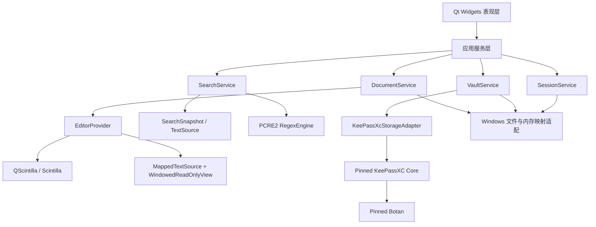
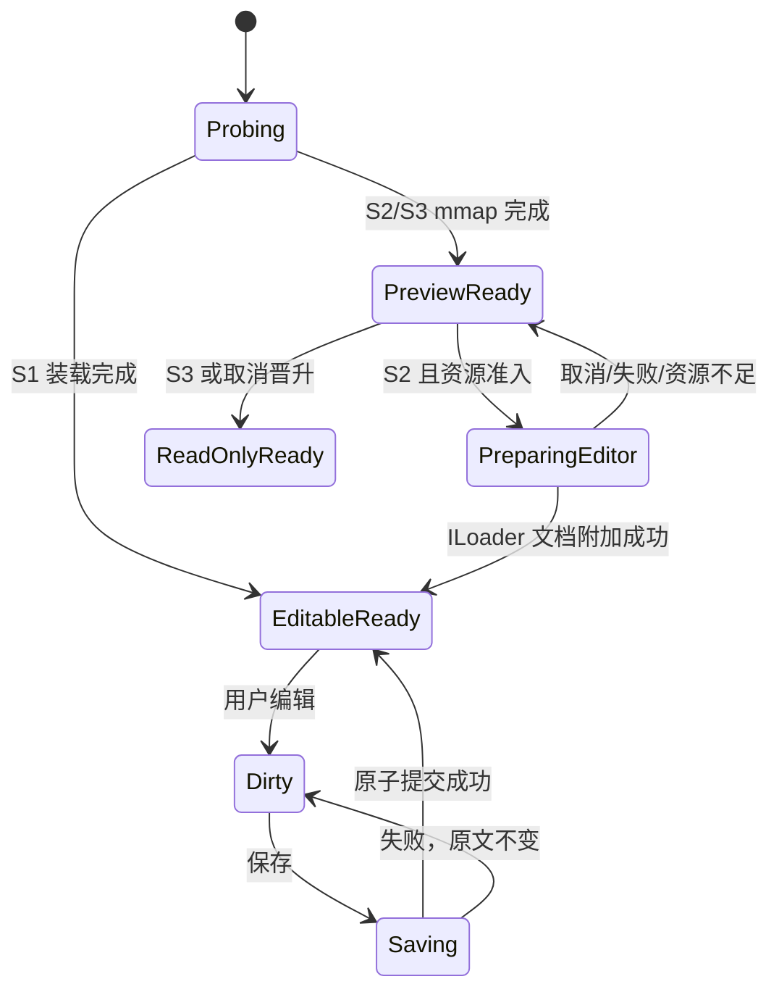
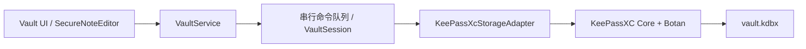

# Notepad Safe 架构设计

> 状态：已决策，作为后续开发的唯一架构基线
> 版本：1.0
> 更新日期：2026-08-14
> 产品许可证：GPLv3

本文替代旧版“L1/L2 + mmap + Patch 编辑”方案。旧代码仍可用于回归和迁移，但不再代表目标架构。

## 1. 产品目标与边界

Notepad Safe 是 Windows 优先的 Qt 桌面产品，提供两组核心体验：

1. 接近 Notepad++ 的多标签文本编辑、编码、搜索、替换和会话体验。
2. 基于 KeePass/KDBX 生态的加密笔记与账号保险库。

大文件能力分为三档：

| 档位 | 判定 | 产品能力 |
|---|---:|---|
| S1 标准编辑 | 小于 32 MiB | Scintilla 完整编辑，全部编辑功能 |
| S2 大文件编辑 | 32 MiB 至 2 GiB（含） | mmap 立即只读预览；后台准备完整 Scintilla 文档；资源允许后晋升为完整编辑 |
| S3 超大文件分析 | 大于 2 GiB | mmap/分段 mmap 只读查看、导航、字面搜索和正则搜索；不编辑、不替换 |

边界统一使用二进制单位：32 MiB = 32 × 1024² 字节，2 GiB = 2 × 1024³ 字节。编码转换可能扩大文本时，以 max(文件字节数, 预计 UTF-8 编辑字节数) 进行编辑档位判定。

### 1.1 当前阶段不做

- 不从零开发文本编辑内核。
- 不再扩展 mmap + PatchList 为通用编辑器。
- 不修改 Scintilla 的存储内核以直接编辑 mmap。
- 不设计自有密码学算法或自有加密文件格式。
- 不在 MVP 中实现云同步、浏览器自动填充、移动端和 2 GiB+ 编辑。
- 不承诺任意硬件都能把接近 2 GiB 的文件完整装入编辑器；资源不足时保持可用的只读分析模式。

## 2. 架构决策

| 编号 | 决策 | 原因 |
|---|---|---|
| ADR-001 | Qt/C++ 是正式桌面主线 | 与现有 Qt/QScintilla UI 一致，减少跨语言秘密数据和 IPC 边界 |
| ADR-002 | Scintilla 是编辑内核供应商，QScintilla 是可替换 Qt 适配层 | 保留成熟编辑体验，同时避免被包装层版本锁死 |
| ADR-003 | KeePassXC Core + Botan 是 KDBX 生产实现 | 写入、历史、附件、KDF 和兼容性成熟；不自行实现密码学 |
| ADR-004 | Rust/Tauri 保险库保留为原型，不进入正式桌面构建 | 当前 keepass-rs 写入成熟度和现有 Qt 产品边界不匹配 |
| ADR-005 | S2 使用“mmap 预览 + ILoader 后台装载 + 单向晋升” | 兼得快速打开和成熟编辑，避免 Patch 编辑器复杂度 |
| ADR-006 | S3 永久只读 | 保留十几 GiB 日志分析价值，不承担编辑器内核重写成本 |
| ADR-007 | 正则统一为 PCRE2 | 三档语义一致；不混用 Scintilla 正则、QRegularExpression 和自制分块语义 |
| ADR-008 | 加密笔记是标准 KDBX Entry，不发明第二种保险库格式 | 保持 KeePass/KeePassXC 互操作和可恢复性 |

## 3. 总体分层



依赖只能从上向下。UI 不得直接访问 QFile mmap 指针、Scintilla 文档指针、KeePassXC Database/Entry 或密码字节。

### 3.1 目标构建目标

| CMake target | 职责 |
|---|---|
| notepadsafe_domain | 无 UI 的文档、搜索、保险库领域类型 |
| notepadsafe_editor | ScintillaGateway、编辑文档、窗口化只读视图 |
| notepadsafe_search | TextSource、搜索快照、PCRE2、结果存储 |
| notepadsafe_vault | VaultService、KeePassXC 适配器、安全剪贴板 |
| notepadsafe_platform | mmap、原子替换、文件身份、进程安全设置 |
| notepadsafe_app | Qt Widgets、命令、菜单、Dock 和组合根 |

## 4. 供应链与版本治理

### 4.1 战略上游

| 上游 | 角色 | 2026-08 基线 | 策略 |
|---|---|---|---|
| Qt | UI、线程、平台抽象 | 当前构建 6.11.x | 固定补丁版本；Qt 与编译器 ABI 成套升级 |
| QScintilla | Qt 编辑器适配 | 2.14.1 | 过渡性锁定；只通过 ScintillaGateway 使用底层指针 API |
| Scintilla | 编辑器内核 | 当前随 QScintilla vendoring；未来独立锁定稳定版 | 作为真正战略上游；后续可替换为直接 Qt 端口 |
| KeePassXC | KDBX 读写和领域实现 | 2.7.12 为首个集成候选 | 固定 release tag/commit；只通过适配器访问 |
| Botan | KeePassXC 密码学依赖 | 由固定 KeePassXC 版本约束后锁定 | 不单独抢跑大版本；Botan 2 已 EOL，不新增 Botan 2 基线 |
| PCRE2 | 统一正则引擎 | 10.47，与 Qt 6.11.1 内置版本对齐 | 直接静态链接同版本的 8/16 位库，统一搜索语义 |
| zlib/minizip 等 | KDBX 传递依赖 | 随 KeePassXC 基线确定 | 在锁文件中展开记录，不视为“隐式依赖” |

“最新版本”不是构建输入。所有生产构建只读取仓库中的供应链锁文件。

### 4.2 供应链锁文件

仓库中的 `third_party/dependencies.lock.json` 是机器可读的唯一锁文件，每个组件至少记录：

```yaml
- name: keepassxc
  version: 2.7.12
  revision: refs/tags/2.7.12
  source: https://github.com/keepassxreboot/keepassxc
  archive_sha256: TBD
  signature: verified
  license: GPL-2.0-or-later
  patches: []
  build_options: [static, core-only]
```

同时保存上游源码归档或只读 subtree，支持离线、可重复构建。禁止构建时从 develop/master 或网络自动拉取源码。所有本地补丁放在 third_party/patches/<component>/<version>/，附原因、上游 issue 和删除条件。

当前 QScintilla 包的版本是明确的，但其内嵌 Scintilla 的文档版本与实际 API 集合不能作为可靠的独立版本标识；首次治理时必须补充源树 hash、接口清单和编译选项，不能只写“Scintilla 版本未知”。

### 4.3 更新流程


规则：

- Qt/QScintilla/Scintilla 与 KeePassXC/Botan 不在同一常规变更中升级。
- KeePassXC 升级必须通过双向 KDBX golden corpus：旧版本创建、新版本打开保存、KeePass/KeePassXC 再次打开。
- Scintilla 升级必须通过编辑命令、IME、编码、撤销、32 MiB 边界、ILoader 和性能基线。
- PCRE2 升级必须通过三档同语义正则语料和 ReDoS 资源限制测试。
- 例行依赖每季度评估；严重安全问题立即评估，不能等待季度窗口。
- 发布产物生成 SPDX/CycloneDX SBOM、源代码对应物、构建器版本和 SHA-256。
- 任一升级都保留上一套锁文件和可安装包，数据库格式升级默认保持向后可读，不静默进行不可逆迁移。

### 4.4 退出策略

- QScintilla：EditorProvider 和 ScintillaGateway 隔离后，可迁移到上游 Scintilla Qt 控件。
- KeePassXC：VaultService 不暴露上游类型，可替换 KDBX adapter；KDBX 文件仍是用户的退出格式。
- PCRE2：SearchQuery/SearchResult 不暴露 pcre2_code 指针，允许替换实现，但产品正则语义必须保持。

## 5. 文档状态机



每个异步结果携带 DocumentId、Revision 和 CancellationToken。结果到达时 revision 不一致则丢弃，禁止旧搜索或旧装载覆盖新状态。

## 6. S1：小于 32 MiB 的标准编辑

- 使用后台 Scintilla ILoader 装载，完成后在 UI 线程通过 pointer-sized ScintillaGateway 附加文档。
- 不再执行 QFile::readAll → QString → QByteArray → SCI_APPENDTEXT 的多重复制和 UI 串行追加。
- 默认启用完整撤销、语法高亮、折叠、换行、多选和书签。
- 文件读取、编码识别和 UTF-8 流式转换在 worker 完成；Scintilla UI 对象只在主线程使用。
- ILoader 由单个 worker 顺序 AddData。一个文件不使用多个线程向同一个 loader 写入。

## 7. S2：32 MiB 至 2 GiB 的大文件编辑

### 7.1 打开流程

1. FileProbe 读取文件身份、大小、BOM、编码样本和可用内存。
2. MappedTextSource 立即映射文件；全量映射失败则使用 1 GiB 对齐的分段映射。
3. WindowedReadOnlyView 将光标附近窗口装入只读 Scintilla，先显示内容，不等待全量行索引。
4. SparseLineIndex 在后台单线程顺序扫描；滚动条以字节位置工作，因此索引未完成也可自由滚动。
5. 通过资源准入后，后台 ILoader 构建完整 Scintilla 文档。
6. 完成后 UI 保存当前全局 byte offset/选择，附加新文档并恢复到对应位置；切换是单向的。

预览期间可以滚动、复制、跳转、字面搜索和正则搜索，但编辑、粘贴和替换保持禁用。用户可以取消“准备编辑”，继续只读分析。

### 7.2 资源准入

2 GiB 是功能上限，不是无条件内存承诺。ResourceAdmission 估计：

- 解码后文本容量。
- Scintilla 文本、行结构和最小样式开销。
- 保存/搜索临时预算。
- 撤销预算和系统保留内存。

只有预计峰值不超过物理内存的 60%，且系统仍能保留至少 2 GiB 可提交空间时自动晋升。用户可在 2 GiB 内请求强制准备，但仍不能越过会导致系统失稳的硬性保留线。推荐 64 位系统、16 GiB 起步，接近 2 GiB 文件推荐 32 GiB RAM。

### 7.3 分级关闭昂贵功能

| 预计编辑字节 | 默认能力 |
|---:|---|
| 32–128 MiB | 完整编辑；语法高亮可用 |
| 128–256 MiB | 高亮只按可见区/增量进行；关闭全文重着色 |
| 256 MiB–2 GiB | 默认关闭语法高亮、折叠、自动换行、文档地图和全文件变化历史 |

用户可以手动开启部分功能，但 UI 必须显示内存影响。撤销内存使用独立预算，默认 min(512 MiB, 物理内存 10%)；达到预算后建立保存点并明确提示，不允许静默耗尽系统内存。

### 7.4 Scintilla 接入约束

- 使用 SCI_CREATELOADER / ILoader::AddData / ConvertToDocument / SCI_SETDOCPOINTER。
- loader worker 不访问 QWidget，不发送普通 QScintilla long 返回值承载指针。
- ScintillaGateway 使用 SCI_GETDIRECTFUNCTION + SCI_GETDIRECTPOINTER，所有位置和指针采用 intptr_t、uintptr_t、Sci_Position。
- 装载阶段使用 SC_DOCUMENTOPTION_STYLES_NONE；需要高亮时再创建样式数据。
- 装载完成前禁用 undo，附加后清空装载历史并建立 save point。

### 7.5 保存与外部冲突

- 从 Scintilla 按固定窗口流式读取，按原编码流式编码到同目录随机临时文件，不构造整文件副本。
- FlushFileBuffers 后使用 ReplaceFileW/等价原子替换；失败保留临时文件并保持原文件不变。
- 打开时记录文件 ID、大小、mtime 和首尾采样 hash；保存前变化则进入冲突状态，不静默覆盖。
- 大规模替换如果预计撤销成本超预算，使用“离线流式替换 → 备份 → 原子提交 → 重新加载”，并明确说明不能用 Ctrl+Z、只能从备份恢复。

## 8. S3：大于 2 GiB 的超大文件只读分析

S3 复用 MappedTextSource、WindowedReadOnlyView、SparseLineIndex 和 SearchService，但永不创建完整 Scintilla 文档。

支持：

- 立即打开、按字节比例滚动、行号逐步精确化。
- 跳转 byte offset、已知行号、文件头尾和搜索结果。
- 有界复制、导出选择、导出匹配行。
- 字面搜索、完整 PCRE2 正则、结果 Dock、取消和进度。
- 日志 tail/follow 可作为后续增量功能。

不支持：

- 编辑、粘贴、替换、自动保存、撤销。
- 全文语法高亮、自动换行、代码折叠、文档地图。
- 单行无限制渲染；超长行按窗口显示，复制/导出仍流式读取完整范围。

### 8.1 窗口化显示

WindowedReadOnlyView 保留 Scintilla 的字体、选择、IME、行号和 indicator 绘制，但只装入光标附近的窗口：

- 默认 16 MiB，可按机器在 8–32 MiB 调整。
- 光标进入窗口前后 25% 区域时异步预取下一窗口。
- 窗口边界对齐完整字符和尽量完整的行。
- 全局位置始终是 64 位原文件 byte offset；局部 Scintilla offset 仅存在于视图内部。

旧 L2ScintillaBridge 的“显示窗口”部分可以迁移；diff 回写 PatchList、虚拟坐标编辑和 patch 保存链全部废止。

### 8.2 稀疏行索引

SparseLineIndex 每固定行数保存一个 64 位锚点，并为可见窗口建立短期行缓存。它不再为每一行永久保存偏移，因此十几 GiB、数亿行文件不会产生同量级索引内存。

- 后台按磁盘顺序单线程扫描，避免多线程争抢页缓存。
- 索引未完成时滚动使用 byte offset，行号显示“约”或“计算中”。
- 搜索结果先保存 byte offset，行列号按需由最近锚点计算。
- 文件变化后旧索引按文件身份失效；稳定格式的索引缓存可在后续版本加入。

## 9. 统一搜索与正则

### 9.1 查询契约

SearchQuery 包含 pattern、Literal/Regex、大小写、整词、方向、范围、编码策略和结果上限。SearchMatch 使用 64 位 startByte/endByte，并携带 DocumentId、Revision；UI 不使用 int 保存文件位置。

三档文件统一经过 SearchService：

| 文档状态 | 搜索快照 |
|---|---|
| S1 | 小型内存 UTF-8 快照 |
| S2 预览或未修改 | 原文件 mmap |
| S2 已编辑 | 按 revision 复用或异步生成只读搜索快照 |
| S3 | 原文件 mmap/分段 mmap |
| KDBX 加密笔记 | 仅内存快照，绝不写明文搜索临时文件 |

S2 生成快照时，主线程以短小批次从 Scintilla 取数据，后台写入 delete-on-close、仅当前用户 ACL 的临时文件；文档继续变化则取消并丢弃快照。未修改文档直接搜索原 mmap，不复制。

### 9.2 字面搜索

- 大小写敏感和 ASCII 不区分大小写可以多线程分块。
- overlap 精确等于 needleBytes - 1；结果只归属“起点位于本块核心区”的 worker，避免漏报和重复。
- Unicode 大小写折叠或复杂整词规则无法保证按原始字节独立分块时，自动转入 PCRE2 顺序路径。
- 线程数默认 min(逻辑核心数, 8, 实际块数)，I/O 慢时允许自适应降低。

### 9.3 正则搜索

产品正则方言固定为 PCRE2 10.47。Qt/QRegularExpression 可用于 UI 校验，但搜索执行统一走 RegexEngine 的 PCRE2 8/16 位接口。

任意正则不采用固定 overlap 并行分块。原因是 .*、多行模式、可变长度量词、lookaround 和反向引用的最大匹配跨度可能无界，固定 4 KiB/64 KiB overlap 都会产生静默漏报。

默认正确路径：

1. 对稳定、逻辑连续的快照编译一次 pattern。
2. 在 worker 中从起始 offset 顺序 global match，不复制整个 mmap。
3. 零长度匹配按一个 Unicode code point 前进，防止死循环。
4. 使用 match/depth/heap limit 和自动 callout 检查取消，约束灾难性回溯。
5. 达到资源限制时返回“正则资源超限”，不伪装为“没有匹配”；用户可提高单次任务限制后重试。

只有静态分析证明不跨行、无回溯引用、无 lookaround 且测试语料验证等价的安全子集，未来才允许并行；优化失败自动回退顺序路径。

### 9.4 结果存储和高亮

- 默认内存保存 offset/length，不复制匹配文本；上下文在可见时按需读取。
- 结果很多时使用当前用户 ACL、delete-on-close 的二进制 offset spool；不写行文本。
- 结果数量、内存和磁盘均有可见预算；超限时停止收集但继续维护“至少 N 条”状态，提示用户收窄查询。
- KDBX 内容不落 spool，只允许内存结果上限。
- 高亮只应用于当前可见窗口和有限邻域，禁止在 GiB 文件上创建每个匹配的永久 indicator。

### 9.5 替换

- S1/S2 EditableReady 才允许替换；S2 预览和 S3 禁止替换。
- 替换计划绑定 revision；提交前 revision 变化则作废并重新搜索。
- 可承受的替换从高 offset 向低 offset 应用，锁定编辑输入并放入一个 Scintilla undo action；取消时回滚整个 action。
- 超过撤销/时间预算时只提供“预览差异 → 流式生成临时文件 → 备份 → 原子替换 → 重载”。
- 替换语法规范化为 $1、${name}；UI 可接受 \1 并在提交前转换，避免不同引擎语义漂移。

## 10. 加密笔记与账号保险库

### 10.1 文件与数据模型

正式存储格式为 KDBX 4.x，首个兼容目标是 KeePassXC 2.7.12。默认 KDF 使用 Argon2id，由上游能力按目标解锁时间校准；默认外层密码算法采用 KeePassXC 推荐的 AES-256 选项。完整性、header authentication 和 protected fields 由 KDBX/KeePassXC 实现，不替换为自制 AES-GCM 容器。

保险库类型映射：

| 产品对象 | KDBX 映射 |
|---|---|
| 账号密码 | 标准 Entry：Title、UserName、Password、URL、Notes、Tags |
| 加密笔记 | 标准 Entry；正文写 Notes；属性 NotepadSafe.Type=SecureNote |
| 分组/笔记本 | 标准 Group |
| 历史版本 | KDBX Entry History |
| 自定义字段 | 标准 custom attributes，敏感字段标记 protected |
| 附件 | KDBX binary/attachment，MVP 先限制体积 |

即使其他 KeePass 客户端不认识 NotepadSafe.Type，也仍能看到标题和 Notes 正文。单条笔记推荐不超过 4 MiB，MVP 硬上限 32 MiB；超大日志和任意大文件不塞入 KDBX Entry，后续另立经过评审的需求。

### 10.2 服务边界



- VaultSession 在专用串行执行上下文中独占上游 Database；不跨线程共享 KeePassXC 可变对象。
- UI 只得到 EntrySummary 或脱敏 EntryDetails，列表 API 永不返回密码。
- 密码通过短生命周期 SecretLease 按需显示/复制，到期清零并通知 UI 隐藏。
- 日志、异常、Qt signal、崩溃报告和任务描述禁止包含主密码、Entry 密码、TOTP seed 或笔记正文。
- KeePassXcStorageAdapter 是唯一可以 include KeePassXC 内部头文件的产品模块。

### 10.3 创建、解锁与锁定

创建：

1. 收集主密码；可选 key file/硬件密钥在后续里程碑加入。
2. 使用 KeePassXC 的 KDBX 配置与 Argon2id 校准创建数据库。
3. 写同目录临时 KDBX，flush，重新打开验证，再原子替换目标。
4. 建立默认 Credentials 和 Secure Notes 分组。

解锁在高优先级 worker 中执行。成功前 UI 不获得部分解密对象；失败只返回分类错误，不区分足以帮助口令枚举的细节。

以下事件触发锁定：用户命令、空闲超时、Windows 工作站锁定、休眠、退出；最小化锁定由用户设置。锁定会关闭编辑器、清空搜索结果和密码租约、清理剪贴板、销毁 VaultSession，并尽力清零产品持有的秘密缓冲区。

### 10.4 加密笔记编辑

- SecureNoteEditor 复用 S1 Scintilla 体验，但属于 VaultSession，不绑定普通文件路径。
- 禁止普通 SessionManager 把正文写到 session.json、autosave/*.tmp 或搜索 spool。
- 自动保存通过序列化的 KDBX 保存事务完成，采用修改 debounce；切换条目、锁定和退出前强制完成或明确报告失败。
- 崩溃恢复依赖最近成功的 KDBX 原子保存和 Entry History，不创建明文恢复文件。
- Vault 锁定时，编辑 widget 销毁而不是隐藏复用；相关 QByteArray/QString 生命周期尽量缩短。

### 10.5 KDBX 安全保存

1. 在目标同目录创建随机临时文件，权限仅当前用户。
2. 由 KeePassXC Core 完整写入 KDBX；禁止 QSaveFile 的直接写回退。
3. FlushFileBuffers，使用当前 composite key 重新打开临时库并做结构校验。
4. 使用 ReplaceFileW 原子替换，并保留轮换的加密 .bak。
5. 替换失败时原数据库不变，临时密文可供恢复；绝不留下明文数据库。

保存前检查文件身份和 mtime。检测外部修改时进入冲突 UI；MVP 支持另存为/重新加载，自动合并在有 KDBX merge golden tests 后再开放。

### 10.6 威胁模型

保护目标：磁盘数据库、备份和云端副本泄露；误把秘密写入日志/会话/临时文件；崩溃中断保存；剪贴板遗留；空闲未锁定。

非目标：拥有管理员/内核权限并能读取进程内存的恶意软件、已控制的输入法/屏幕录制、用户主动导出明文后的保护。产品应复用 KeePassXC 的内存与 Windows 加固措施并禁用非必要 crash dump，但不作无法兑现的“内存绝对不可读”承诺。

## 11. 异步任务与优先级

现有 AsyncTaskManager 保留为任务展示和取消入口，但业务通过窄接口提交任务，不直接传裸 mmap/Database 指针。

| 优先级 | 任务 |
|---|---|
| P0 | 锁定、保存失败恢复、用户取消 |
| P1 | 保险库解锁/保存、交互式 find next |
| P2 | S1/S2 文档装载、用户发起 find all |
| P3 | SparseLineIndex、预取、语法增量高亮 |
| P4 | 依赖扫描、缓存清理等维护任务 |

主线程单次工作目标小于 16 ms，硬上限 50 ms；超过 500 ms 的任务必须有进度/不确定进度状态和取消。取消是协作式的，worker 每个 I/O 块或可控匹配步骤检查 token。

## 12. 会话、临时数据与隐私分区

| 数据 | 允许持久化 | 位置/规则 |
|---|---|---|
| 普通文件标签状态 | 是 | session.json，只存路径、视图和 revision 元数据 |
| 普通未保存文本 | 是 | 用户可关闭的 autosave；当前用户 ACL |
| KDBX 路径/最后分组 | 是 | 不含正文和密码 |
| KDBX 解密正文/密码 | 否 | 仅进程内存 |
| 普通大文件搜索 offset | 临时 | delete-on-close spool，不含上下文文本 |
| KDBX 搜索结果 | 否 | 仅内存，锁定时清除 |

临时目录按运行实例使用随机 ID。正常退出和下次启动均清理过期非敏感文件；不能依赖“安全删除”保护 SSD 上曾写入的明文，因此秘密数据从设计上不落盘。

## 13. 测试与验收

### 13.1 必须建立的测试资产

- editor-golden：编码、EOL、IME、多选、撤销、长行、边界大小和保存往返。
- search-golden：同一语料在 S1、S2 mmap、S2 编辑快照、S3 上产生相同结果；包括跨 16 MiB 边界和零长度正则。
- regex-adversarial：灾难性回溯、深层递归、巨大捕获、无界跨行和取消。
- kdbx-golden：KDBX3/4、AES/ChaCha20、Argon2d/id、key file、历史、附件、自定义字段、Unicode、损坏/截断文件。
- interoperability：Notepad Safe 创建/修改后由 KeePass 和 KeePassXC 打开；反向亦然。
- fault-injection：磁盘满、断电点、ReplaceFileW 失败、外部修改、错误密码、取消解锁。
- fuzz：KDBX 解析入口、编码检测、正则替换解析和 session 元数据。

### 13.2 性能验收基线

在固定硬件、固定语料和冷/热缓存分别记录，不写无法复现的单一宣传数字。

| 指标 | 目标 |
|---|---|
| S2/S3 首屏可见 | NVMe 常规机器小于 500 ms，不等待全量索引 |
| UI 最长事件 | 正常小于 16 ms，任何路径小于 50 ms |
| 取消反馈 | 小于 100 ms；单次受限正则不得无限阻塞 |
| S2 编辑晋升 | 吞吐和峰值内存纳入版本基线；升级不得退化超过 10% |
| 10+ GiB 滚动 | 预取命中时保持交互流畅，无全文件复制 |
| KDBX 保存 | 任意注入失败点均保留一个可验证的旧库或新库 |

2 GiB 编辑验收使用 32 GiB RAM 的 64 位基准机；16 GiB 机器验证资源不足时正确退回只读，而不是交换风暴或进程崩溃。

## 14. 现有代码处置

| 现有模块 | 处置 |
|---|---|
| QsciScintilla 编辑体验 | 保留，收敛到 EditorProvider/ScintillaGateway |
| VirtualFileView mmap 和窗口显示 | 保留验证成果，重构为只读 WindowedReadOnlyView |
| LineIndex | 改为 SparseLineIndex；不永久索引每一行 |
| PatchList 及冷/热溢出 | 冻结，仅保留到迁移测试完成；目标代码删除 |
| L2ScintillaBridge | 保留下拉显示；删除 diff/flush/坐标编辑链 |
| LargeFileSearch | 提取 TextSource；字面搜索保留并修正边界；正则改为统一 PCRE2 顺序正确路径 |
| DynamicThresholds.L1_EDIT_LIMIT | 已由固定 32 MiB/2 GiB 的 FileTierPolicy 替代；动态值只用于资源预算和线程数 |
| CryptoTask 占位 AES-GCM 方案 | 已删除，替换为 VaultService/IVaultBackend 安全边界；KeePassXC adapter 待接入 |
| Rust vault-core/Tauri | 不进入 Qt 产品构建；保留在父仓库供参考，后续单独决定归档 |

迁移准入阶段已经用统一 `FileTierPolicy` 取代运行入口中的 `L1_EDIT_LIMIT`：32 MiB 是 S1/S2 精确边界，2 GiB 是 S2/S3 精确边界；`ResourceAdmission` 已形成无分配、可重复测试的保守估算策略。当前 S2 晋升执行器和 S3 UI 强制只读尚未接入，因此分类完成不等于对应体验已经完成。

## 15. 开发顺序

| 阶段 | 交付物 | 完成条件 |
|---|---|---|
| P0 架构与供应链地基 | 本文、依赖锁格式、模块 CMake 边界、FileTierPolicy | 干净构建；旧 Patch 路径冻结 |
| P1 KDBX 核心 | 固定 KeePassXC/Botan、VaultService、创建/解锁/原子保存、兼容语料 | KeePass/KeePassXC 双向打开；故障保存安全 |
| P2 保险库核心体验 | 账号 CRUD、加密笔记、历史、自动锁、安全剪贴板、内存搜索 | 无明文 autosave/日志；锁定清理通过测试 |
| P3 编辑装载重构 | ScintillaGateway + ILoader；S1 后台装载 | 100 MiB 不再通过 UI SCI_APPENDTEXT 串行加载 |
| P4 S2 大文件编辑 | mmap 首屏、资源准入、后台晋升、流式保存 | 32 MiB/2 GiB 边界和失败回退通过 |
| P5 S3 分析与统一搜索 | 窗口化只读、SparseLineIndex、PCRE2、结果虚拟化 | 10+ GiB 查看/搜索稳定；跨块正则不漏报 |
| P6 清理 | 删除 Patch 编辑链和失效测试，补齐 SBOM/升级自动化 | 无生产路径引用 PatchList |

P1/P2 优先于新的超大文件实验。P3–P5 只按本文既定路线实现，不再同时探索多套编辑内核。

## 16. 上游资料

- Scintilla 文档与发布历史：https://www.scintilla.org/ScintillaDoc.html
- QScintilla：https://riverbankcomputing.com/software/qscintilla/
- KeePass KDBX：https://keepass.info/help/kb/kdbx.html
- KeePassXC：https://github.com/keepassxreboot/keepassxc
- Botan：https://botan.randombit.net/
- Qt QRegularExpression/PCRE2：https://doc.qt.io/qt-6/qregularexpression.html
