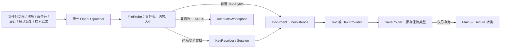

# Notepad Safe 目标体验与动态验收参考

> 状态：目标模式规范；后续自主探索、实现和 GUI 验收的产品参考
> 版本：1.0
> 更新日期：2026-08-17
> 配套架构：`docs/DESIGN.md` 3.1

成熟产品/上游组件的采用与拒绝边界见 `docs/REFERENCE_BASELINE.md`；自主迭代顺序和发布停止条件见 `docs/ITERATION_ROADMAP.md`。

## 0. 文档职责

`DESIGN.md` 决定安全边界、文件格式、模块边界和开发顺序；本文决定用户最终应该感受到什么，以及怎样证明这种体验真的存在。两者共同构成开发基线：

- 架构、安全或数据兼容冲突时，以 `DESIGN.md` 为准。
- 控件布局、操作连续性、功能可达性和用户旅程验收时，以本文为准。
- 代码存在、单元测试通过、worker 返回成功、可以跳到一个大文件偏移，都不能单独证明体验完成。
- 每项用户可见能力必须在正式 `notepad-safe.exe` 中由真实键盘/鼠标操作，并验证实际渲染内容、焦点、选择、文件结果和重启结果。

本文参考 Windows Notepad 的低认知负担、Notepad++ 的文本编辑/编码/搜索结果习惯、VS Code 的标签恢复和搜索信息架构、成熟 Hex 编辑器的 offset/数值/字符三栏模型，以及 KeePassXC 的账户条目和秘密按需访问方式。Notepad Safe 不复制这些产品的全部功能；它只继承与本产品目标相符的成熟交互预期。

## 1. 产品承诺

一句话目标：**文件离线时默认安全，可信用户使用时就是一个反应直接、行为可预测的记事本。**

产品必须同时满足四条承诺：

1. **普通文件不受加密架构拖累。** 打开普通文本时获得完整记事本体验；打开未知二进制时获得完整 Hex 体验；大文件按能力分级，但浏览、搜索和状态反馈仍可预测。
2. **安全 Note 不使用第二套编辑器。** 解锁后的 Text/Binary payload 进入与普通文件相同的 Document、EditorProvider、搜索、撤销、主题、菜单和状态栏路径；差异只存在于打开前的解锁与保存后的密文持久化。
3. **账户不是拼接的保险箱。** 账户管理是与文档并列的中央工作区，共享身份、会话、恢复和视觉系统，但使用适合账号条目的列表/详情交互，不伪装成文本文件。
4. **日常操作不要求理解加密。** 新建默认安全；打开只有一个入口；保存保持当前类型；只有“另存为”承担安全文档与普通文件之间的显式转换。
5. **文件大小不产生第二套编辑器。** S1/S2/S3 Text 共用同一 EditorSurface，B1/B2/B3
   Binary 共用同一 HexView；Tier 只改变数据源、任务状态和写入 capability。字体、gutter、
   正文、滚动条位置、选择、搜索高亮、菜单和主题必须一致；S2/S3 始终是同一只读表面。

不追求的范围：IDE 调试器、终端、语言服务器、工程构建、Git 工作流、远程开发、插件市场、云同步和浏览器自动填充。参考 VS Code 是为了学习编辑、恢复、搜索和状态反馈，不是把产品扩展成 IDE。

## 2. 四个正交维度

“文本/Hex”“普通/加密”“小/大文件”“锁定/解锁”不得继续混成条件分支。一个打开目标由四个正交维度描述：

| 维度 | 值 | 决定什么 |
|---|---|---|
| ContentKind | Text / Bytes / Accounts | 用户在操作正文、原始字节还是账号条目 |
| PersistenceKind | PlainFile / SecureKdbx / SecureDraft / AccountsKdbx | 保存、恢复、冲突检测和格式转换 |
| Presentation | Text / Hex / Accounts | 屏幕如何呈现内容；Text/Hex 可由用户重新解释 |
| ProviderState | S1 Editable / Large ReadOnly / Locked | 当前可用命令和资源状态 |

核心不变量：



加密是 Persistence 的属性，不是编辑器类型；Text/Hex 是 Presentation 的属性，不是文件是否加密的标识。安全 Text 解锁后与普通 Text 共享编辑体验，安全 Binary 解锁后与普通 Binary 共享 Hex 体验。

## 3. 所有入口必须收敛

下列入口必须经过同一个 `OpenDispatcher`，得到相同的探测、解锁、大小分级、错误和最近文件行为：

| 输入路径 | 目标行为 | 禁止行为 |
|---|---|---|
| Ctrl+O / 文件 > 打开 | 多选任意文件；按文件头和内容路由 | 让用户先选“打开加密文件/文本/二进制” |
| Windows Shell / 命令行参数 | 首帧显示后渐进打开；与 Ctrl+O 相同 | 为命令行维护简化探测路径 |
| 拖放到窗口或标签区 | 默认打开成新标签；多个文件保持顺序 | 因编辑器可接收文本拖放而误插入路径字符串 |
| 最近文件 | 重新 Probe；文件类型或内容变化后重新路由 | 复用旧标签类型猜测 |
| 会话恢复 | 先显示 Shell，再按 manifest 渐进恢复 | 启动期间同步读大文件导致无窗口 |
| 搜索结果打开未加载文件 | 先统一打开，等待 Provider ready，再定位 MatchId | Search Dock 直接创建第二套编辑器 |
| “以文本/Hex 重新打开” | 保持同一文件和 Persistence，只改变 Presentation | 把安全 KDBX 的密文字节当普通 Hex 暴露 |
| 外来/历史安全文档 | 当前会话解锁失败才询问该密码域；成功后会话内复用 | 每次打开、保存、搜索都重复询问密码 |

新建和保存路径固定：

- Ctrl+N 创建未命名 SecureDraft/Text，立即进入普通编辑器，不询问格式、路径或密码。
- 未命名草稿的恢复数据始终加密；关闭/崩溃/重启后可以恢复。
- Ctrl+S 对已有文件保持 `PersistenceKind`；安全文件仍为安全文件，普通文件仍为普通文件。
- 未命名文档第一次 Ctrl+S 默认给出安全文档目标；不额外弹“是否加密”。
- Ctrl+Shift+S 是唯一转换入口，明确提供“安全文档”“文本文件”“原始二进制”目标；转换成功后当前标签采用新类型，源文件不被删除。

## 4. 全局编辑器体验不变量

无论普通还是解锁后的安全文档、Text 还是 Hex、S1 还是窗口化 Provider，下列交互成立：

1. 一个视图每个方向最多一条用户可见滚动条；滚动条位置就是正文位置的唯一真值。
2. 鼠标滚轮、触控板、PageUp/PageDown、Home/End、拖动滑块、搜索跳转和恢复位置不能互相争夺位置。
3. 用户每次输入都产生可见且可解释的结果；后台任务不得悄悄把正文跳回旧窗口。
4. 切标签、切主题、打开/关闭 Dock、窗口缩放和 DPI 改变不得丢失 caret、selection、top line 或水平位置。
5. 可编辑状态必须具备成组 Undo/Redo；只读状态从菜单、快捷键、上下文菜单和直接输入四层共同阻止修改。
6. 标签始终显示标题和 dirty 状态；安全状态不依赖常驻锁图标或特殊颜色表达。
7. 状态栏显示当前内容真正有用的信息，不显示实现细节或相互矛盾的两个进度。
8. 错误不伪装成空内容、零匹配或成功；取消与失败都保留原文档和可继续执行的下一步。

## 5. 普通文本与解锁后安全 Text

### 5.1 基础编辑

目标基线接近 Notepad++ 的日常文本体验：

- 键入、删除、换行、Tab、缩进、选择、拖选、双击选词、三击/行选择符合 Windows 编辑器习惯。
- Ctrl+Z/Ctrl+Y、剪切/复制/粘贴、全选、复制行、删除行、上下移动行、排序和书签按菜单能力矩阵启停。
- caret 在 Unicode、组合字符、emoji、CRLF 和文件尾行为稳定；状态栏明确区分字符列、行和 byte position。
- 长行编辑不截断、不静默换行；自动换行只改变呈现，不改变文件内容。
- 关闭自动换行时，水平滚动范围覆盖当前文档最长可见逻辑行；拖到最右端必须能看到该行最后一个字符。
- Shift+滚轮或水平触控手势可以水平滚动；重新启用自动换行后水平条消失且正文不丢位置。
- 垂直滚轮逐步显示相邻行，连续滚动没有重复、缺口、闪回或整页突跳；PageDown 的下一屏与上一屏有稳定视觉锚点。
- 缩放、字体、浅色/深色、选择色、当前行、搜索 indicator 和只读态有足够对比，且安全 Text 不使用另一套主题。

### 5.2 编码、EOL 与语言

- 探测并保留 UTF-8、UTF-8 BOM、UTF-16 LE/BE、GBK、GB18030、Big5、Shift-JIS 与 Windows-1252。所有尺寸级别使用相同的固定总预算头/中/尾采样；无法可靠探测时明确显示当前 UTF-8 回退解释和非法字节状态。
- 外层“以 … 编码显示”只重新解释原始字节，不修改文件。脏的小文件复用保存/取消流程；保存成功后按未修改文件处理，取消则不切换。大文件就地重建当前窗口投影，不完整重开或全量解码。
- 折叠菜单“转换为”始终先另存为新文件，严格验证源编码并严格编码目标；源文件不覆盖，成功后按用户指定的目标编码打开新文件。大文件使用有界流式转换，转换期间源文件变化则不提交目标。
- 状态栏始终显示编码、CRLF/LF/CR、语言、INS/OVR、长度和位置；点击相应 segment 进入同一菜单，不造快捷入口。
- 语言/lexer 只影响呈现；不得改变编码、保存字节或搜索位置。
- 混合 EOL、无结尾换行、NUL、超长行、非法源字节和目标编码不可表示字符需要明确策略和 fixture；普通保存和编码转换都不能静默替换或规范化。

### 5.3 文件生命周期

- 原子保存失败不破坏原文件；磁盘满、权限、文件占用和 rename 失败都保留 dirty 正文。
- 外部修改时统一提示重新加载、另存为或取消；不能无提示覆盖，也不能用旧搜索 offset 跳转。
- 标签关闭、关闭全部、退出、锁定和 Windows 关机路径共享同一保存/恢复协议。
- Session/Hot Exit 恢复标签顺序、活动标签、caret、selection、scroll、Presentation、Dock 和 dirty 内容。
- 普通文件恢复缓存同样加密，避免应用自己的自动恢复把普通/安全正文长期写成明文临时文件。

## 6. 大文件体验

### 6.1 能力分级

| 状态 | 打开后体验 | 编辑/替换 | 搜索 |
|---|---|---|---|
| S1 `<32 MiB` | 完整 Scintilla，立即编辑 | 全部支持 | 当前/全部打开；目录留待发布后独立立项 |
| S2 `32 MiB–2 GiB` | 按需随机读首屏和全文件连续浏览 | 永久禁用 | 与 S3 同一只读搜索路径 |
| S3 `>2 GiB` | 永久窗口化只读分析 | 禁用 | 全文件 literal/产品正则、渐进结果 |

快速打开的定义不是“`openFile()` 很快返回”，而是窗口在预算内显示正确首屏，并立刻响应滚动、搜索和复制。32 MiB 以上不得创建“准备编辑”后台任务或切换到完整 Scintilla 文档。

### 6.2 窗口化浏览连续性

Windowed Provider 是一个无限文档的有限投影，必须模拟普通编辑器的连续空间：

- 窗口至少保留前后 overlap；预取下一窗口后再原子替换显示区，不能在边界先清空或把 caret 重置到局部 0。
- Wheel delta 累积为行/像素意图；一次滚轮不等于重新把锚点放到另一个 2 MiB 块的开头。
- 替换投影时保持 top visual line、caret absolute byte、selection absolute range 和 horizontal pixel offset。
- 文本窗口边界按解码和行边界扩展，不能把多字节字符、CRLF 或超长逻辑行切成两个看似无关的片段。
- 全局纵向滚动条可采用归一化值，但 tooltip/状态栏和所有内部位置必须是 64 位绝对 byte/line；EOF 可达且最后一个 byte 可见。
- 横向 extent 不能只由当前投影中偶然出现的短行决定。超长行跨窗口时，需要 line-aware range、延迟测量或专用长行视图，确保最右内容可达。
- 文件追加时可选择 Tail 模式；用户手工向上滚动即暂停跟随，并提供明确“回到末尾”，不能抢回位置。

### 6.3 S2/S3 统一只读

- 32 MiB 以上始终保持 `Large ReadOnly`，不创建后台编辑文档、不做资源准入、不提供重试晋升。
- 任务中心只显示真实发生的搜索、索引或文件刷新任务，不得出现“准备大文件编辑”。
- Preview 背后不得存在未展示的第二套编辑器或完整文件副本；浏览、搜索和复制共用同一位置真值。

### 6.4 本次方案验证结论与关闭状态

2026-08-17 用户使用正式 `notepad-safe.exe` 验证：单滚动窗口化 Provider 可以浏览完整大文件，S2/S3 方向可行。后续自动化切片又确认长期 mmap/具体文件 watcher 会妨碍 Windows 原子替换，生产预览已改为无持久句柄的按需随机读；该变更不改变全局 64 位位置与有限投影模型。到第 9 轮，以下首轮阻断项均已按默认比例、150% 或实际 200% 的相应矩阵关闭；表格保留为回归总账：

| Issue ID | 当前观察 | 目标结果 | 动态验收 |
|---|---|---|---|
| `LF-UX-001` | **Round 9 已关闭。** 有界投影扩展到完整逻辑长行并跟踪真实水平宽度；全局位置不受窗口切换影响 | 关闭换行时可从行首连续到达最后字符；切换窗口不改变水平位置 | 长行横向 GUI、0/25/50/75/100% 全局位置及实际 200% DPI S2/S3 4/4 通过 |
| `LF-UX-002` | **Round 9 已关闭。** wheel/pixelDelta 在窗口内逐行移动，只在重叠边界换页 | 小幅滚轮显示相邻行；跨窗口无重复、gap、闪回和大跳 | 五个窗口双向滚轮/触控板、末尾稳定等待与 4.59 GiB 搜索跳转通过；`gui-largefile-200dpi-round9.txt` |
| `HEX-UX-001` | **Round 3 已关闭核心阻断。** offset/Hex/编码字符区共用 byte selection，B1 编辑/Undo/保存与搜索跳转已动态验收；字节通配符和 Inspector 留作后续增强 | offset、Hex、字符区、caret、selection、编辑、搜索和保存形成一致模型 | `gui-hex-round3-slice.txt`、`gui-hex-search-final.txt` 与逐字节 round-trip 均通过 |
| `HEX-UX-002` | **Round 9 已关闭。** B1/B2/B3 均按 viewport 选择完整 4-byte 分组；宽窄重排不裁切首末 nibble，也不继承旧横向偏移 | 依据窗口宽度采用合适 bytes-per-row；窄/宽窗口紧凑可读 | 默认/窄宽截图及实际 200% DPI 编辑—保存—重开、崩溃恢复 4/4 通过；`gui-hex-200dpi-round9.txt` |
| `TIER-UX-003` | **部分关闭。** Binary 可见契约已统一：B1/B2/B3 均为地址 margin、纯 Hex 网格、编码字符 pane、两表面同步滚轮和唯一全局纵向滚动条；Binary→Text 后统一切换为十进制 byte-offset gutter 且不构建全文行索引。内部 Provider 仍不同，可信 Text S1/S2/S3 的几何与模式迁移一致性尚未关闭 | Text 各 Tier 共用 EditorSurface；Binary 各 Tier 共用 HexView 可见契约；只允许 capability/状态文案不同 | `windowedHexUsesUnifiedThreeColumnByteContract`、`windowedHexBothPanesWheelInLockstep`、Binary Text byte-offset/零扫描、真实 228MB/4.9GB 样本与 B1 邻接回归通过；Text 同内容切片及 S1 可编辑表面与 S2/S3 只读表面的逐帧几何一致性仍待证明 |

除上述已复现项外，下面是必须主动探索的风险。它们不表示已经观察到缺陷，但在关闭对应旅程前必须用动态测试证明不存在：

| Risk ID | 风险 | 证明不存在所需的动态测试 |
|---|---|---|
| `LF-RISK-003` | 投影重载闪烁、短暂空白或 caret 回到局部 0 | 慢速录制跨五个窗口的 wheel/PageDown；逐帧检测空白帧并记录 absolute caret/top byte |
| `LF-RISK-004` | 选择和复制不能跨 projection 边界 | 从窗口末尾向下拖选到下一窗口，Shift+键盘继续扩展；复制结果与源 byte range 一致 |
| `LF-RISK-005` | 搜索 indicator 在窗口重载后丢失或错位 | 当前文件 Find All 后滚出/滚回多个窗口；每个可见 MatchId 仍高亮，活动命中样式正确 |
| `LF-RISK-006` | 快速跳转时旧 windowReady 覆盖最后一次用户操作 | 连续双击远距离结果、立刻手工滚动；最终停在最后输入，旧 requestId 被丢弃 |
| `LF-RISK-007` | 文件 append/truncate/replace 后继续读取旧内容 | **2026-08-17 核心切片已通过**：追加后自动读到新尾部；原子替换为更小文件后钳制位置并正确显示新头尾。Tail 暂未实现，仍作为后续独立门槛 |
| `LF-RISK-008` | 编码字符、CRLF 或超长逻辑行在窗口边界损坏 | 把 UTF-8/16/GBK、多字节 emoji、CRLF 和 200 MiB 单行分别放在边界前后逐字符核对 |
| `LF-RISK-009` | 全局行号与 byte offset 混淆，Go To/状态栏误导 | 在稀疏索引未完成、部分完成、完成三阶段执行 Go To line/byte 并核对状态栏和正文 |
| `LF-RISK-010` | 归一化滚动条在 10+ GiB 上丢失 EOF 或相邻位置分辨率 | 头/中/尾、最后 1 byte、细拖与键盘微调；确认覆盖完整且 tooltip 给出真实 64 位位置 |
| `HEX-RISK-003` | nibble/字符区 caret 不同步或覆盖错 byte | 对单字节和多字节 fixture 交替从两栏键入、IME、Undo/Redo，逐步核对 caret 与磁盘 byte |
| `HEX-RISK-004` | selection、复制格式、Paste 和 EOF 非完整行有 off-by-one | 覆盖空选择、1/15/16/17 bytes、跨行、跨窗口和 EOF，逐种 Copy As/Paste round-trip |
| `HEX-RISK-005` | 切换 bytes-per-row/DPI 后地址、选择或跳转改变 | 保持同一 absolute selection，依次改变窗口宽度、DPI 和 8/16/32 布局并核对三栏 |
| `ROUTE-RISK-001` | Ctrl+O、拖放、CLI、最近、恢复和搜索结果得到不同 Provider | 同一 fixture 经六条入口打开，比较 ProbeResult、Persistence、Presentation、SizeTier 和菜单能力 |
| `SAVE-RISK-001` | Plain/Secure 转换后标签仍走旧保存路径 | 两方向另存为后继续编辑、Ctrl+S、关闭重开；检查文件头、DocumentId、内容和当前类型 |
| `SEC-RISK-001` | 安全 Note 解锁后缺少普通 Text/Hex 功能或泄露明文状态 | 同内容 Plain/Secure 执行同一 GUI 脚本比较结果；锁定后检查正文、Dock、剪贴板和恢复数据 |
| `ACCOUNT-RISK-001` | 账户 Workspace 与文档快捷键/搜索/dirty 状态串线 | 在账户编辑与脏文档间反复切换，执行 Ctrl+F/Ctrl+S/Ctrl+W/锁定并核对目标与恢复状态 |
| `TASK-RISK-001` | 后台任务显示完成但 Provider/文件未真正完成 | 在 100% 瞬间读取 ProviderState/document length/磁盘 hash；只有提交完成才结束任务 |
| `A11Y-RISK-001` | DPI、键盘和读屏下核心功能不可达 | 100/150/200% DPI 使用键盘-only 完成 Journeys A/C/F/G，并检查 accessible name/focus order |

## 7. Hex 编辑与大二进制浏览

### 7.1 视觉模型

成熟 Hex 视图默认使用三列：固定宽度绝对 offset、字节值网格、编码字符解释。三列共享同一个 byte selection 和纵向位置。

- Offset 足以显示当前文件最大地址，2 GiB+ 不截断；默认十六进制并保持等宽对齐。
- 默认每行 16 bytes；可根据宽度选择 8/16/32 或“动态但只换完整 byte group”，不允许任意折行破坏地址心算。
- Hex bytes 按 4 或 8 分组增强扫描；字符区按当前编码优先还原合法多字节序列，不可打印或非法单元使用不破坏 byte 定位的占位符。
- 窄窗口优先保住 offset 和 Hex；字符列可按设置隐藏。宽窗口若仍有剩余空间，应保持紧凑居左或展示可选 Data Inspector，不把数据稀疏拉伸到难以扫读。
- Data Inspector 是次要工具：只在选中 byte 时显示 unsigned/signed integer、float、endianness 等解释；默认不抢占编辑宽度，也不成为完成 Hex 基础体验的前置条件。

### 7.2 导航、选择和编辑

- 点击 Hex 的高/低 nibble、字符区字符、offset 行区都有确定 caret；左右键按 nibble/byte 前进，上下键保持列。
- Hex 和字符两栏选择完全同步；Shift、鼠标拖选、Ctrl+A、选择范围、Go to Offset 使用 byte range。
- 状态栏显示 absolute offset、selection byte count、INS/OVR、文件大小和 B1/B2/B3 能力。
- Hex 字节网格 Copy 提供人可读 Hex；字符区 Copy 的可见文本按当前编码解码，同时携带应用私有原始 bytes。普通应用获得文本，Notepad Safe 内部粘贴优先使用原始 bytes；Find 粘贴把私有 bytes 转为 Hex 精确查询。
- Hex 字节网格不承载 Unicode 输入法；只接受 `0–9/A–F`。字符区可以使用输入法，但不把 preedit 写进投影；IME commit 和直接文本先按当前显示编码严格编码，合法多字节结果作为一个 byte 事务进入 OVR/INS 与 Undo/Redo，不可表示或控制输入原子拒绝。切回 Text 后保持正常输入法。
- B1 可支持插入和覆盖，并有 Undo/Redo、保存和 hash round-trip。
- B2 固定长度写穿只有在 crash-safe journal、外部冲突、跨窗口撤销和保存测试通过后启用；当前稳定策略是只读单滚动 fallback。
- B3 永久只读；任何键入、Paste、Cut、Delete 和 Replace 都不能修改 mmap 或产生误导 dirty 标记。
- 文件尾的非完整行必须显示全部剩余 bytes；EOF 选择、复制和搜索不能漏最后 1–15 bytes。

### 7.3 Hex 搜索

- 查询类型明确为 Hex bytes 或按当前显示编码解释的 text。当前发布的 Hex bytes 接受连续、空格、逗号、
  连字符、下划线和逐字节 `0x` 写法；byte wildcard 属于后续显式语法扩展，不能在未实现时展示。
- Find Next/Previous、Find All、范围和结果 Dock 与 Text 共用 SearchSession，但 Match 的 PositionSpace 为 SourceBytes。
- 双击结果后必须同时定位 offset、Hex selection 和字符区 selection；不能只滚到大概窗口。
- 当前发布的搜索对话框不提供 Hex bytes Replace；替换输入和两个替换按钮必须灰显，字节修改走
  Hex 编辑器的 INS/OVR、选择、粘贴和 Undo 契约。未来若增加 bytes Replace，需另行定义长度、
  wildcard 捕获和 B1/B2 写入事务，不能误走 Text replacement。

## 8. 搜索、替换和日志分析

### 8.1 单一查询体验

Ctrl+F 打开同一个非模态查找界面。范围默认“当前文件”，用户可明确选择“全部打开文件”；切标签不会暗自把当前文件升级为全局任务。本次发布不显示尚未实现的“文件夹”范围。

查询解释是一个三态状态机，而不是可任意叠加的复选框集合：

| 模式 | 可选项 | 必须灰显并清空 |
|---|---|---|
| Literal | 区分大小写、整词、循环、范围 | 无 |
| Regex | 区分大小写、循环、范围 | 整词、Hex bytes |
| Hex bytes | 循环、范围 | Regex、区分大小写、整词、全部替换控件 |

范围内没有 Binary/Hex target 时 Hex bytes 灰显；查询为空时所有执行按钮灰显；后台 Find All
运行时 query、模式、范围、导航、替换和重复启动全部灰显，只保留取消和关闭。禁用控件必须
经真实点击保持不变，领域层仍防御程序化非法状态。模式切换不得依靠“先允许错误组合、点击后再
互相取消”来维持正确性。

- 查找、F3/Shift+F3、查找全部和替换共享 query、case、whole-word、regex/byte mode 和 scope。
- 当前文件即时高亮所有可见命中，活动命中有独立样式；overview ruler 可显示全文件分布，但不能代替结果列表。
- Find All 立即打开底部 Dock，先显示运行态再渐进追加结果，不等待完整行索引。
- Find Next 从光标向前拿到第一处即选中，不等待 Find All 完成；Find Previous 优先复用已发现索引，
  无前序索引且表达式跨度无界时显示正在向前定位，不能用不安全的固定回看窗口伪造即时答案。
- 全部打开文件按标签/稳定 target 顺序分组；每组显示命中数、状态和失败/跳过原因。未来目录搜索仍须按路径分组并复用同一结果模型。
- 文件组和结果行使用同一位置栏宽度，正文起点一致；结果先完整显示关键词，再从两侧远端裁剪
  上下文。Text 和 Hex 的 hover/selected 都突出整行，关键词 highlight 位于其上且左右/中间基线一致。
- 双击结果必须打开/激活正确标签，等待目标 Provider 窗口 ready，滚动到关键词、选中精确 range
  并在正文保留清晰高亮；导航属于只读视图变化，不得改变 modified/revision 或使结果失效。
- 快速双击两个远距离结果时，最终位置属于最后一次点击；旧异步 request 不能覆盖新请求。
- 百万结果使用虚拟化/分页和有界内存；取消后保留部分结果并标记“不完整”，不能报告为完整零结果。

以下 2026-08-17 记录只证明旧 PCRE2/UTF-8 与 Hex 路径当时覆盖的行为，不是 ADR-022 的准入
证据，也不能替代新的 PCRE2 非 UTF 日志子集合同。正式 GUI 曾直接打开保留的 4,928,168,473-byte S3 样本：在 Hex 模式
输入 75% 位置的 32-byte signature 并点击“查找全部”，对话框先进入可取消的 mmap 准备态，
随后 Dock 得到带 64 位 offset 的唯一结果；真实双击后窗口化正文精确选中跨显示行的 32 bytes，
且仅有一条纵向滚动条。另一全新 S3 标签从“查找下一个”进入相同准备态，首次命中后重复
forward/backward 不再读取隐藏后端的空选区，非循环边界与 wrap 均正确。完整搜索/替换专项为
30 个功能用例全部通过；另以 60,050 个分行结果证明越过 50,000 条常驻上限后，临时 spool 的
最后一行仍能在 Dock 即时显示、高亮并双击到精确正文范围。这项证据不替代可控编码
语料、百万级压力和跨全部锁定入口清理门禁。旧实现对 2 GiB 后的有效 UTF-8 S3 Text Regex 曾证明
大小写不敏感匹配、64 位结果、双击和只读替换边界；当时安全优先的 UTF-8 全量验证 + PCRE2 扫描
当前为两遍读取，本机优化后 59.2 s，应在 UI 中如实呈现进度，不能与 Hex/Literal 性能混为一谈。
Binary/Hex 文档未切到 Text 呈现时，普通文本/byte 查询按原始字节 Literal 执行；不能为了
Unicode case-fold 暗中要求整个二进制文件是有效 UTF-8。切到 Text 呈现后，显示、Literal 和
Regex 必须共用当前编码投影；非法单元以可定位 U+FFFD 参与文本搜索，不再把整份 subject 拒绝。
真实 4.9 GB 样本的
默认复制文本 Find Next 已由 `tc_fr_031` 验证。
同一规则由 `tc_fr_032` 使用确定含非法 UTF-8 的小型 Binary 固化为可移植快速回归。

### 8.2 语义一致性

- Text 的 literal/whole word/产品正则在 S1、S2/S3 ReadOnly 和 Secure Text 上语义一致；物理编码不能改变正则语言。
- Hex 的 byte/text 查询在 B1/B2/B3 和 Secure Binary 上语义一致。
- 搜索不以完整 LineIndex 为启动条件；line/column/context 可以稍后装饰，Match 的 64 位 byte range 先成立。
- 编码转换由 PositionMapper 管理；UTF-8/GBK/UTF-16、中文、emoji、CRLF、跨块和 2 GiB 后的位置都不能用裸 int 猜测。
- S1 正文在应用解码后以显式 UTF-8 进入 QScintilla；S2/S3 仍以原始字节为权威，正则只通过
  storage adapter 按 scalar 读取，不能把 S1 的内部 UTF-8 事实误推广为大文件全文转码。
- 编辑后仅相应 target 结果 stale；过期结果禁止近似跳转，并提供重新搜索。
- 每个 target 的搜索身份包含 revision、编码和 Text/Hex 呈现；切换编码或呈现不能复用旧导航缓存，也不能让旧异步回调选中当前正文。
- Dock 渐进批次和最终结果冻结各自 target 的编码、byte range、上下文和高亮；切换活动标签或 resize 只改变绘制，不重新解码或缩短 Model 内容。
- Secure 内容的 query、context、spool 和结果只存在于受控内存/加密临时数据；立即锁定后全部清除且恢复时不闪现。

### 8.3 替换

- 当前文件 Replace/Replace All 作用于当前可编辑 target，并形成可撤销操作组。
- 全部打开文件先生成 eligible/skipped/failed manifest，再对 S1 和 Secure Text 等兼容目标执行；S2/S3/B2/B3 明确跳过替换。
- 批量替换成功后保持各自 PersistenceKind，只标脏、不自动把安全文件解密保存或把普通文件加密。
- Replace 在当前命中已经选中时先替换该命中，再选择下一处；不得先 Find Next 而跳过用户看到的
  当前项。Literal replacement 中 `$1`、`${name}`、`\1`、`\n` 全部按字面写入；Regex
  replacement 支持 `$0/$1…`、`${name}`、`$$`、`\1`、`\n/\r/\t/\\`，缺失捕获或不完整模板
  在首个字节修改前拒绝。空 replacement 是合法删除，空 query 禁止执行；零长度 Regex 的
  Replace All 在定义出安全推进/Undo 语义前明确拒绝。
- 全部打开文件范围只修改策略可写 Text target；Binary、锁定安全文档和真正只读 Provider
  列入跳过摘要。可编辑 Provider 不能仅因内部实现名为 L2 就被静默跳过；同一 target 能执行
  当前文件替换，就必须通过同一 capability 判定参与全部打开文件替换。
- 文件夹替换必须有独立预览/备份/提交流程；不能把打开文档的 Undo 幻觉扩展到任意磁盘目录。

## 9. 安全 Note 的无缝体验

### 9.1 日常流程

| 用户动作 | 安全 Note 体验 |
|---|---|
| 新建 | 立即获得空白 Text 编辑器；后台 SecureDraft，无格式询问 |
| 首次保存 | 默认安全文档；有效七天会话内不再询问主密码 |
| 再次打开 | FileProbe 识别产品 KDBX；当前会话可解锁则直接进入正文 |
| 编辑/查找/替换 | 与普通同尺寸 Text 使用完全相同 EditorProvider/SearchSession |
| 普通保存 | 加密、原子替换、保持 DocumentId/keyVersion；无“确认加密” |
| 另存为文本 | 唯一显式解密导出；成功后当前标签成为 PlainFile |
| 普通文件另存为安全文档 | 唯一显式加密转换；成功后当前标签成为 SecureKdbx |
| 立即锁定/Windows 锁定策略触发 | 先安全保存或保留加密恢复点，清空正文、结果和密钥租约，显示可恢复遮罩 |

安全 payload 严格小于 32 MiB，因此安全 Text/Binary 始终复用成熟 S1/B1 编辑器，不把 KDBX 与 S2/S3 的资源风险耦合。解密后不能因来源是安全文件而缺少语法、编码、搜索、书签、Undo、主题、状态栏或标签恢复能力。

### 9.2 解锁、历史密码和恢复

- 七天会话是本机当前 Windows 用户的无感钥匙，不是文件唯一钥匙；AppData 全毁后仍能用文件+主密码或恢复密钥解锁。
- 当前会话主密码版本无法打开文件时，才展示窄范围密码/恢复流程，并说明文件、keyVersion 和不会影响当前身份。
- 同一外来密码域在本会话成功一次后可复用；失败不能污染当前主密码，也不能反复弹窗阻塞其余文件搜索。
- 修改主密码只产生新 keyVersion，不批量静默改写历史文件；旧文件按需解析。
- 恢复密钥必须有导出、离机保存、重新验证和清晰的丢失后果；程序不能承诺恢复用户没有保存的唯一秘密。

### 9.3 运行时边界

- 主密钥、FileKey、密码和 TOTP seed 通过短生命周期 SecureBuffer/lease 使用，完成后清零；七天持久化的是 DPAPI capsule，不是七天常驻明文根密钥。
- 编辑器正文在解锁期间必然存在于内存；产品不承诺抵抗同用户恶意进程，但要避免日志、异常、任务标题、swap-friendly 长寿命副本和明文临时文件扩大暴露。
- 密码显示超时，失焦/切后台立即隐藏；剪贴板仅在内容仍是本应用写入值时定时清理。
- 崩溃恢复、搜索 spool、缩略图、最近文本和截图测试不得留下可恢复的安全正文。

## 10. 账户管理体验

账户 KDBX 与安全 Note 共享 SecurityIdentity、KeyResolver、会话、恢复、KDBX 写入事务和运行时秘密约束；它们不共享正文编辑器 UI。

### 10.1 工作区模型

- “账户”是主工具栏和工具菜单中的一级目的地，进入中央工作区；不是右侧/底部 Vault Dock。
- 空态只有说明和一个“新建账号”；有数据时采用搜索 + 条目列表 + 只读详情，窄屏退化为列表→详情导航。
- 默认选中条目进入只读详情，不直接暴露可编辑密码表单；显式“编辑”后才修改。
- 高频动作靠近字段：复制用户名、复制密码、显示密码、复制验证码、打开网站。页面任一状态最多突出两个主动作。
- 搜索标题、用户名、URL、标签和备注，不搜索密码/TOTP seed；列表模型永远不携带秘密。
- 新建/编辑集成密码生成和强度提示；提示不阻止保存导入的旧密码。
- TOTP 展示当前短期验证码和倒计时，不把 seed 暴露给 UI model 或日志。
- 删除先进入回收站；恢复回原组，永久删除只在回收站上下文出现并确认。
- 切离账户、切条目、取消编辑、锁定和应用后台化均释放已显示/编辑的秘密。

### 10.2 与编辑器 Shell 融合

- 文档、账户、安全中心使用同一窗口、主题、导航和身份状态，不同时把账户 Dock 覆盖在编辑器上。
- 切到账户时，文档标签和搜索结果状态保留但文档命令按 capabilities 禁用；Ctrl+F 聚焦账户搜索，Ctrl+S 只在账户编辑 dirty 时保存条目。
- 返回文档后恢复原活动标签、caret、scroll、Find 状态和 Dock 可见性，不把账户查询带入文档搜索。
- 打开产品安全 Note 路由到文档；打开无产品 Note 标记的兼容 KDBX 路由到账户/兼容工作区。两者由文件内部标记决定，不靠扩展名或用户选择“保险箱”。

## 11. Shell、菜单、状态栏和后台任务

顶级菜单固定为文件、编辑、搜索、视图、语言、编码、工具、帮助。工具栏默认只保留新建、打开、保存、查找、账户。每个 QAction 只有一个 CommandId 和一条业务连接，由当前 Workspace/DocumentCapabilities 决定状态。

状态栏按当前上下文显示：

- Text：语言、长度/行数、Ln/Col/byte、EOL、编码、INS/OVR、dirty/只读。
- Hex：文件大小、absolute offset、selection bytes、B1/B2/B3、INS/OVR 或只读。
- S2/S3：档位、只读分析、全局 64 位位置；不显示 Preview/Preparing/Editable/ReadOnlyFallback 等已废止状态，也不显示两个互相冲突的滚动百分比。
- Accounts：不显示文档行列/编码；只显示必要的身份/会话或同步状态。
- 无文档：隐藏上一文件元数据。

后台任务只负责可观察性，不替代正文状态：

- 单个父任务下面展示 Mapping/Index/Search/Decode/Attach/Save 等 phase，避免多个无关联进度条轰炸用户。
- 状态栏 chip 只显示最高优先级摘要；任务中心显示来源、阶段、已处理/总量、速度、取消、错误和重试。
- 有足够样本后显示平滑 ETA；预计或实际超过 30 秒且用户仍可决策时，从状态栏 chip 弹出一次
  非阻塞气泡，引导用户打开对应任务详情并选择继续、取消或任务支持的缩小范围。
- “100%”必须与 Provider/文件提交的真实完成一致；不可取消的原子提交阶段隐藏取消按钮。
- 所有标题和错误脱敏，不包含安全正文、密码、query context 或临时密钥路径。

## 12. 功能总账

以下是目标体验的用户可见总账。每行都必须关联 FeatureId、Command/Widget、capability、自动化和正式进程证据；任何新增按钮或菜单未登记即视为设计遗漏。

| 区域 | 必须具备的能力 | 正式 GUI 最小旅程 |
|---|---|---|
| 新建 | 默认 SecureDraft/Text，无提示 | Ctrl+N→输入→退出→重启恢复→保存为安全文档 |
| 统一打开 | Text/Binary/Secure Note/Accounts KDBX/损坏 KDBX | Ctrl+O、拖放、CLI、最近、恢复逐条验证相同路由 |
| 保存 | 保持类型、原子提交、冲突保护 | Plain/Secure/Raw 各编辑保存重开，注入失败后原文件 hash 不变 |
| 另存为 | Secure/Text/Raw 转换 | 两方向转换、取消、覆盖、上限拒绝、源文件保留 |
| 标签 | dirty、关闭、关闭全部、顺序、溢出、路径 | 20+ 混合标签键鼠切换并重启恢复 |
| Text 编辑 | 输入、选择、Undo、剪贴板、行操作、书签 | 菜单和快捷键各执行，文件 round-trip |
| Text 呈现 | wrap、长行横滚、zoom、主题、lexer | 长行最右字符、主题/DPI、切换后位置保持 |
| 编码/EOL | 检测、重开、转换、BOM、状态栏 | UTF-8/16/GBK 与 CRLF/LF golden 保存重开 |
| S2 | 快速只读、连续浏览、搜索、复制 | 256 MiB 与接近 2 GiB 的头/中/尾浏览；确认无编辑后台任务 |
| S3 | 全范围只读、搜索、Tail 可选 | 4.59 GiB/10+ GiB 滚动、搜索、跳转、取消 |
| Hex | 三栏、nibble/编码字符区、选择、复制、Go to、Find | 单/多字节、非法序列、EOF、跨窗口、B1 写入与 B2/B3 只读 |
| 查找 | 当前/全部打开、literal/regex/byte；目录明确不在本版 | 真实对话框输入、F3、范围切换、取消 |
| 查找全部 | 渐进 Dock、分组、高亮、精确双击 | S1/S2/S3/Secure/Hex 混合文件多位置跳转 |
| 替换 | 当前和 eligible 全部打开、Undo、跳过报告 | Plain/Secure 保持类型，S3 明确跳过 |
| 会话恢复 | 首帧、渐进恢复、加密 Draft、布局 | 强杀进程后恢复混合标签和最后位置 |
| 安全会话 | 首次建立、七天无感、过期、锁定 | 建立→重启无提示→锁定清空→重新解锁 |
| 历史/外来文件 | 密码域、恢复密钥、会话复用 | 错误密码、正确密码、同域二次零提示 |
| 安全 Note | 解锁后完整 Text/Hex 体验 | 与等内容 Plain 文件执行同一编辑/搜索脚本并比较 |
| Accounts | 空态、CRUD、搜索、秘密、TOTP、回收站 | 宽/窄、深/浅、复制清理、锁定、重启 |
| 安全中心 | 身份、主密码、恢复、设备会话、立即锁定 | 每个动作成功/失败/取消及敏感内容清理 |
| 状态栏 | 上下文、能力、位置、任务摘要 | 逐个 Workspace/Provider 切换，无残留和裁切 |
| 任务中心 | 队列、进度、取消、失败、重试、历史 | S2+Search 并发，真实取消且正文持续响应 |
| 设置 | 主题、布局、面板、编辑偏好和迁移 | 新旧/损坏设置、DPI/显示器变化后恢复 |
| 可访问性 | 焦点、键盘、名称、对比度、高 DPI | 无鼠标走完核心旅程，读屏名称与焦点顺序正确 |

## 13. 动态 GUI 验收方法

### 13.1 三层缺一不可

1. **领域/组件测试**：验证格式、映射、搜索、保存、KDF、恢复和错误注入；运行快，定位正确性。
2. **展示中的 Qt Widget 测试**：窗口必须 `show()` 且 exposed；用 QTest 真实点击、拖动、wheel、键入和快捷键，验证实际 editor text/selection/scrollbar/geometry，而不只调用 slot。
3. **正式进程 E2E + 视觉 QA**：启动本次 Release `notepad-safe.exe`，经 MainWindow、OpenDispatcher、菜单、对话框和真实文件执行；截图检查布局，同时检查磁盘输出和重启状态。

“动态测试到每一个功能”具体意味着：

- 按钮必须真的被鼠标点击；快捷键必须由键盘事件触发；右键菜单、双击、拖放、滚轮和 scrollbar drag 分别测试。
- 验证可见内容，不只验证内部 offset。大文件测试需把屏幕首/末 marker 与源文件 byte range 对照。
- 验证时间行为：松手后 1 秒不回弹、任务运行时 UI 心跳、密码显示超时、剪贴板定时清理、Debounce 后结果更新。
- 验证焦点和模态关系：对话框不被遮挡，关闭后焦点回到合理控件，Enter/Escape 不触发错误默认动作。
- 验证持久结果：保存后关闭并重新打开，应用重启后恢复，不以当前内存状态代替。
- 每次测试记录 Build hash、Windows/Qt、DPI、主题、fixture hash、步骤、截图、状态 trace 和结论。

### 13.2 状态轨迹

每条跨模块 GUI 用例至少记录：

```text
DocumentId / Revision / PersistenceKind / ContentKind / Presentation
ProviderState / FileSize / AbsoluteByte / TopByte / SelectionByteRange
SearchSessionId / TargetGeneration / MatchId / RequestId
SecurityIdentityId / KeyVersion（只记录非秘密 ID）/ SessionState
TaskId / Phase / CompletedBytes / TotalBytes / CancelState
```

这些字段用于区分“搜索找到错位置”“窗口载入错内容”“旧异步请求覆盖”和“保存转换错格式”，不得写入密码、FileKey、TOTP seed 或安全正文。

### 13.3 视觉与设备矩阵

关键页面最低覆盖 1024×700、1280×800、1920×1080；100%、150%、200% DPI；浅色、深色、跟随系统；中文长文案和英文；键盘-only 与鼠标。重点检查：

- 菜单/对话框裁切、默认按钮、焦点框、tooltip、快捷键冲突。
- 编辑器 gutter、滚动条、查找 indicator、selection、当前行和只读态对比度。
- Hex offset/bytes/编码字符区对齐和有效空间利用。
- Search Dock 在窄高、宽矮、百万结果、长路径和 Unicode context 下仍可读。
- Accounts 空态、列表/详情、编辑、回收站、密码揭示和窄屏返回路径。

### 13.4 测试数据

- 小型 golden：编码、EOL、Unicode、NUL、0–255 bytes、KDBX 版本、错误密码和损坏文件。
- 日常大文件：64/256 MiB 可控文本，含每个窗口边界、超长行和可预测 marker。
- 发布大文件：接近 2 GiB 可编辑文本、真实 4.59 GiB `bigtestfile`、10+ GiB 生成日志。
- `smalltestfile` 和 `bigtestfile` 永不删除；写测试只操作副本。
- 安全 fixture 使用专用测试身份，报告和截图不得包含真实密码或正文。

## 14. 用户旅程级发布门槛

单功能通过后仍需以下端到端旅程全部成立：

### Journey A：普通记事本

打开 UTF-8 文本→滚动/查找/编辑/Undo→切编码/语言/主题→保存→外部修改冲突→重开。整个过程不出现安全术语或密码提示。

### Journey B：未知二进制

统一打开→自动 Hex→offset/字符区联动选择→查找 byte pattern→B1 编辑保存或 B2/B3 明确只读→以文本重新解释。不会把二进制静默损坏成文本。

### Journey C：默认安全 Note

新建→立即输入→崩溃恢复→保存→重启七天会话无提示→执行与 Journey A 相同的编辑/搜索→另存为文本→普通保存保持新类型。

### Journey D：普通文件转安全

打开普通文本→另存为安全文档→标签继续同一位置和 dirty 语义→关闭重开无提示→立即锁定后正文和搜索结果消失→解锁恢复。

### Journey E：外来/历史安全文件

当前会话解锁失败→只询问该文件密码/恢复材料→成功进入完整编辑器→同密码域第二个文件无提示→保存不改变本地身份主密码。

### Journey F：账户管理

从文档进入账户→搜索/新建/生成密码/保存→复制用户名和密码→超时清理→TOTP→回收站/恢复→返回文档，原 caret、scroll 和 Search Dock 不变。

### Journey G：大日志分析

打开 2 GiB+ 日志→首屏立即可见→滚轮连续浏览→当前文件 Find All→渐进 Dock→双击多个远距离结果精确高亮→切到全部打开文件→取消→手工滚动位置不被旧任务覆盖。

### Journey H：S2/S3 统一只读

打开 256 MiB/近 2 GiB 文本→连续浏览和搜索→确认任务中心没有准备编辑任务→输入、粘贴、删除、替换和保存修改均不可用→原文件 hash 不变。

## 15. 自主探索闭环

后续每个纵向批次按以下顺序执行：

1. 从第 12 章选择一个功能组和受影响旅程，不从孤立按钮开始。
2. 用正式 exe 和目标 fixture 重现当前行为，记录可见缺陷、性能和状态轨迹。
3. 把缺陷加入本文件 Issue/Register 或 `DESIGN.md` 对应门槛，先建立能失败的动态 GUI 用例。
4. 沿 OpenDispatcher → Document/Workspace → Provider → CommandState → Save/Search 的完整路径修复，避免只在 MainWindow 加特殊分支。
5. 运行最小相关组件测试和 GUI 旅程；通过后才运行相邻回归，控制构建和大文件扫描次数。
6. 人工检查截图/实际窗口；布局、连续性或焦点不合格就不把自动化绿色视为完成。
7. 更新功能总账、已知问题、证据和阶段状态；只在用户文件兼容、安全边界或不可逆决策变化时暂停询问。

产品状态恢复不采用“退回修改前版本”作为默认答案。目标始终是：保留已接受的新能力，恢复修改前
仍有价值的行为，并删除已确认缺陷。每个批次必须按用户旅程识别影响面，而不是只测试改动函数：

- 文档/真实 bytes、显示投影、键盘与 IME、选择和剪贴板、搜索与 Dock、保存、关闭重开及会话恢复构成一条完整影响链；变化触及哪一段，就验证该段及其下游消费者。
- 自动化通过不能代替展示中的窗口行为；复制内容、焦点、resize、高亮、状态栏和进度必须从用户可见结果验证。
- 旧测试与新目标冲突时，必须说明旧断言保护的是缺陷还是仍有效能力；更新旧断言的同时补充新能力和相邻不回退断言。
- 测试成本与改动成比例：先跑最小定向门禁，再跑受影响的完整功能组和用户旅程；不把未执行的安全、安装或视觉门禁宣称为已恢复。
- 最终产品与通过测试的程序必须来自同一干净构建；增量产物只能用于诊断，不能作为跨公共接口改动的最终证据。

优先级固定：数据不丢/安全边界 > 打开、编辑、保存基本可用 > 连续浏览与搜索正确 > 状态和错误可理解 > 效率与视觉精修 > 可选高级功能。

## 16. 参考产品中采用与不采用的部分

| 参考 | 采用 | 不采用/暂缓 |
|---|---|---|
| Windows Notepad | 单一打开/保存心智、低干扰正文、标准 Windows 输入 | 云端 AI、与离线安全目标无关的功能 |
| Notepad++ | 多标签、编码/EOL、状态栏、Text 编辑、Find All Dock、结果双击、书签、wrap/zoom | 插件生态、宏、Run 菜单和全部高级面板 |
| VS Code | dirty/恢复、范围清楚的搜索、按文件分组结果、渐进状态、可恢复布局 | IDE、终端、调试、语言服务器、项目系统 |
| VS Code Hex / Okteta | offset+bytes+chars、编辑/Undo、Find/Replace、动态 bytes-per-line、Data Inspector | 大型逆向分析套件、结构模板语言 |
| KeePassXC | KDBX、条目字段、生成器、TOTP、历史、回收站、秘密按需显示 | 独立数据库窗口心智、浏览器/SSH/云集成 |

## 17. 上游体验参考

- Notepad++ User Interface、状态栏、横向滚动和 Search Results 导航：<https://npp-user-manual.org/docs/user-interface/>
- VS Code Basic Editing、Find/Replace、Search across files、Hot Exit：<https://code.visualstudio.com/docs/editing/codebasics>
- VS Code User Interface：<https://code.visualstudio.com/docs/editing/userinterface>
- Microsoft VS Code Hex Editor：<https://marketplace.visualstudio.com/items?itemName=ms-vscode.hexeditor>
- KDE Okteta 传统 Hex 两栏、动态 bytes-per-line、选择/覆盖/查找：<https://docs.kde.org/trunk_kf5/en/okteta/okteta/interface-overview.html>
- KeePassXC Getting Started（解锁、条目、生成器、标签、TOTP）：<https://keepassxc.org/docs/KeePassXC_GettingStarted>
- KeePassXC User Guide：<https://keepassxc.org/docs/KeePassXC_UserGuide>
- Windows Notepad 官方帮助：<https://support.microsoft.com/en-us/windows/help-in-notepad-4d68c388-2ff2-0e7f-b706-35fb2ab88a8c>
